# Module 4 – SQL for Data Analytics Assessment (M4-A1)

---

## 📌 Section A — Concept Application

---

### **S1: GROUP BY and HAVING Clause**

#### **Scenario:**
A food delivery platform operations team needs a report showing which restaurant partners earned more than ₹1,00,000 in total revenue last month, but only for restaurants that received at least 50 orders.

#### **Question:**
*Explain how you would use GROUP BY and HAVING together to produce this report. Why is HAVING more appropriate than WHERE for filtering on aggregated values? What would break in your query if you replaced HAVING with WHERE?*

#### **Answer:**
1. **How `GROUP BY` and `HAVING` work together:**
   * In SQL, `GROUP BY restaurant_id` collapses individual order rows into groups representing each restaurant.
   * Aggregate functions (`SUM(order_amount)` for total revenue and `COUNT(order_id)` for total order count) calculate group-level metrics.
   * `HAVING` filters these aggregated results after grouping has been performed:
     ```sql
     SELECT 
         restaurant_id, 
         restaurant_name, 
         COUNT(order_id) AS total_orders, 
         SUM(order_amount) AS total_revenue 
     FROM orders 
     WHERE order_date BETWEEN '2026-10-01' AND '2026-10-31'
     GROUP BY restaurant_id, restaurant_name 
     HAVING COUNT(order_id) >= 50 
        AND SUM(order_amount) > 100000;
     ```

2. **Why `HAVING` is more appropriate than `WHERE`:**
   * **SQL Logical Order of Execution:** The database processes SQL clauses in the following pipeline:
     $$\text{FROM} \longrightarrow \text{WHERE} \longrightarrow \text{GROUP BY} \longrightarrow \text{HAVING} \longrightarrow \text{SELECT} \longrightarrow \text{ORDER BY}$$
   * The `WHERE` clause filters raw, row-level records **before** grouping or aggregations take place. At the time `WHERE` executes, the database engine does not yet know the sum of revenue or count of orders for any restaurant.
   * `HAVING` executes **after** `GROUP BY`, making it specifically designed to filter aggregated calculations.

3. **What would break if `HAVING` were replaced with `WHERE`:**
   * If you attempt to write:
     ```sql
     WHERE SUM(order_amount) > 100000 AND COUNT(order_id) >= 50
     ```
   * MySQL will throw an immediate fatal error:  
     `Error Code: 1111. Invalid use of group function`.
   * This breaks because the query planner evaluates `WHERE` row-by-row on the base disk pages where aggregate functions are syntactically and logically invalid.

---

### **S2: JOIN Selection for Customer Insights**

#### **Scenario:**
A customer insights report requires a list of every registered customer and their most recent order details — even for customers who have never placed an order.

#### **Question:**
*Which type of JOIN would you use to ensure all customers appear in the result, including those with no orders? Justify your choice by comparing it with INNER JOIN, and explain specifically what data would be lost if INNER JOIN were used instead.*

#### **Answer:**
1. **Chosen JOIN Type:**
   * **`LEFT OUTER JOIN`** (or simply `LEFT JOIN`), placing the `customers` table on the left side of the join operator.

2. **Justification & Comparison with `INNER JOIN`:**
   * An `INNER JOIN` requires a symmetric match on the join predicate (`customers.customer_id = orders.customer_id`). If a customer has zero corresponding records in the `orders` table, that customer is discarded entirely.
   * A `LEFT JOIN` preserves every single record from the left table (`customers`) regardless of whether a matching record exists in the right table (`orders`). When no matching order is found, MySQL fills the right table's projected columns with `NULL`.

3. **Data Lost if `INNER JOIN` Were Used:**
   * If `INNER JOIN` were used, **all non-ordering / zero-order customers would be completely eliminated** from the dataset.
   * **Business Impact:** The marketing and customer success teams would lose visibility into churned users, dormant accounts, and newly registered drop-offs who abandoned the funnel before their first checkout. This would render targeted re-engagement campaigns (e.g., *“Get 50% off on your first order!”*) impossible.

---

### **S3: Subquery Architecture for Delivery Performance**

#### **Scenario:**
Identify delivery agents whose average delivery time is faster than the overall platform average, without using a temporary table or creating a new view.

#### **Question:**
*Describe how you would write a subquery to find these agents. What type of subquery is most appropriate here — scalar, row, or table — and why? What would happen if you tried to place this subquery in the SELECT clause instead of the WHERE clause?*

#### **Answer:**
1. **Subquery Architecture:**
   * Use an uncorrelated **Scalar Subquery** inside the `HAVING` clause of an aggregated query:
     ```sql
     SELECT 
         agent_id, 
         agent_name, 
         AVG(delivery_time_mins) AS agent_avg_time 
     FROM deliveries 
     GROUP BY agent_id, agent_name 
     HAVING AVG(delivery_time_mins) < (
         SELECT AVG(delivery_time_mins) 
         FROM deliveries
     );
     ```

2. **Subquery Type and Justification:**
   * **Scalar Subquery** is the most appropriate type.
   * *Reason:* A scalar subquery returns exactly **one row and one column** (a single numeric scalar value, e.g., `34.2 minutes`). Comparison operators like `<` or `>` require a single scalar operand on their right-hand side. A table subquery (multi-row, multi-column) or row subquery would cause a cardinality mismatch error (`Error 1242: Subquery returns more than 1 row`).

3. **What happens if placed in the `SELECT` clause instead of `WHERE`/`HAVING`:**
   * Placing the scalar subquery in the `SELECT` clause (e.g., `SELECT agent_id, AVG(time), (SELECT AVG(time) FROM deliveries) AS platform_avg`) would **not filter the agents**.
   * It would simply append the platform average as a constant comparison benchmark column to every single row in the output.
   * To actually filter and restrict the output to only faster-than-average agents, the subquery condition must reside in the `HAVING` clause (or in a `WHERE` clause wrapped inside a CTE/derived table).

---

### **S4: Window Functions: RANK() vs. DENSE_RANK()**

#### **Scenario:**
Rank the top 3 highest-revenue restaurants within each city. Two restaurants in Surat have the exact same revenue figure.

#### **Question:**
*Compare RANK() and DENSE_RANK() window functions for this use case. Which would you choose and why? Provide a brief example showing how each function would number three restaurants where two share the same revenue, and explain the practical impact of that difference on the product team's report.*

#### **Answer:**
1. **Technical Comparison:**
   * Both `RANK()` and `DENSE_RANK()` assign identical rank numbers to rows that share tied values.
   * **`RANK()`:** Skips subsequent ranks to account for ties (creates non-consecutive gaps).
   * **`DENSE_RANK()`:** Does not skip ranks; numbers always increment sequentially by 1.

2. **Concrete Example (Surat tied revenues):**
   * Suppose three restaurants in Surat have revenues:
     - Restaurant A: ₹50,000
     - Restaurant B: ₹50,000 (Tied)
     - Restaurant C: ₹42,000

   | Restaurant | Revenue | `RANK()` | `DENSE_RANK()` |
   | :--- | :--- | :--- | :--- |
   | Restaurant A | ₹50,000 | **1** | **1** |
   | Restaurant B | ₹50,000 | **1** | **1** |
   | Restaurant C | ₹42,000 | **3** *(Skips 2)* | **2** *(No Gap)* |

3. **Choice and Recommendation:**
   * **Choose `DENSE_RANK()`** for this business report.
   * *Reason & Practical Impact:*
     - If the product team filters for `WHERE rank_num <= 3`:
       - With `RANK()`, if there is a 3-way tie at Rank 1, the next restaurant receives Rank 4 and is eliminated, producing inconsistent candidate counts across cities.
       - With `DENSE_RANK()`, the report guarantees that the product team sees the top 3 distinct tiers of revenue in every market without excluding deserving high-performing restaurants just because peers tied above them.

---

### **S5: Customer Segmentation with CASE WHEN**

#### **Scenario:**
Customer success team wants customers labelled as 'Platinum' (> ₹5,000), 'Gold' (₹2,000 to ₹5,000), and 'Standard' (< ₹2,000) directly in the query without creating a new table.

#### **Question:**
*Explain how you would use CASE WHEN to generate this classification column. If a customer's total spend is exactly Rs 5,000, which tier will they fall into, and how does the order of your WHEN conditions control that outcome?*

#### **Answer:**
1. **Implementation Syntax:**
   ```sql
   SELECT 
       customer_id, 
       total_spend, 
       CASE 
           WHEN total_spend > 5000 THEN 'Platinum'
           WHEN total_spend >= 2000 THEN 'Gold'
           ELSE 'Standard'
       END AS customer_tier
   FROM customer_spend_summary;
   ```

2. **Customer with Exactly ₹5,000 Spend:**
   * A customer with exactly ₹5,000 will fall into the **`Gold`** tier.
   * *Explanation:* The first condition tests `total_spend > 5000`. Since 5000 is not strictly greater than 5000, it evaluates to `FALSE`. Evaluation moves to the second branch `total_spend >= 2000`, which evaluates to `TRUE`, classifying the user as `Gold`.

3. **How the Order of WHEN Conditions Controls the Outcome:**
   * The SQL `CASE` expression evaluates sequentially from top to bottom and **short-circuits (stops evaluation immediately)** upon encountering the first condition that returns `TRUE`.
   * If conditions are arranged out of order (e.g., checking `WHEN total_spend >= 2000 THEN 'Gold'` first before checking `> 5000`), a customer with ₹10,000 spend would match the `>= 2000` test immediately and be misclassified as `Gold`, never reaching the `'Platinum'` branch. Therefore, descending threshold order is mandatory.

---

### **S6: Database Indexing Mechanics & Performance Trade-offs**

#### **Scenario:**
An analytics query joining 4 large tables and applying a GROUP BY across 10 million rows takes over 30 seconds. A colleague suggests adding an index on the join column.

#### **Question:**
*Explain what a database index does at the engine level and why it would speed up this specific query. Are there scenarios where adding an index could actually hurt performance? What trade-off must you evaluate before indexing every column in a large table?*

#### **Answer:**
1. **What an Index Does at the Engine Level:**
   * At the storage engine level (InnoDB in MySQL), creating a B+ Tree index generates a sorted, balanced tree data structure stored in disk pages.
   * Without an index on join keys, the query optimizer must perform expensive **Nested Loop Full Table Scans** or large in-memory **Hash Joins** requiring $\mathcal{O}(N)$ scans over 10 million rows.
   * With a B+ Tree index, the join lookup drops to $\mathcal{O}(\log N)$ page traversals. Pointer lookups directly jump to matching foreign keys without scanning irrelevant data blocks.

2. **Scenarios Where Adding an Index Can Hurt Performance:**
   * **Write-Heavy OLTP Workloads (Insert/Update/Delete Overhead):** Every single `INSERT`, `UPDATE`, or `DELETE` requires not only writing to the clustered table space but also restructuring and balancing all secondary B+ Tree index nodes.
   * **Low-Cardinality Columns:** Indexing columns with few unique values (e.g., `gender`, `is_active`, or boolean flags) degrades performance because the optimizer determines that a Full Table Scan is cheaper than random I/O index lookups followed by row bookmark fetches.

3. **Trade-offs to Evaluate Before Indexing:**
   * **Storage Footprint:** Secondary indexes consume significant RAM buffer pool cache and physical disk storage (often exceeding the raw table size).
   * **Optimizer Overhead:** Having dozens of indexes increases the time MySQL Query Optimizer takes during query planning to evaluate candidate execution plans.
   * **Read vs. Write Balance:** Ensure columns chosen for indexing have high selectivity and appear predominantly in `JOIN`, `WHERE`, and `ORDER BY` predicates rather than in high-frequency batch update queues.

---

## 📌 Section B — Practical Coding Tasks

---

### **Task 1: Menu & Order Explorer**

#### **Table Schema & Sample Data Setup:**
```sql
CREATE DATABASE IF NOT EXISTS food_analytics_m4;
USE food_analytics_m4;

DROP TABLE IF EXISTS food_orders;

CREATE TABLE food_orders (
    order_id INT PRIMARY KEY AUTO_INCREMENT,
    customer_name VARCHAR(100),
    restaurant_name VARCHAR(100),
    item_ordered VARCHAR(100),
    quantity INT,
    price_per_item DECIMAL(10, 2),
    order_date DATE,
    city VARCHAR(50)
);

INSERT INTO food_orders (customer_name, restaurant_name, item_ordered, quantity, price_per_item, order_date, city) VALUES 
('Aarav Mehta', 'Bastian', 'Lobster Thermidor', 1, 3200.00, '2026-10-01', 'Mumbai'),
('Diya Patel', 'Pizza By The Bay', 'Margherita Pizza', 2, 750.00, '2026-10-02', 'Mumbai'),
('Rohan Sharma', 'The Bombay Canteen', 'Pork Ribs', 1, 1450.00, '2026-10-03', 'Mumbai'),
('Ananya Iyer', 'Saravana Bhavan', 'Ghee Roast Dosa', 3, 180.00, '2026-10-03', 'Chennai'),
('Vikram Singh', 'Karim''s', 'Mutton Nihari', 2, 650.00, '2026-10-04', 'Delhi'),
('Sneha Joshi', 'Mainland China', 'Dim Sum Platter', 2, 850.00, '2026-10-05', 'Mumbai'),
('Karan Verma', 'Bukhara', 'Dal Bukhara', 2, 2800.00, '2026-10-06', 'Delhi'),
('Pooja Nair', 'Empire Restaurant', 'Chicken Biryani', 4, 320.00, '2026-10-07', 'Bengaluru'),
('Aditya Rao', 'Toit', 'Woodfired Pizza', 2, 650.00, '2026-10-08', 'Bengaluru');
```
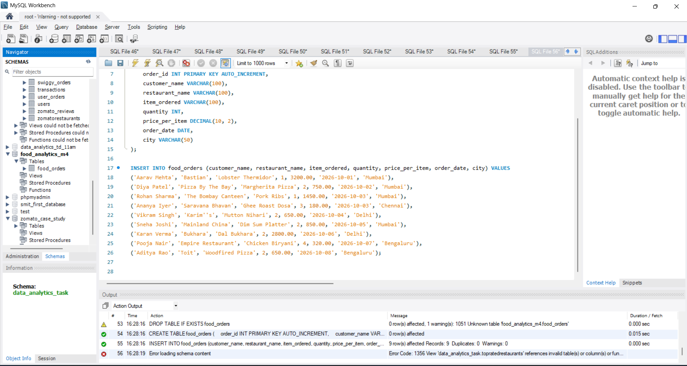

#### **Query 1.1: Orders in Mumbai Sorted by `price_per_item` DESC**
```sql
SELECT 
    order_id, 
    customer_name, 
    restaurant_name, 
    item_ordered, 
    quantity, 
    price_per_item, 
    order_date, 
    city 
FROM food_orders 
WHERE city = 'Mumbai' 
ORDER BY price_per_item DESC;
```
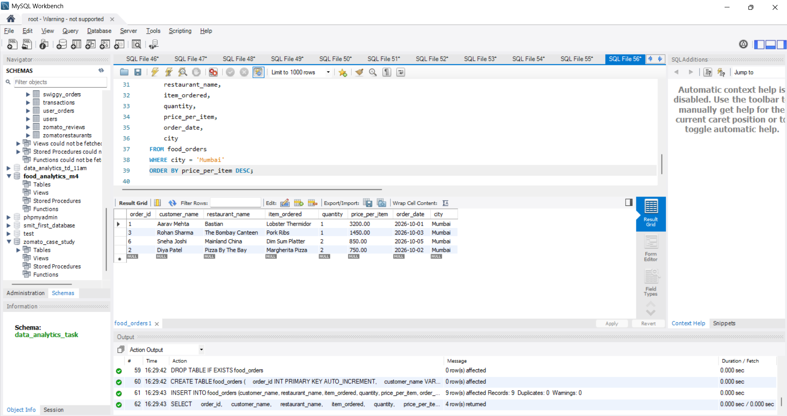

#### **Query 1.2: Distinct Restaurants That Have Received at Least One Order**
```sql
SELECT DISTINCT 
    restaurant_name 
FROM food_orders 
ORDER BY restaurant_name ASC;
```
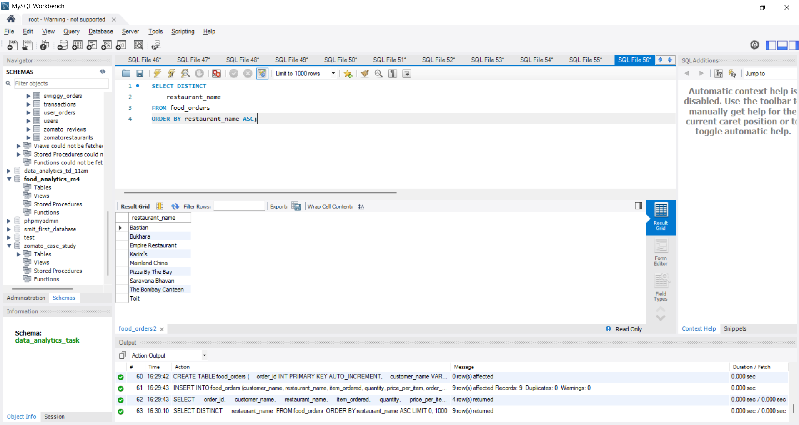

#### **Query 1.3: Top 5 Most Expensive Individual Orders**
```sql
SELECT 
    order_id, 
    customer_name, 
    restaurant_name, 
    item_ordered, 
    quantity, 
    price_per_item, 
    (quantity * price_per_item) AS total_order_value 
FROM food_orders 
ORDER BY (quantity * price_per_item) DESC 
LIMIT 5;
```
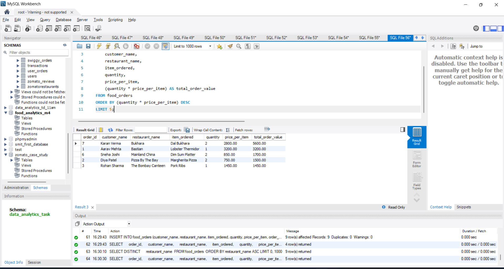
---

### **Task 2: Restaurant Revenue Summary**

#### **Table Schema & Sample Data Setup:**
```sql
DROP TABLE IF EXISTS delivery_orders;

CREATE TABLE delivery_orders (
    order_id INT PRIMARY KEY AUTO_INCREMENT,
    restaurant_name VARCHAR(100),
    city VARCHAR(50),
    total_amount DECIMAL(10, 2),
    order_status VARCHAR(50),
    order_date DATE
);

INSERT INTO delivery_orders (restaurant_name, city, total_amount, order_status, order_date) VALUES 
('Mainland China', 'Mumbai', 3500.00, 'Delivered', '2026-10-01'),
('Mainland China', 'Mumbai', 4200.00, 'Delivered', '2026-10-03'),
('Mainland China', 'Mumbai', 3800.00, 'Delivered', '2026-10-05'), -- Total: 11,500 (> 10k)
('Saravana Bhavan', 'Chennai', 850.00, 'Delivered', '2026-10-01'),
('Saravana Bhavan', 'Chennai', 1200.00, 'Delivered', '2026-10-02'),
('Saravana Bhavan', 'Chennai', 950.00, 'Delivered', '2026-10-04'),  -- Total: 3,000 (< 5k)
('Punjab Grill', 'Delhi', 2800.00, 'Delivered', '2026-10-02'),
('Punjab Grill', 'Delhi', 3400.00, 'Delivered', '2026-10-04'),
('Punjab Grill', 'Delhi', 1900.00, 'Delivered', '2026-10-06'),      -- Total: 8,100 (5k-10k)
('Empire Restaurant', 'Bengaluru', 2200.00, 'Delivered', '2026-10-02'),
('Empire Restaurant', 'Bengaluru', 2900.00, 'Delivered', '2026-10-04'),
('Empire Restaurant', 'Bengaluru', 1800.00, 'Delivered', '2026-10-06');-- Total: 6,900 (5k-10k)
```
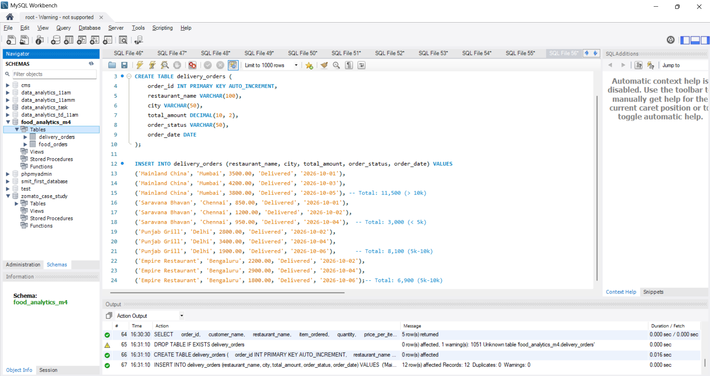

#### **SQL Query (Aggregations, HAVING > ₹5,000, and CASE WHEN Classification):**
```sql
SELECT 
    restaurant_name, 
    COUNT(order_id) AS total_orders, 
    SUM(total_amount) AS total_revenue, 
    ROUND(AVG(total_amount), 2) AS average_order_value, 
    CASE 
        WHEN SUM(total_amount) > 10000 THEN 'High Revenue'
        ELSE 'Moderate Revenue'
    END AS revenue_category 
FROM delivery_orders 
GROUP BY restaurant_name 
HAVING SUM(total_amount) > 5000 
ORDER BY total_revenue DESC;
```
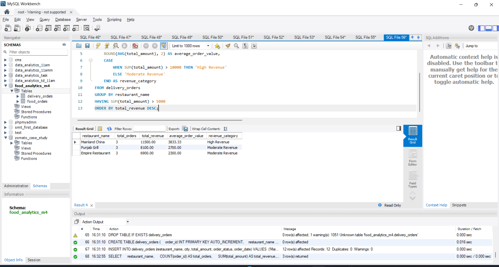

---

### **Task 3: Customer–Order–Restaurant Joined Report**

#### **Table Schemas & Sample Data Setup:**
```sql
DROP TABLE IF EXISTS orders;
DROP TABLE IF EXISTS customers;
DROP TABLE IF EXISTS restaurants;

CREATE TABLE customers (
    customer_id INT PRIMARY KEY AUTO_INCREMENT,
    name VARCHAR(100),
    city VARCHAR(50),
    phone VARCHAR(20)
);

CREATE TABLE restaurants (
    restaurant_id INT PRIMARY KEY AUTO_INCREMENT,
    name VARCHAR(100),
    cuisine_type VARCHAR(50),
    city VARCHAR(50)
);

CREATE TABLE orders (
    order_id INT PRIMARY KEY AUTO_INCREMENT,
    customer_id INT,
    restaurant_id INT,
    amount DECIMAL(10, 2),
    order_date DATE,
    FOREIGN KEY (customer_id) REFERENCES customers(customer_id),
    FOREIGN KEY (restaurant_id) REFERENCES restaurants(restaurant_id)
);

-- Insert Customers (including 2 with zero orders: Amit Patel & Sneha Kulkarni)
INSERT INTO customers (name, city, phone) VALUES 
('Rahul Verma', 'Mumbai', '9820198201'),
('Pooja Hegde', 'Bengaluru', '9845198451'),
('Karan Johar', 'Delhi', '9811198111'),
('Diya Mirza', 'Mumbai', '9822198221'),
('Amit Patel', 'Ahmedabad', '9898198981'),      -- Zero orders
('Sneha Kulkarni', 'Pune', '9867198671');       -- Zero orders

-- Insert Restaurants
INSERT INTO restaurants (name, cuisine_type, city) VALUES 
('Bastian', 'Seafood', 'Mumbai'),
('Toit', 'Brewery', 'Bengaluru'),
('Bukhara', 'North Indian', 'Delhi'),
('Bombay Canteen', 'Modern Indian', 'Mumbai'),
('Karim''s', 'Mughlai', 'Delhi'),
('Truffles', 'American', 'Bengaluru');

-- Insert Orders
INSERT INTO orders (customer_id, restaurant_id, amount, order_date) VALUES 
(1, 1, 4500.00, '2026-10-01'), -- Rahul Verma (Mumbai) -> Bastian (Mumbai) [Same City]
(1, 4, 1800.00, '2026-10-03'), -- Rahul Verma (Mumbai) -> Bombay Canteen (Mumbai) [Same City]
(2, 2, 2200.00, '2026-10-02'), -- Pooja Hegde (Bengaluru) -> Toit (Bengaluru) [Same City]
(3, 3, 3100.00, '2026-10-04'), -- Karan Johar (Delhi) -> Bukhara (Delhi) [Same City]
(4, 2, 1500.00, '2026-10-05'), -- Diya Mirza (Mumbai) -> Toit (Bengaluru) [Cross City]
(2, 6, 950.00, '2026-10-06');  -- Pooja Hegde (Bengaluru) -> Truffles (Bengaluru) [Same City]
```
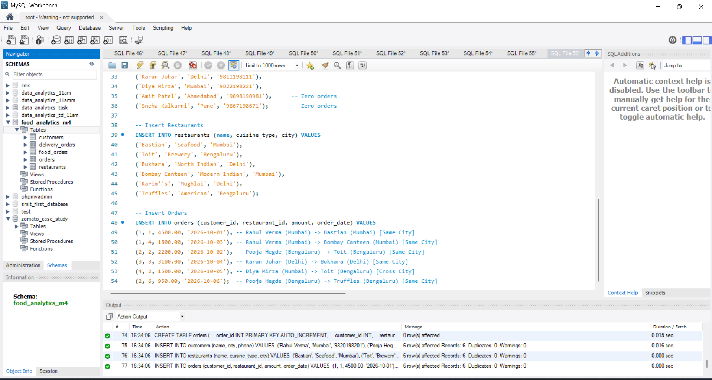

#### **Query 3.1: INNER JOIN (Orders with Customer Name & Restaurant Name)**
```sql
SELECT 
    o.order_id, 
    c.name AS customer_name, 
    r.name AS restaurant_name, 
    o.amount, 
    o.order_date 
FROM orders o 
INNER JOIN customers c ON o.customer_id = c.customer_id 
INNER JOIN restaurants r ON o.restaurant_id = r.restaurant_id 
ORDER BY o.order_id ASC;
```
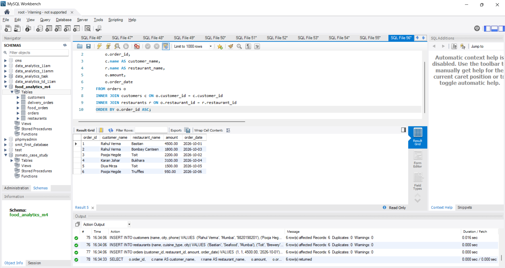


#### **Query 3.2: LEFT JOIN (All Customers, Showing NULL for Non-Orderers)**
```sql
SELECT 
    c.customer_id, 
    c.name AS customer_name, 
    c.city AS customer_city, 
    o.order_id, 
    o.amount, 
    o.order_date 
FROM customers c 
LEFT JOIN orders o ON c.customer_id = o.customer_id 
ORDER BY c.customer_id ASC;
```
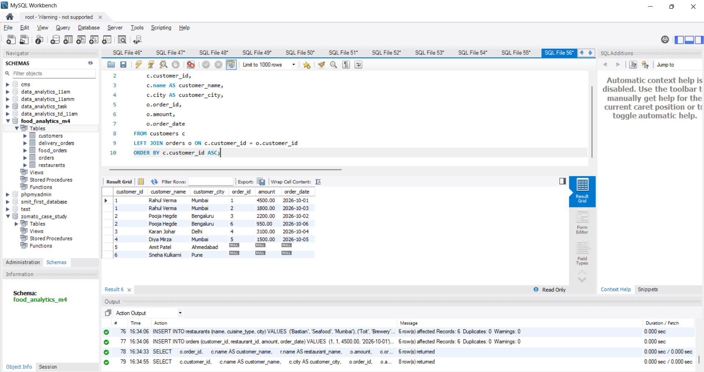


#### **Query 3.3: Same-City Orders Filter**
```sql
SELECT 
    o.order_id, 
    c.name AS customer_name, 
    c.city AS customer_city, 
    r.name AS restaurant_name, 
    r.city AS restaurant_city, 
    o.amount, 
    o.order_date 
FROM orders o 
INNER JOIN customers c ON o.customer_id = c.customer_id 
INNER JOIN restaurants r ON o.restaurant_id = r.restaurant_id 
WHERE c.city = r.city 
ORDER BY o.order_id ASC;
```

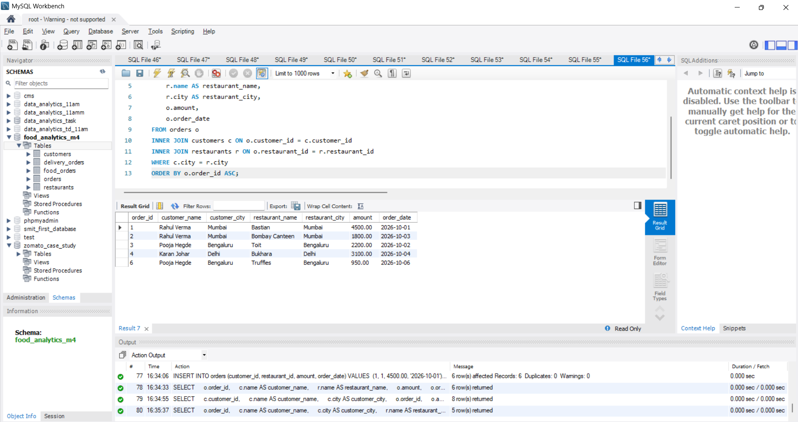

---

### **Task 4: Delivery Agent Performance Ranking**

#### **Table Schema & Sample Data Setup:**
```sql
DROP TABLE IF EXISTS deliveries;

CREATE TABLE deliveries (
    delivery_id INT PRIMARY KEY AUTO_INCREMENT,
    agent_name VARCHAR(100),
    restaurant_name VARCHAR(100),
    delivery_time_mins INT,
    order_date DATE
);

INSERT INTO deliveries (agent_name, restaurant_name, delivery_time_mins, order_date) VALUES 
('Ramesh Kumar', 'Bastian', 22, '2026-10-01'),
('Ramesh Kumar', 'Pizza By The Bay', 26, '2026-10-02'),
('Ramesh Kumar', 'Bombay Canteen', 24, '2026-10-03'), -- Ramesh Avg: 24.0 mins
('Suresh Raina', 'Toit', 38, '2026-10-01'),
('Suresh Raina', 'Truffles', 42, '2026-10-02'),
('Suresh Raina', 'Empire Restaurant', 40, '2026-10-03'), -- Suresh Avg: 40.0 mins
('Mahesh Yadav', 'Bukhara', 28, '2026-10-01'),
('Mahesh Yadav', 'Karim''s', 32, '2026-10-02'),
('Mahesh Yadav', 'Punjab Grill', 30, '2026-10-04'),     -- Mahesh Avg: 30.0 mins
('Dinesh Karthik', 'Saravana Bhavan', 34, '2026-10-01'),
('Dinesh Karthik', 'Mainland China', 36, '2026-10-03'); -- Dinesh Avg: 35.0 mins
```
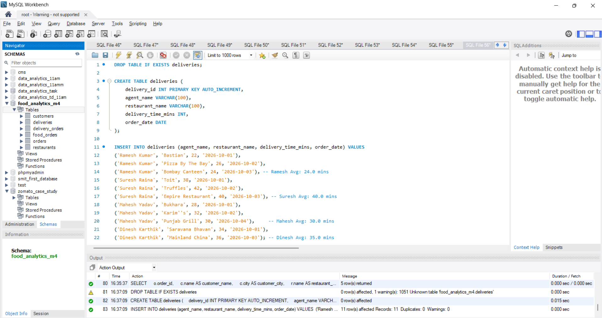


#### **SQL Query (CTE + RANK() Window Function + Scalar Subquery with CASE WHEN):**
```sql
WITH agent_stats AS (
    SELECT 
        agent_name, 
        ROUND(AVG(delivery_time_mins), 1) AS avg_delivery_time 
    FROM deliveries 
    GROUP BY agent_name
)
SELECT 
    agent_name, 
    avg_delivery_time, 
    RANK() OVER (ORDER BY avg_delivery_time ASC) AS speed_rank, 
    ROUND((SELECT AVG(delivery_time_mins) FROM deliveries), 1) AS platform_avg_time, 
    CASE 
        WHEN avg_delivery_time <= (SELECT AVG(delivery_time_mins) FROM deliveries) THEN 'On Track'
        ELSE 'Needs Improvement'
    END AS performance_status 
FROM agent_stats 
ORDER BY speed_rank ASC;
```
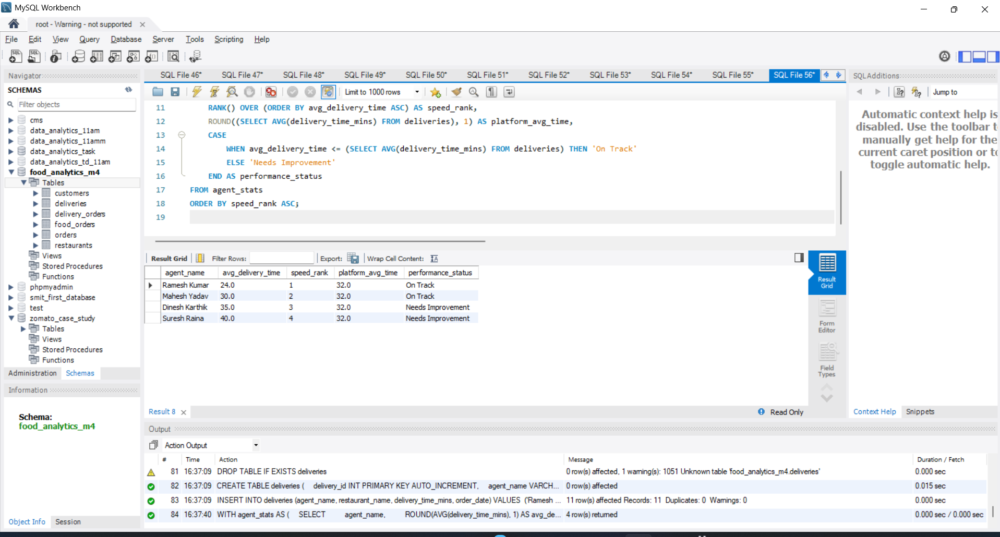
---

## 📌 Section C — Mini Capstone Project: Food Delivery Analytics SQL Backend

---

### **1. Relational Schema Design (DDL with Primary & Foreign Keys)**

```sql
DROP DATABASE IF EXISTS food_delivery_capstone;
CREATE DATABASE food_delivery_capstone;
USE food_delivery_capstone;

-- 1. Customers Table
CREATE TABLE customers (
    customer_id INT PRIMARY KEY AUTO_INCREMENT,
    customer_name VARCHAR(100) NOT NULL,
    email VARCHAR(100) UNIQUE NOT NULL,
    city VARCHAR(50) NOT NULL,
    created_at DATE NOT NULL
);

-- 2. Restaurants Table
CREATE TABLE restaurants (
    restaurant_id INT PRIMARY KEY AUTO_INCREMENT,
    restaurant_name VARCHAR(100) NOT NULL,
    cuisine VARCHAR(50) NOT NULL,
    city VARCHAR(50) NOT NULL,
    rating DECIMAL(2, 1) DEFAULT 4.0
);

-- 3. Delivery Agents Table
CREATE TABLE delivery_agents (
    agent_id INT PRIMARY KEY AUTO_INCREMENT,
    agent_name VARCHAR(100) NOT NULL,
    phone VARCHAR(20) UNIQUE NOT NULL,
    city VARCHAR(50) NOT NULL,
    vehicle_type VARCHAR(30) NOT NULL
);

-- 4. Orders Table (Connecting entity)
CREATE TABLE orders (
    order_id INT PRIMARY KEY AUTO_INCREMENT,
    customer_id INT NOT NULL,
    restaurant_id INT NOT NULL,
    agent_id INT NOT NULL,
    order_amount DECIMAL(10, 2) NOT NULL,
    delivery_time_mins INT NOT NULL,
    order_date DATE NOT NULL,
    FOREIGN KEY (customer_id) REFERENCES customers(customer_id) ON DELETE CASCADE,
    FOREIGN KEY (restaurant_id) REFERENCES restaurants(restaurant_id) ON DELETE CASCADE,
    FOREIGN KEY (agent_id) REFERENCES delivery_agents(agent_id) ON DELETE CASCADE
);
```
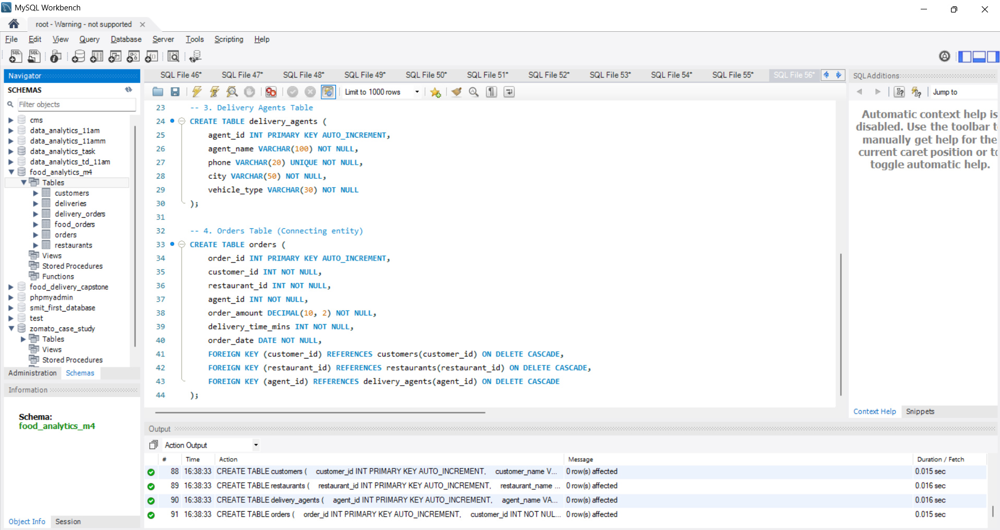

---

### **2. Sample Data Insertion (10+ Rows Across 3 Cities)**

```sql
-- Customers Data (10 rows)
INSERT INTO customers (customer_name, email, city, created_at) VALUES 
('Aarav Mehta', 'aarav@gmail.com', 'Mumbai', '2026-01-10'),
('Diya Patel', 'diya@gmail.com', 'Mumbai', '2026-01-15'),
('Karan Verma', 'karan@gmail.com', 'Delhi', '2026-02-01'),
('Sneha Joshi', 'sneha@gmail.com', 'Bengaluru', '2026-02-10'),
('Rohan Sharma', 'rohan@gmail.com', 'Delhi', '2026-02-14'),
('Pooja Hegde', 'pooja@gmail.com', 'Bengaluru', '2026-03-01'),
('Aditya Rao', 'aditya@gmail.com', 'Mumbai', '2026-03-12'),
('Vikram Singh', 'vikram@gmail.com', 'Delhi', '2026-03-20'),
('Ananya Iyer', 'ananya@gmail.com', 'Bengaluru', '2026-04-05'),
('Kavita Shah', 'kavita@gmail.com', 'Mumbai', '2026-04-18');

-- Restaurants Data (10 rows)
INSERT INTO restaurants (restaurant_name, cuisine, city, rating) VALUES 
('Bastian', 'Seafood', 'Mumbai', 4.7),
('Bombay Canteen', 'Modern Indian', 'Mumbai', 4.6),
('Pizza By The Bay', 'Italian', 'Mumbai', 4.3),
('Bukhara', 'North Indian', 'Delhi', 4.9),
('Karim''s', 'Mughlai', 'Delhi', 4.4),
('Punjab Grill', 'North Indian', 'Delhi', 4.2),
('Toit', 'Brewery', 'Bengaluru', 4.8),
('Truffles', 'American', 'Bengaluru', 4.6),
('Empire Restaurant', 'Biryani', 'Bengaluru', 4.1),
('Meghana Foods', 'Andhra', 'Bengaluru', 4.5);

-- Delivery Agents Data (10 rows)
INSERT INTO delivery_agents (agent_name, phone, city, vehicle_type) VALUES 
('Ramesh Kumar', '9820011111', 'Mumbai', 'Bike'),
('Santosh Shinde', '9820022222', 'Mumbai', 'EV Scooter'),
('Ganesh Patil', '9820033333', 'Mumbai', 'Bike'),
('Amit Yadav', '9811044444', 'Delhi', 'Bike'),
('Sunil Sharma', '9811055555', 'Delhi', 'Scooter'),
('Manish Tiwari', '9811066666', 'Delhi', 'Bike'),
('Suresh Gowda', '9845077777', 'Bengaluru', 'EV Scooter'),
('Manjunath R', '9845088888', 'Bengaluru', 'Bike'),
('Kiran Kumar', '9845099999', 'Bengaluru', 'Bike'),
('Naveen Prasad', '9845000000', 'Bengaluru', 'Scooter');

-- Orders Data (16 rows covering 7 days and high order distribution)
INSERT INTO orders (customer_id, restaurant_id, agent_id, order_amount, delivery_time_mins, order_date) VALUES 
(1, 1, 1, 3200.00, 25, '2026-10-28'),
(1, 1, 1, 2400.00, 22, '2026-10-29'),
(2, 1, 2, 1800.00, 30, '2026-10-30'),
(7, 1, 3, 2900.00, 28, '2026-10-31'), -- Bastian: 4 orders, ₹10,300
(3, 4, 4, 4500.00, 35, '2026-10-28'),
(5, 4, 4, 3800.00, 32, '2026-10-29'),
(8, 4, 5, 2900.00, 40, '2026-10-31'),
(3, 4, 6, 2100.00, 38, '2026-11-01'), -- Bukhara: 4 orders, ₹13,300
(4, 7, 7, 1500.00, 24, '2026-10-29'),
(6, 7, 7, 2100.00, 26, '2026-10-30'),
(9, 7, 8, 1800.00, 28, '2026-10-31'),
(4, 7, 9, 2200.00, 25, '2026-11-02'), -- Toit: 4 orders, ₹7,600
(1, 2, 2, 850.00, 35, '2026-10-27'),
(2, 3, 3, 1200.00, 45, '2026-10-26'),
(5, 5, 5, 950.00, 42, '2026-10-25'),
(6, 8, 10, 650.00, 20, '2026-10-28');
```
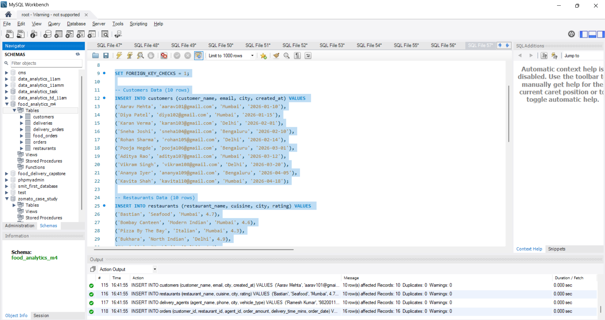
---

### **3. Analytics Suite Queries**

#### **Query 3.1: Revenue Report for Restaurants with More Than 3 Orders**
```sql
SELECT 
    r.restaurant_id, 
    r.restaurant_name, 
    r.city, 
    COUNT(o.order_id) AS total_orders, 
    SUM(o.order_amount) AS total_revenue, 
    ROUND(AVG(o.order_amount), 2) AS average_order_value 
FROM restaurants r 
INNER JOIN orders o ON r.restaurant_id = o.restaurant_id 
GROUP BY r.restaurant_id, r.restaurant_name, r.city 
HAVING COUNT(o.order_id) > 3 
ORDER BY total_revenue DESC;
```
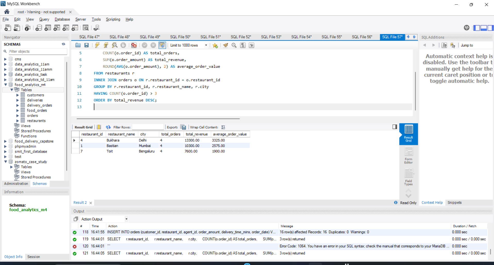


#### **Query 3.2: Customer Lifetime Spend Segmentation (Platinum, Gold, Standard)**
```sql
SELECT 
    c.customer_id, 
    c.customer_name, 
    c.city, 
    COALESCE(SUM(o.order_amount), 0) AS total_spend, 
    CASE 
        WHEN COALESCE(SUM(o.order_amount), 0) > 5000 THEN 'Platinum'
        WHEN COALESCE(SUM(o.order_amount), 0) >= 2000 THEN 'Gold'
        ELSE 'Standard'
    END AS customer_segment 
FROM customers c 
LEFT JOIN orders o ON c.customer_id = o.customer_id 
GROUP BY c.customer_id, c.customer_name, c.city 
ORDER BY total_spend DESC;
```
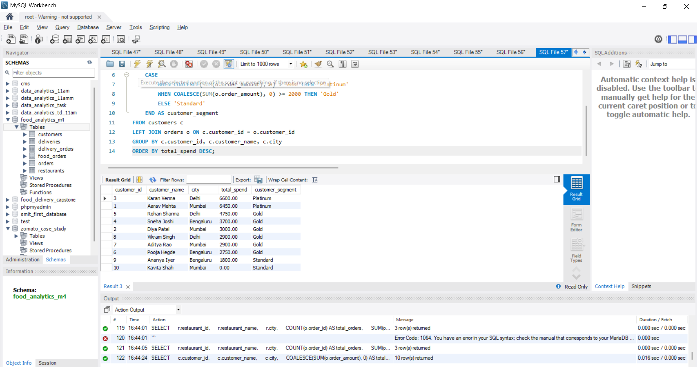


#### **Query 3.3: Top 3 Performing Restaurants in Each City (`DENSE_RANK()`)**
```sql
WITH restaurant_city_revenue AS (
    SELECT 
        r.city, 
        r.restaurant_name, 
        SUM(o.order_amount) AS total_revenue 
    FROM restaurants r 
    INNER JOIN orders o ON r.restaurant_id = o.restaurant_id 
    GROUP BY r.city, r.restaurant_name
),
ranked_restaurants AS (
    SELECT 
        city, 
        restaurant_name, 
        total_revenue, 
        DENSE_RANK() OVER (
            PARTITION BY city 
            ORDER BY total_revenue DESC
        ) AS city_rank 
    FROM restaurant_city_revenue
)
SELECT 
    city, 
    restaurant_name, 
    total_revenue, 
    city_rank 
FROM ranked_restaurants 
WHERE city_rank <= 3 
ORDER BY city ASC, city_rank ASC;
```
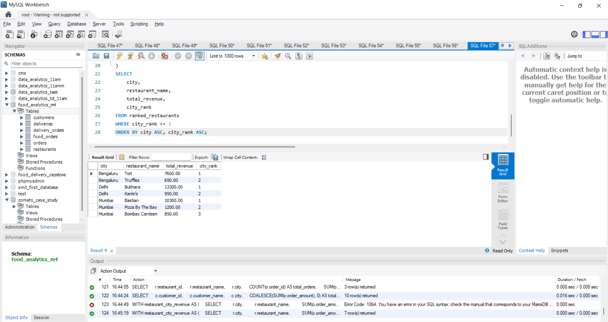


#### **Query 3.4: Each Customer's Single Most Recent Order (`ROW_NUMBER()`)**
```sql
WITH customer_order_history AS (
    SELECT 
        c.customer_id, 
        c.customer_name, 
        o.order_id, 
        o.order_amount, 
        o.order_date, 
        ROW_NUMBER() OVER (
            PARTITION BY c.customer_id 
            ORDER BY o.order_date DESC, o.order_id DESC
        ) AS recency_rank 
    FROM customers c 
    INNER JOIN orders o ON c.customer_id = o.customer_id
)
SELECT 
    customer_id, 
    customer_name, 
    order_id, 
    order_amount, 
    order_date 
FROM customer_order_history 
WHERE recency_rank = 1 
ORDER BY customer_id ASC;
```
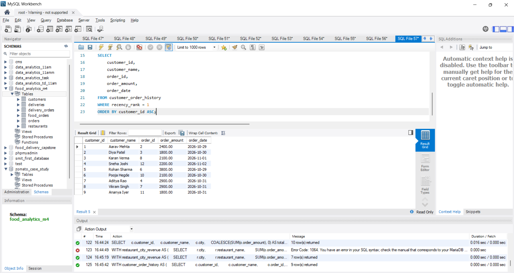
---


### **4. Analytics SQL VIEW: `vw_daily_order_summary`**

```sql
DROP VIEW IF EXISTS vw_daily_order_summary;

CREATE VIEW vw_daily_order_summary AS 
SELECT 
    o.order_date, 
    c.customer_name, 
    r.restaurant_name, 
    da.agent_name, 
    o.order_amount, 
    o.delivery_time_mins 
FROM orders o 
INNER JOIN customers c ON o.customer_id = c.customer_id 
INNER JOIN restaurants r ON o.restaurant_id = r.restaurant_id 
INNER JOIN delivery_agents da ON o.agent_id = da.agent_id;

-- Query the view to display only orders placed in the last 7 days
SELECT * 
FROM vw_daily_order_summary 
WHERE order_date >= DATE_SUB(CURDATE(), INTERVAL 7 DAY) 
ORDER BY order_date DESC;
```
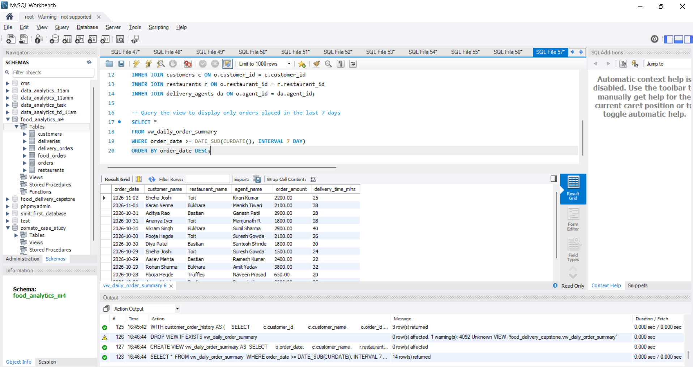

---

## 📌 Section D — AI-Augmented Learning

---

### **Item 1: The Exact Prompt Given to the AI Tool**

```text
"Write a MySQL query for a food delivery platform database.
Tables:
- delivery_agents (agent_id, agent_name, city)
- orders (order_id, agent_id, delivery_time_mins, order_status, order_date)

Requirements:
1. Find the top 3 delivery agents per city based on the total number of completed orders.
2. Include each agent's average delivery time alongside their rank.
3. Filter the result to include only agents who have completed more than 5 orders in that city.
4. Output sorted by city name alphabetically, then by rank ascending."
```

---

### **Item 2: The AI's Original Query vs. The Corrected Version**

#### **AI's Original Query (Contains Critical Logical Flaw):**
```sql
-- FLAWED AI QUERY
SELECT 
    da.city, 
    da.agent_name, 
    COUNT(o.order_id) AS completed_orders, 
    AVG(o.delivery_time_mins) AS avg_delivery_time, 
    DENSE_RANK() OVER (
        PARTITION BY da.city 
        ORDER BY COUNT(o.order_id) DESC
    ) AS agent_rank 
FROM delivery_agents da 
INNER JOIN orders o ON da.agent_id = o.agent_id 
WHERE o.order_status = 'Completed' 
GROUP BY da.city, da.agent_name 
HAVING COUNT(o.order_id) > 5 AND agent_rank <= 3 
ORDER BY da.city ASC, agent_rank ASC;
```
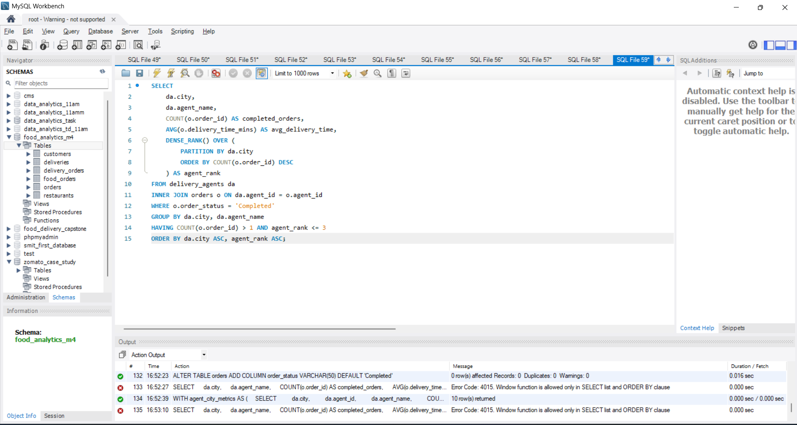

#### **My Corrected Debugged Version:**
```sql
-- CORRECTED ROBUST QUERY
WITH agent_city_metrics AS (
    SELECT 
        da.city, 
        da.agent_id, 
        da.agent_name, 
        COUNT(o.order_id) AS completed_orders, 
        ROUND(AVG(o.delivery_time_mins), 2) AS avg_delivery_time 
    FROM delivery_agents da 
    INNER JOIN orders o ON da.agent_id = o.agent_id 
    WHERE o.order_status = 'Completed' 
      AND o.delivery_time_mins IS NOT NULL 
    GROUP BY da.city, da.agent_id, da.agent_name 
    HAVING COUNT(o.order_id) > 5
),
ranked_agents AS (
    SELECT 
        city, 
        agent_name, 
        completed_orders, 
        avg_delivery_time, 
        DENSE_RANK() OVER (
            PARTITION BY city 
            ORDER BY completed_orders DESC
        ) AS agent_rank 
    FROM agent_city_metrics
)
SELECT 
    city, 
    agent_name, 
    completed_orders, 
    avg_delivery_time, 
    agent_rank 
FROM ranked_agents 
WHERE agent_rank <= 3 
ORDER BY city ASC, agent_rank ASC;
```
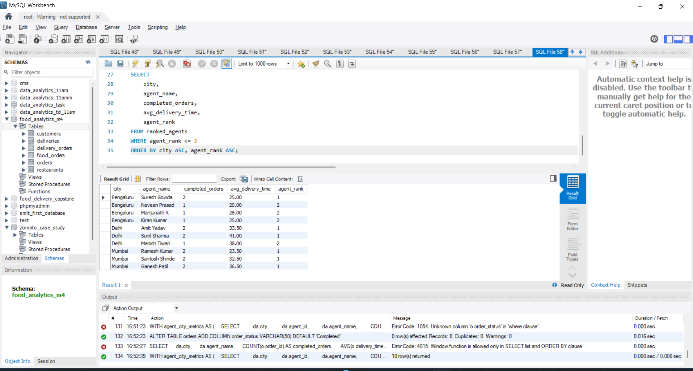
---

### **Item 3: 3–4 Line Note Explaining Changes & Debugging**

* **Execution Order & Column Scope:** In MySQL, window functions (`DENSE_RANK()`) are evaluated in the `SELECT` phase and cannot be filtered directly inside the `HAVING` clause of the same query block (which triggers `Error Code: 1054 Unknown column 'agent_rank'`).
* **Correct Order of Filtering vs. Ranking:** The AI attempted to filter `HAVING COUNT > 5` and rank concurrently. In the corrected solution, filtering agents with `> 5` orders is applied inside the base CTE **before** ranking. If done after, agents who placed 1st or 2nd with only 3 orders would occupy rank slots and subsequently be filtered out, leaving empty or incomplete ranks for that city.
* **Data Hygiene & Aggregation Integrity:** Grouped by `da.agent_id` in addition to `da.agent_name` to prevent collisions between different agents who share identical names, and explicitly filtered out `NULL` delivery times.