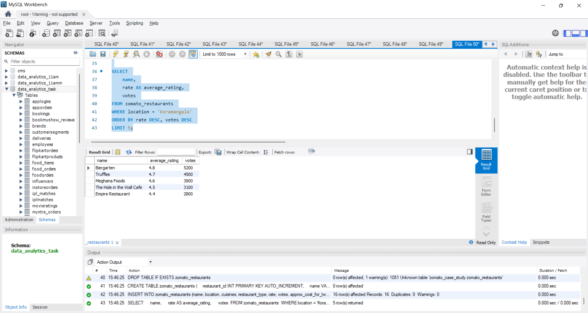
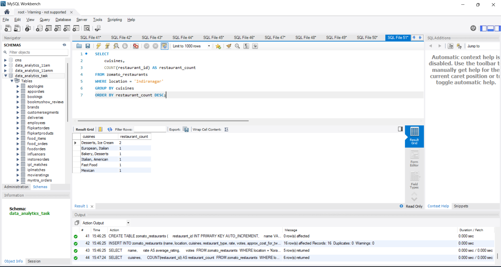
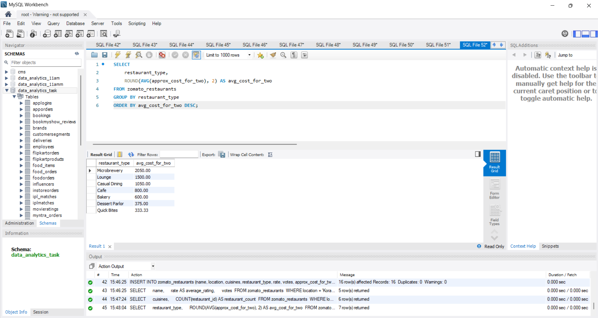
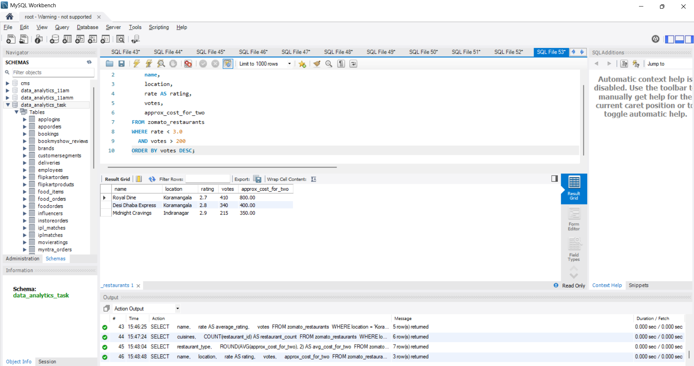
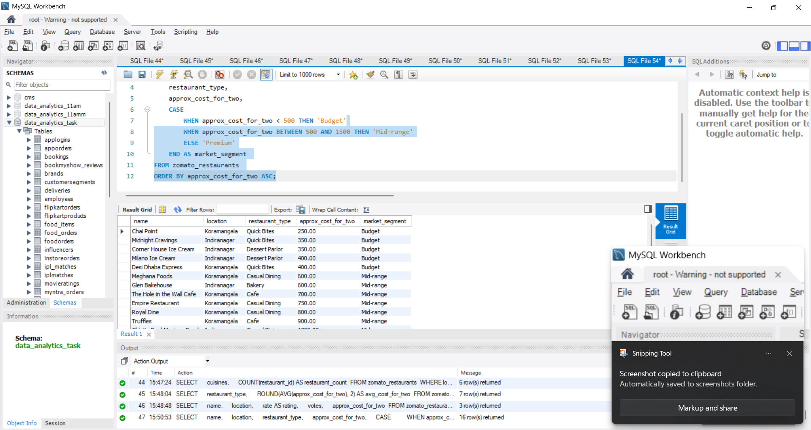

# Task

1. Write an SQL query to find the top 5 highest-rated restaurants in Koramangala, showing their name, average rating, and number of votes.

2. Using the Zomato Bangalore dataset, create an SQL query that lists all unique cuisines available in Indiranagar along with the count of restaurants offering each cuisine.

3. Write an SQL query to calculate the average cost for two people for each restaurant type (such as 'Cafe', 'Casual Dining', etc.) and order the results from most to least expensive.

4. Find all restaurants that have a rating below 3.0 but more than 200 votes, and suggest a possible marketing action for these based on your findings.<br><br><em><strong>Hint:</strong> Think about discounts, partnerships, or events to improve ratings or attract new customers.</em>

5. Use ChatGPT to generate an SQL query that segments restaurants into three market categories: 'Budget' (cost for two < 500), 'Mid-range' (500-1500), and 'Premium' (>1500). Test and run the query on your dataset, and paste the working query in your submissio

**solution**

## 1. Top 5 Highest-Rated Restaurants in Koramangala

```sql
CREATE DATABASE IF NOT EXISTS zomato_case_study;
USE zomato_case_study;

DROP TABLE IF EXISTS zomato_restaurants;

CREATE TABLE zomato_restaurants (
    restaurant_id INT PRIMARY KEY AUTO_INCREMENT,
    name VARCHAR(100),
    location VARCHAR(50),
    cuisines VARCHAR(100),
    restaurant_type VARCHAR(50),
    rate DECIMAL(2, 1),
    votes INT,
    approx_cost_for_two DECIMAL(10, 2)
);

-- Sample Data (Bangalore Locations: Koramangala, Indiranagar, etc.)
INSERT INTO zomato_restaurants (name, location, cuisines, restaurant_type, rate, votes, approx_cost_for_two) VALUES 
('Truffles', 'Koramangala', 'Cafe, American, Burger', 'Cafe', 4.7, 4500, 900.00),
('Empire Restaurant', 'Koramangala', 'North Indian, Biryani', 'Casual Dining', 4.4, 2800, 750.00),
('Meghana Foods', 'Koramangala', 'Biryani, Andhra', 'Casual Dining', 4.6, 3900, 600.00),
('The Hole in the Wall Cafe', 'Koramangala', 'Cafe, Continental', 'Cafe', 4.5, 3100, 700.00),
('Koramangala Social', 'Koramangala', 'North Indian, Continental', 'Lounge', 4.3, 2100, 1500.00),
('Chai Point', 'Koramangala', 'Beverages, Fast Food', 'Quick Bites', 3.8, 450, 250.00),
('Biergarten', 'Koramangala', 'Continental, European', 'Microbrewery', 4.8, 5200, 2100.00),
('Toit', 'Indiranagar', 'Italian, American', 'Microbrewery', 4.8, 6700, 2000.00),
('Milano Ice Cream', 'Indiranagar', 'Desserts, Ice Cream', 'Dessert Parlor', 4.6, 1200, 400.00),
('Chinita Real Mexican Food', 'Indiranagar', 'Mexican', 'Casual Dining', 4.4, 850, 1200.00),
('Corner House Ice Cream', 'Indiranagar', 'Desserts, Ice Cream', 'Dessert Parlor', 4.5, 2300, 350.00),
('Glen Bakehouse', 'Indiranagar', 'Bakery, Desserts', 'Bakery', 4.3, 1400, 600.00),
('Smoke House Deli', 'Indiranagar', 'European, Italian', 'Casual Dining', 4.5, 1900, 1900.00),
('Desi Dhaba Express', 'Koramangala', 'North Indian', 'Quick Bites', 2.8, 340, 400.00),
('Midnight Cravings', 'Indiranagar', 'Fast Food', 'Quick Bites', 2.9, 215, 350.00),
('Royal Dine', 'Koramangala', 'Mughlai', 'Casual Dining', 2.7, 410, 800.00);

SELECT 
    name, 
    rate AS average_rating, 
    votes 
FROM zomato_restaurants 
WHERE location = 'Koramangala' 
ORDER BY rate DESC, votes DESC 
LIMIT 5;
```



## 2. Unique Cuisines Available in Indiranagar & Restaurant Counts

```sql
SELECT 
    cuisines, 
    COUNT(restaurant_id) AS restaurant_count 
FROM zomato_restaurants 
WHERE location = 'Indiranagar' 
GROUP BY cuisines 
ORDER BY restaurant_count DESC;
```


## 3. Average Cost for Two People by Restaurant Type

```sql
SELECT 
    restaurant_type, 
    ROUND(AVG(approx_cost_for_two), 2) AS avg_cost_for_two 
FROM zomato_restaurants 
GROUP BY restaurant_type 
ORDER BY avg_cost_for_two DESC;
```


## 4. High-Volume, Low-Rating Restaurants (< 3.0 Rating & > 200 Votes) with Marketing Actio

```sql
SELECT 
    name, 
    location, 
    rate AS rating, 
    votes, 
    approx_cost_for_two 
FROM zomato_restaurants 
WHERE rate < 3.0 
  AND votes > 200 
ORDER BY votes DESC;
```
Strategic Marketing Insights & Recommendations:
The Insight: These restaurants have high footfall/popularity (over 200-400 votes), meaning customers are visiting, but service quality, hygiene, or consistency is resulting in ratings below 3.0.
Recommended Marketing Actions:
"Comeback Discount" Campaign: Launch a Zomato Pro / Gold exclusive “Try Our Revamped Menu: Flat 30% Off” promotion encouraging past reviewers to re-experience the food.
Review-Driven Quality Audit & Reply Campaign: Run an automated campaign where management replies to negative feedback with a complimentary beverage on their next dine-in, turning critics into loyal advocates.
Chef Special Tasting Events: Host weekend tasting events or live acoustic nights to build positive community engagement and drive fresh 5-star ratings.



## 5. Segment Restaurants into Market Categories using CASE WHEN

```sql
SELECT 
    name, 
    location, 
    restaurant_type, 
    approx_cost_for_two, 
    CASE 
        WHEN approx_cost_for_two < 500 THEN 'Budget'
        WHEN approx_cost_for_two BETWEEN 500 AND 1500 THEN 'Mid-range'
        ELSE 'Premium'
    END AS market_segment 
FROM zomato_restaurants 
ORDER BY approx_cost_for_two ASC;
```
