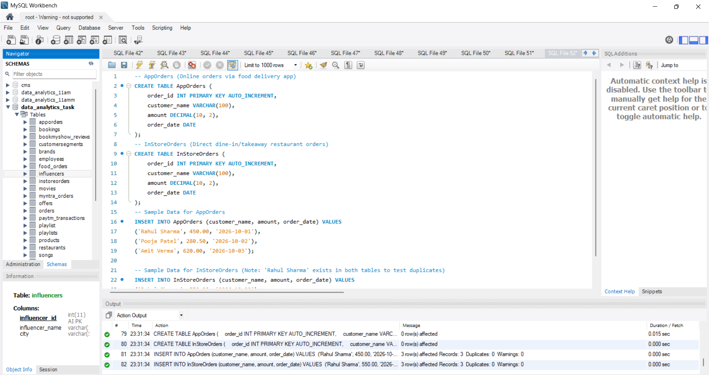
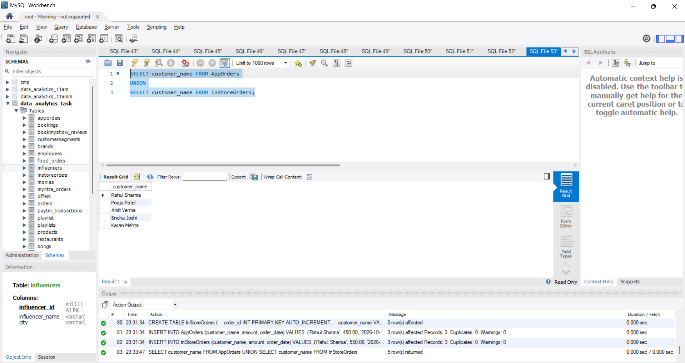
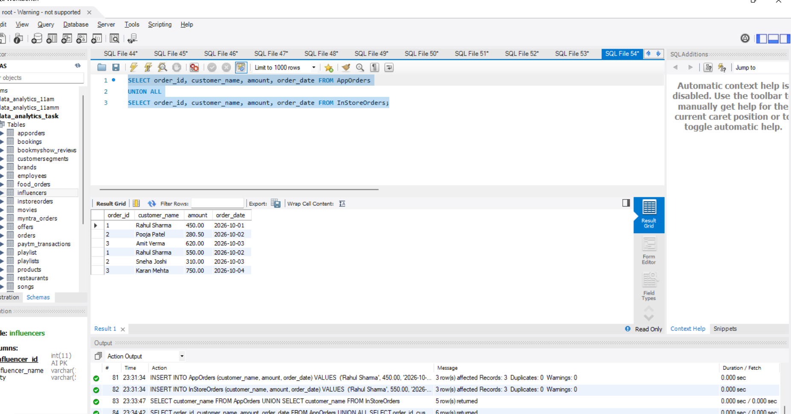
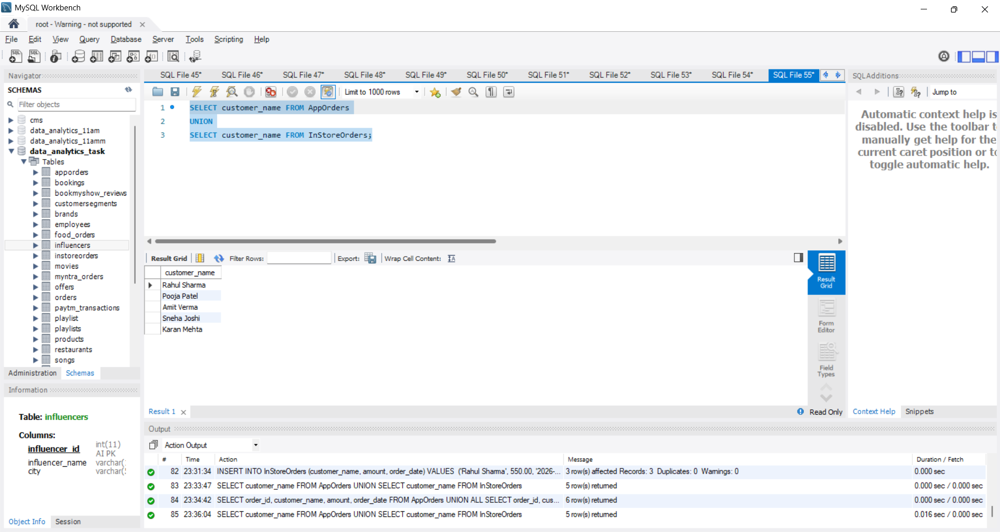
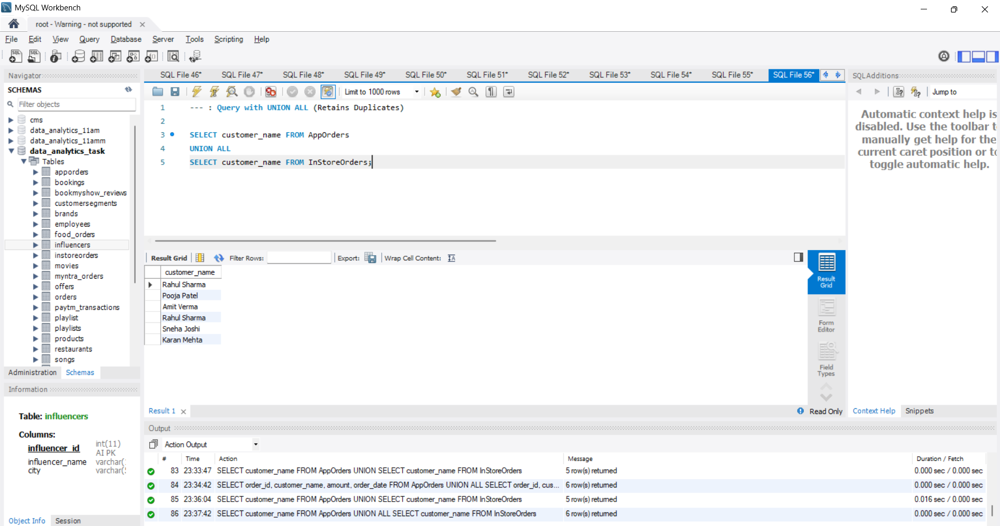

# Task

1. Create two tables: AppOrders (for orders placed via a food delivery app like Zomato) and InStoreOrders (for direct restaurant orders), each with columns: order_id, customer_name, amount, and order_date. Insert at least 3 sample records into each table.

2. Write a SQL query using UNION to combine all unique customer names from both AppOrders and InStoreOrders tables into a single list.

3. Write a SQL query using UNION ALL to display every order (including duplicates if any) from both AppOrders and InStoreOrders, showing order_id, customer_name, amount, and order_date.

4. Demonstrate the difference between UNION and UNION ALL by adding a duplicate customer_name in both tables, then running both queries and noting the difference in the result count.<br><br><em><strong>Hint:</strong> UNION removes duplicates, UNION ALL does not.</em>

**solution**

## 1. Create Tables `AppOrders` and `InStoreOrders` with Sample Records

```sql
-- AppOrders (Online orders via food delivery app)
CREATE TABLE AppOrders (
    order_id INT PRIMARY KEY AUTO_INCREMENT,
    customer_name VARCHAR(100),
    amount DECIMAL(10, 2),
    order_date DATE
);

-- InStoreOrders (Direct dine-in/takeaway restaurant orders)
CREATE TABLE InStoreOrders (
    order_id INT PRIMARY KEY AUTO_INCREMENT,
    customer_name VARCHAR(100),
    amount DECIMAL(10, 2),
    order_date DATE
);

-- Sample Data for AppOrders
INSERT INTO AppOrders (customer_name, amount, order_date) VALUES 
('Rahul Sharma', 450.00, '2026-10-01'),
('Pooja Patel', 280.50, '2026-10-02'),
('Amit Verma', 620.00, '2026-10-03');

-- Sample Data for InStoreOrders (Note: 'Rahul Sharma' exists in both tables to test duplicates)
INSERT INTO InStoreOrders (customer_name, amount, order_date) VALUES 
('Rahul Sharma', 550.00, '2026-10-02'),
('Sneha Joshi', 310.00, '2026-10-03'),
('Karan Mehta', 750.00, '2026-10-04');
```



---

## 2. Combine Unique Customer Names using UNION

```sql
SELECT customer_name FROM AppOrders
UNION
SELECT customer_name FROM InStoreOrders;
```


----

## 3. Display All Orders (Including Duplicates) using UNION ALL

```sql
SELECT order_id, customer_name, amount, order_date FROM AppOrders
UNION ALL
SELECT order_id, customer_name, amount, order_date FROM InStoreOrders;
```


----

## 4. Demonstrating the Difference Between UNION and UNION ALL

```sql
SELECT customer_name FROM AppOrders
UNION
SELECT customer_name FROM InStoreOrders;

--- : Query with UNION ALL (Retains Duplicates)

SELECT customer_name FROM AppOrders
UNION ALL
SELECT customer_name FROM InStoreOrders;
```





------