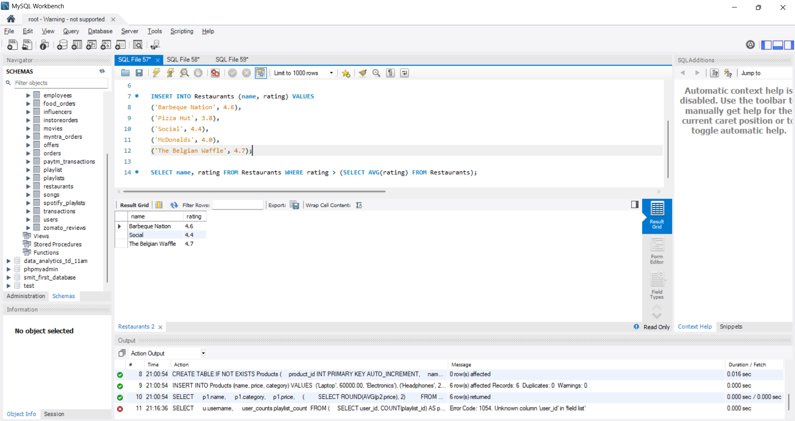
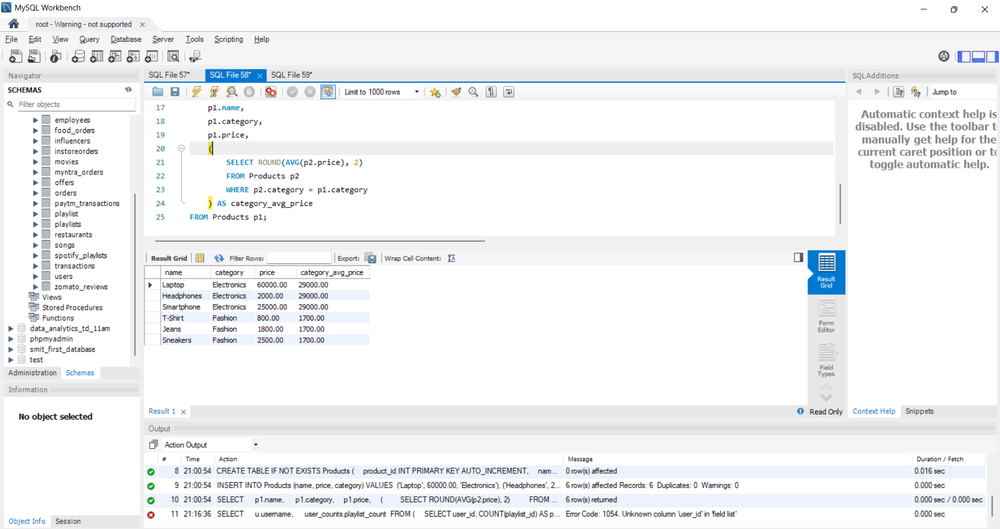
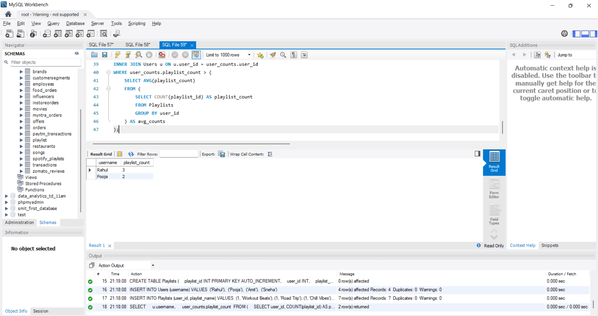
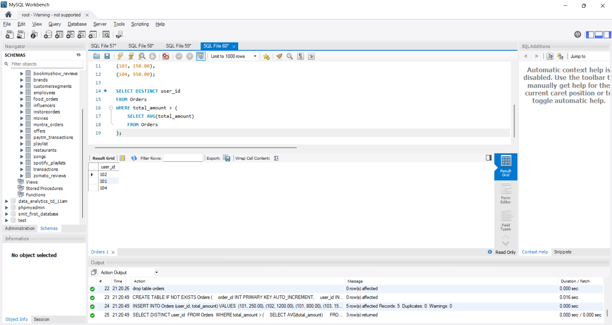

# Task 

1. Write a SQL query to display the names and ratings of restaurants (from a table named Restaurants) where the rating is higher than the average rating of all restaurants in the table.<br><br><em><strong>Hint:</strong> Use a subquery in the WHERE clause to calculate the average rating.</em>

2. In a Flipkart-style Products table (columns: product_id, name, price, category), write a SQL query to list each product name along with the average price of its category as an additional column using a scalar subquery in the SELECT statement.

3. Given a Playlists table (playlist_id, user_id, playlist_name) and a Users table (user_id, username), write a SQL query using a subquery in the FROM clause to show each username and the number of playlists they have created, displaying only users who have created more playlists than the average number of playlists per user.<br><br><em><strong>Hint:</strong> Use a derived table (subquery in FROM) to count playlists per user, then filter with a subquery in WHERE.</em>

4. Suppose you have an Orders table (order_id, user_id, total_amount) for a food delivery app. Write a query to find all user_ids who have placed at least one order with a total_amount greater than the average order amount, using a subquery in the WHERE clause

**solution**

## 1. Restaurants with Rating Higher Than Average Rating (Subquery in WHERE

```sql
SELECT name, rating FROM Restaurants WHERE rating > (SELECT AVG(rating) FROM Restaurants);
```


-----

## 2. Product Name with Category Average Price (Scalar Subquery in SELECT)

```sql
SELECT 
    p1.name, 
    p1.category,
    p1.price,
    (
        SELECT ROUND(AVG(p2.price), 2) 
        FROM Products p2 
        WHERE p2.category = p1.category
    ) AS category_avg_price 
FROM Products p1;
```


-----

## 3. Users with More Playlists Than Average (Derived Table in FROM & Subquery in WHERE)

```sql
SELECT 
    u.username, 
    user_counts.playlist_count 
FROM (
    SELECT user_id, COUNT(playlist_id) AS playlist_count 
    FROM Playlists 
    GROUP BY user_id
) AS user_counts
INNER JOIN Users u ON u.user_id = user_counts.user_id
WHERE user_counts.playlist_count > (
    SELECT AVG(playlist_count) 
    FROM (
        SELECT COUNT(playlist_id) AS playlist_count 
        FROM Playlists 
        GROUP BY user_id
    ) AS avg_counts
);
```


----

## 4. Users with at Least One Order Greater Than Average Order Amount

```sql
SELECT DISTINCT user_id 
FROM Orders 
WHERE total_amount > (
    SELECT AVG(total_amount) 
    FROM Orders
);
```


