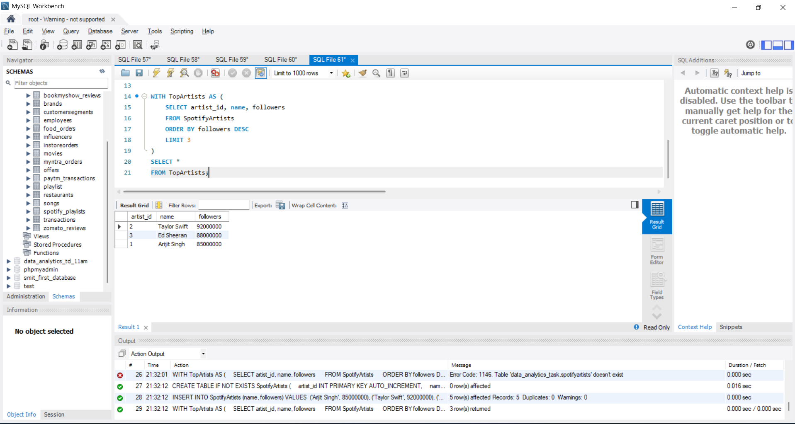
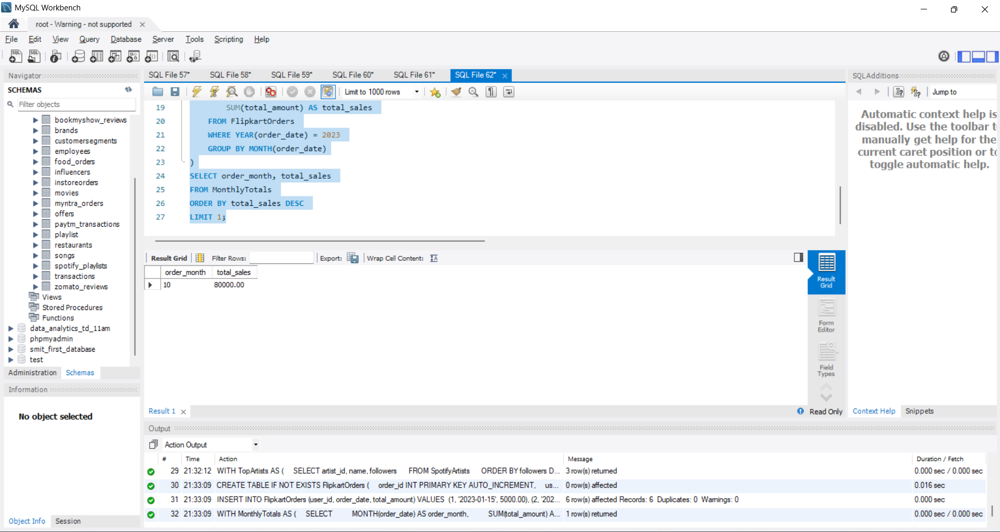
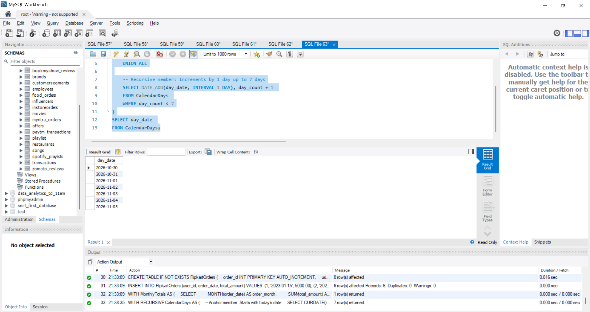
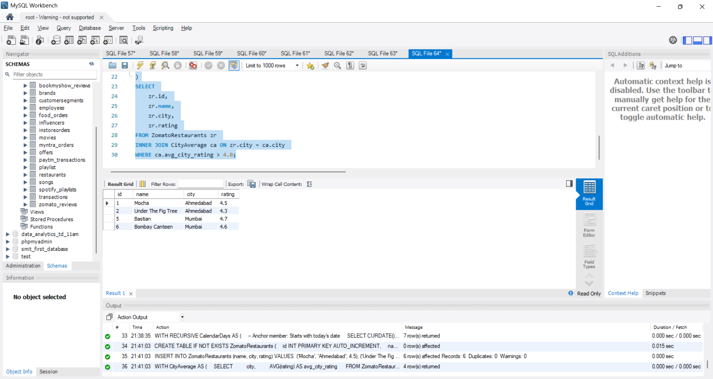
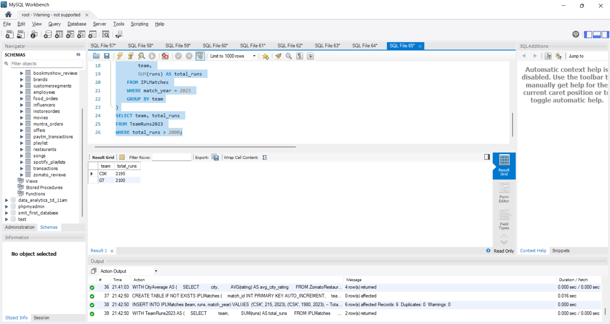

# Task

1. Write an SQL query using the WITH clause to create a temporary result set called TopArtists that selects the top 3 most-followed artists from a table SpotifyArtists (columns: artist_id, name, followers), then select all rows from TopArtists.

2. Using a table named FlipkartOrders (columns: order_id, user_id, order_date, total_amount), write a query with a CTE called MonthlyTotals that calculates the total sales amount for each month in 2023, then select the month with the highest total sales from MonthlyTotals.<br><br><em><strong>Hint:</strong> Use EXTRACT(MONTH FROM order_date) or DATE_FORMAT(order_date, '%m') depending on your SQL dialect.</em>

3. Create a recursive CTE to generate a list of dates for the next 7 days starting from today in a table called CalendarDays (columns: day_date).<br><br><em><strong>Hint:</strong> Use UNION ALL inside your CTE and limit recursion to 7 levels.</em>

4. Given a table called ZomatoRestaurants (columns: id, name, city, rating), use a CTE to find the average rating for each city, then select all restaurants in cities where the average rating is above 4.0.

5. Use ChatGPT or Copilot to help you write an SQL query with a CTE that, given a table IPLMatches (columns: match_id, team, runs, match_year), calculates the total runs scored by each team in 2023 and lists only teams with more than 2000 runs


**solution**

## 1. Top 3 Most-Followed Artists using CTE (WITH Clause)

```sql
CREATE TABLE IF NOT EXISTS SpotifyArtists (
    artist_id INT PRIMARY KEY AUTO_INCREMENT,
    name VARCHAR(100),
    followers INT
);

INSERT INTO SpotifyArtists (name, followers) VALUES 
('Arijit Singh', 85000000),
('Taylor Swift', 92000000),
('Ed Sheeran', 88000000),
('Diljit Dosanjh', 45000000),
('Prateek Kuhad', 12000000);

WITH TopArtists AS (
    SELECT artist_id, name, followers 
    FROM SpotifyArtists 
    ORDER BY followers DESC 
    LIMIT 3
)
SELECT * 
FROM TopArtists;
```


----

## 2. Month with Highest Total Sales in 2023 (MonthlyTotals CTE)

```sql
CREATE TABLE IF NOT EXISTS FlipkartOrders (
    order_id INT PRIMARY KEY AUTO_INCREMENT,
    user_id INT,
    order_date DATE,
    total_amount DECIMAL(10, 2)
);

INSERT INTO FlipkartOrders (user_id, order_date, total_amount) VALUES 
(1, '2023-01-15', 5000.00),
(2, '2023-01-20', 3000.00),
(3, '2023-05-10', 12000.00),
(4, '2023-10-15', 45000.00), -- Big Billion Days
(5, '2023-10-18', 35000.00),
(6, '2023-12-05', 18000.00);

WITH MonthlyTotals AS (
    SELECT 
        MONTH(order_date) AS order_month, 
        SUM(total_amount) AS total_sales 
    FROM FlipkartOrders 
    WHERE YEAR(order_date) = 2023 
    GROUP BY MONTH(order_date)
)
SELECT order_month, total_sales 
FROM MonthlyTotals 
ORDER BY total_sales DESC 
LIMIT 1;
```


----

## 3. Recursive CTE to Generate Next 7 Days Starting Today (CalendarDays)

```sql
WITH RECURSIVE CalendarDays AS (
    -- Anchor member: Starts with today's date
    SELECT CURDATE() AS day_date, 1 AS day_count

    UNION ALL

    -- Recursive member: Increments by 1 day up to 7 days
    SELECT DATE_ADD(day_date, INTERVAL 1 DAY), day_count + 1 
    FROM CalendarDays 
    WHERE day_count < 7
)
SELECT day_date 
FROM CalendarDays;
```



----

## 4. Restaurants in Cities Where City Average Rating > 4.0

```sql
CREATE TABLE IF NOT EXISTS ZomatoRestaurants (
    id INT PRIMARY KEY AUTO_INCREMENT,
    name VARCHAR(100),
    city VARCHAR(50),
    rating DECIMAL(2, 1)
);

INSERT INTO ZomatoRestaurants (name, city, rating) VALUES 
('Mocha', 'Ahmedabad', 4.5),
('Under The Fig Tree', 'Ahmedabad', 4.3),
('The Dhaba', 'Surat', 3.6),
('Taste of Surat', 'Surat', 3.8),
('Bastian', 'Mumbai', 4.7),
('Bombay Canteen', 'Mumbai', 4.6);

WITH CityAverage AS (
    SELECT 
        city, 
        AVG(rating) AS avg_city_rating 
    FROM ZomatoRestaurants 
    GROUP BY city
)
SELECT 
    zr.id, 
    zr.name, 
    zr.city, 
    zr.rating 
FROM ZomatoRestaurants zr 
INNER JOIN CityAverage ca ON zr.city = ca.city 
WHERE ca.avg_city_rating > 4.0;
```



-----

## 5. IPL 2023 Teams with More Than 2000 Runs using CTE

```sql
CREATE TABLE IF NOT EXISTS IPLMatches (
    match_id INT PRIMARY KEY AUTO_INCREMENT,
    team VARCHAR(50),
    runs INT,
    match_year INT
);

INSERT INTO IPLMatches (team, runs, match_year) VALUES 
('CSK', 215, 2023),
('CSK', 1980, 2023), -- Total CSK = 2195 (> 2000)
('GT', 2100, 2023),  -- Total GT = 2100 (> 2000)
('RCB', 1850, 2023), -- Total RCB = 1850 (< 2000)
('MI', 1900, 2023),  -- Total MI = 1900 (< 2000)
('CSK', 1800, 2022); -- Other year (Excluded)

WITH TeamRuns2023 AS (
    SELECT 
        team, 
        SUM(runs) AS total_runs 
    FROM IPLMatches 
    WHERE match_year = 2023 
    GROUP BY team
)
SELECT team, total_runs 
FROM TeamRuns2023 
WHERE total_runs > 2000;
```



------