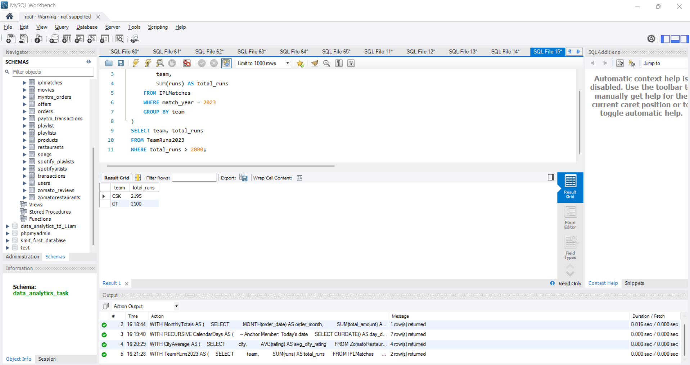

1. Create a table called Orders with columns: order_id, user_id, order_amount, and app_name (e.g., 'Zomato', 'Swiggy', 'Flipkart'). Insert at least 10 sample records with different users and apps. Write an SQL query using the OVER() function to display each order's amount along with the total order amount for all orders.

2. Using the Orders table, write an SQL query to show each user's order_id, order_amount, and the average order_amount for that user using the OVER(PARTITION BY user_id) clause.<br><br><em><strong>Hint:</strong> Use AVG(order_amount) OVER(PARTITION BY user_id) to get the per-user average.</em>

3. Suppose you have a table called Playlist with columns: song_id, user_id, and duration_sec. Write an SQL query to display each song's duration, and the total duration of songs added by each user using SUM(duration_sec) OVER(PARTITION BY user_id).

4. Given a table named MovieRatings with columns: rating_id, user_id, movie_name, and rating (1-5), write an SQL query to show each rating, the average rating per movie, and the difference between the user's rating and the movie's average rating using window functions.<br><br><em><strong>Hint:</strong> Use AVG(rating) OVER(PARTITION BY movie_name) and subtract it from the user's rating.</em>

**solution**

## 1. Create Orders Table and Query Total Amount using OVER()

```sql
DROP TABLE IF EXISTS Orders;

CREATE TABLE Orders (
    order_id INT PRIMARY KEY AUTO_INCREMENT,
    user_id INT,
    order_amount DECIMAL(10, 2),
    app_name VARCHAR(50)
);

INSERT INTO Orders (user_id, order_amount, app_name) VALUES 
(101, 350.00, 'Zomato'),
(102, 550.00, 'Swiggy'),
(101, 1200.00, 'Flipkart'),
(103, 220.00, 'Zomato'),
(104, 890.00, 'Flipkart'),
(102, 310.00, 'Swiggy'),
(105, 1500.00, 'Flipkart'),
(103, 400.00, 'Swiggy'),
(101, 280.00, 'Zomato'),
(104, 650.00, 'Zomato');

SELECT 
    order_id, 
    user_id, 
    app_name, 
    order_amount, 
    SUM(order_amount) OVER() AS total_order_amount_all 
FROM Orders;
```


---

## 2. Average Order Amount per User using OVER(PARTITION BY user_id)

```sql
SELECT 
    user_id, 
    order_id, 
    order_amount, 
    ROUND(AVG(order_amount) OVER(PARTITION BY user_id), 2) AS user_avg_order_amount 
FROM Orders;
```


----

## 3. Total Playlist Duration per User using SUM() OVER(PARTITION BY user_id)

```sql
SELECT 
    song_id, 
    user_id, 
    duration_sec, 
    SUM(duration_sec) OVER(PARTITION BY user_id) AS total_user_duration_sec 
FROM Playlist;
```


----

## 4. Movie Ratings Difference from Average using Window Functions

```sql
DROP TABLE IF EXISTS MovieRatings;

CREATE TABLE MovieRatings (
    rating_id INT PRIMARY KEY AUTO_INCREMENT,
    user_id INT,
    movie_name VARCHAR(100),
    rating DECIMAL(2, 1)
);

INSERT INTO MovieRatings (user_id, movie_name, rating) VALUES 
(1, 'Inception', 5.0),
(2, 'Inception', 4.0),
(3, 'Inception', 4.5),
(1, 'Interstellar', 4.0),
(2, 'Interstellar', 3.0),
(3, 'Interstellar', 5.0),
(4, 'Interstellar', 4.0);

SELECT 
    rating_id, 
    user_id, 
    movie_name, 
    rating AS user_rating, 
    ROUND(AVG(rating) OVER(PARTITION BY movie_name), 2) AS movie_avg_rating, 
    ROUND(rating - AVG(rating) OVER(PARTITION BY movie_name), 2) AS rating_diff_from_avg 
FROM MovieRatings;
```


----