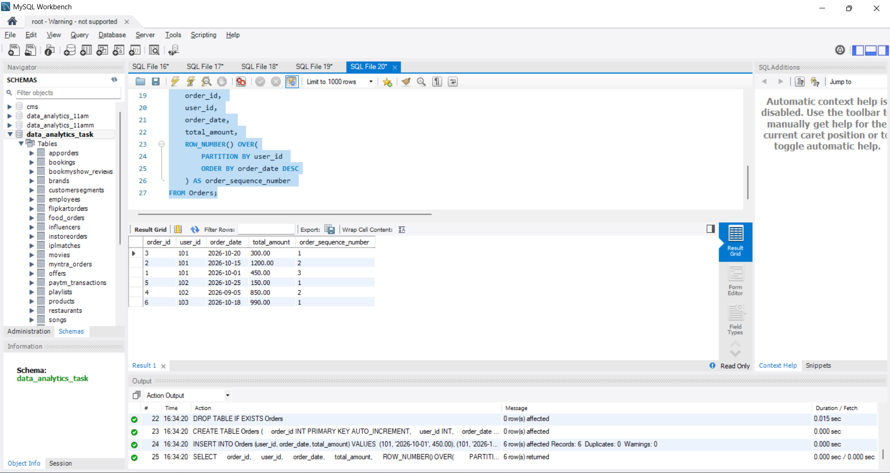
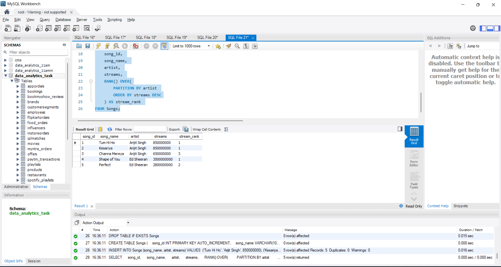
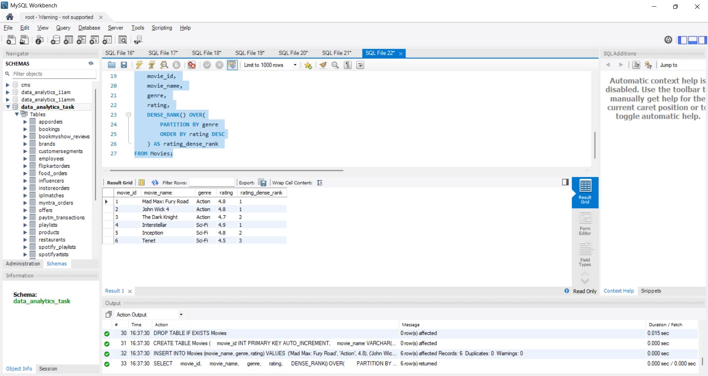
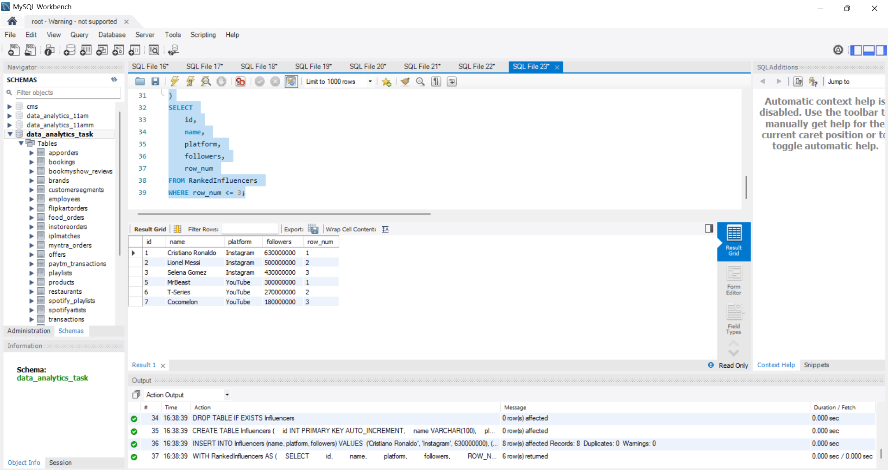

1. Given a table Orders with columns (order_id, user_id, order_date, total_amount), write an SQL query using ROW_NUMBER() to assign a unique sequential number to each order per user, ordered by order_date descending.

2. Suppose you have a table called Songs with columns (song_id, artist, streams). Write an SQL query using RANK() to list each song along with its rank based on streams within each artist.

3. For a table named Movies with columns (movie_id, genre, rating), write an SQL query using DENSE_RANK() to assign a rank to each movie within its genre based on rating, with the highest rating getting rank 1.

4. Imagine a table named Influencers with columns (id, platform, followers). Write an SQL query to display the top 3 influencers per platform using ROW_NUMBER(), showing id, platform, followers, and their row number.<br><br><em><strong>Hint:</strong> Use a subquery or CTE to filter for row numbers less than or equal to 3.</em>

**solution**

## 1. Assign Sequential Order Number per User using ROW_NUMBER()

```sql
DROP TABLE IF EXISTS Orders;

CREATE TABLE Orders (
    order_id INT PRIMARY KEY AUTO_INCREMENT,
    user_id INT,
    order_date DATE,
    total_amount DECIMAL(10, 2)
);

INSERT INTO Orders (user_id, order_date, total_amount) VALUES 
(101, '2026-10-01', 450.00),
(101, '2026-10-15', 1200.00),
(101, '2026-10-20', 300.00),
(102, '2026-09-05', 850.00),
(102, '2026-10-25', 150.00),
(103, '2026-10-18', 990.00);

SELECT 
    order_id, 
    user_id, 
    order_date, 
    total_amount, 
    ROW_NUMBER() OVER(
        PARTITION BY user_id 
        ORDER BY order_date DESC
    ) AS order_sequence_number 
FROM Orders;
```


---

## 2. Rank Songs by Streams within Each Artist using RANK()

```sql
DROP TABLE IF EXISTS Songs;

CREATE TABLE Songs (
    song_id INT PRIMARY KEY AUTO_INCREMENT,
    song_name VARCHAR(100),
    artist VARCHAR(100),
    streams BIGINT
);

INSERT INTO Songs (song_name, artist, streams) VALUES 
('Tum Hi Ho', 'Arijit Singh', 850000000),
('Kesariya', 'Arijit Singh', 850000000),  -- Tie: gets rank 1
('Channa Mereya', 'Arijit Singh', 650000000), -- Skips rank to 3 (RANK behavior)
('Shape of You', 'Ed Sheeran', 3500000000),
('Perfect', 'Ed Sheeran', 2800000000);

SELECT 
    song_id, 
    song_name, 
    artist, 
    streams, 
    RANK() OVER(
        PARTITION BY artist 
        ORDER BY streams DESC
    ) AS stream_rank 
FROM Songs;
```


---

## 3. Dense Rank Movies by Rating within Genre using DENSE_RANK()

```sql
DROP TABLE IF EXISTS Movies;

CREATE TABLE Movies (
    movie_id INT PRIMARY KEY AUTO_INCREMENT,
    movie_name VARCHAR(100),
    genre VARCHAR(50),
    rating DECIMAL(2, 1)
);

INSERT INTO Movies (movie_name, genre, rating) VALUES 
('Mad Max: Fury Road', 'Action', 4.8),
('John Wick 4', 'Action', 4.8),        -- Tie: gets rank 1
('The Dark Knight', 'Action', 4.7),     -- Gets rank 2 without gap (DENSE_RANK behavior)
('Interstellar', 'Sci-Fi', 4.9),
('Inception', 'Sci-Fi', 4.8),
('Tenet', 'Sci-Fi', 4.5);

SELECT 
    movie_id, 
    movie_name, 
    genre, 
    rating, 
    DENSE_RANK() OVER(
        PARTITION BY genre 
        ORDER BY rating DESC
    ) AS rating_dense_rank 
FROM Movies;
```



----

## 4. Top 3 Influencers per Platform using ROW_NUMBER()

```sql
DROP TABLE IF EXISTS Influencers;

CREATE TABLE Influencers (
    id INT PRIMARY KEY AUTO_INCREMENT,
    name VARCHAR(100),
    platform VARCHAR(50),
    followers BIGINT
);

INSERT INTO Influencers (name, platform, followers) VALUES 
('Cristiano Ronaldo', 'Instagram', 630000000),
('Lionel Messi', 'Instagram', 500000000),
('Selena Gomez', 'Instagram', 430000000),
('Kylie Jenner', 'Instagram', 400000000),
('MrBeast', 'YouTube', 300000000),
('T-Series', 'YouTube', 270000000),
('Cocomelon', 'YouTube', 180000000),
('SET India', 'YouTube', 175000000);

WITH RankedInfluencers AS (
    SELECT 
        id, 
        name, 
        platform, 
        followers, 
        ROW_NUMBER() OVER(
            PARTITION BY platform 
            ORDER BY followers DESC
        ) AS row_num 
    FROM Influencers
)
SELECT 
    id, 
    name, 
    platform, 
    followers, 
    row_num 
FROM RankedInfluencers 
WHERE row_num <= 3;
```


----


