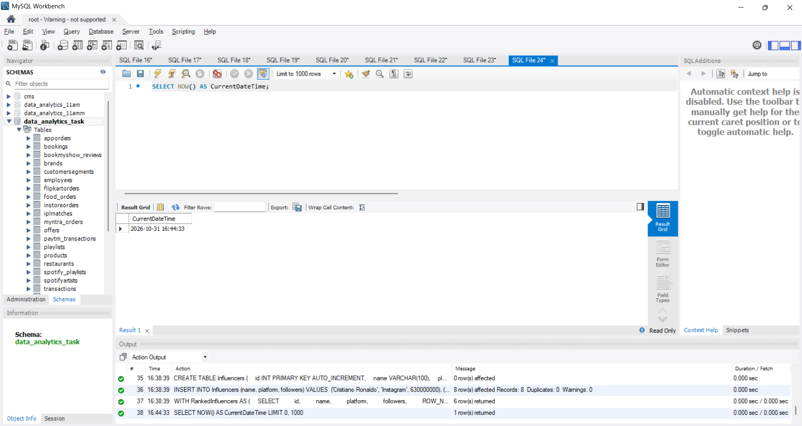
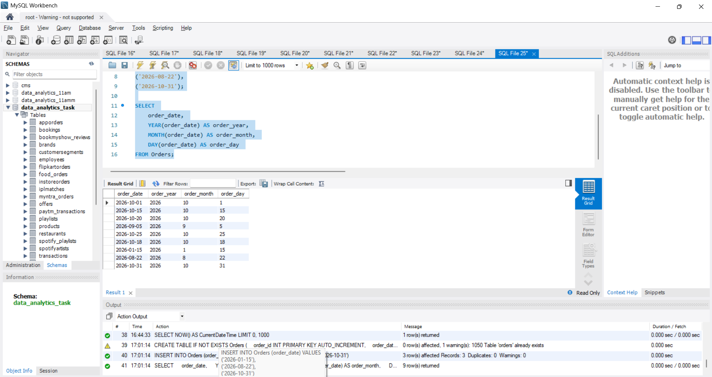
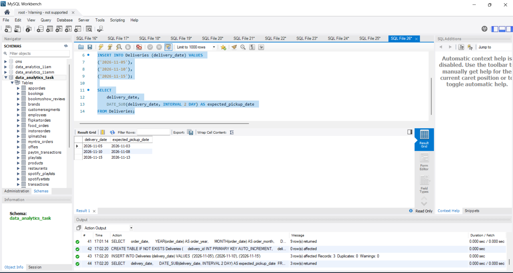
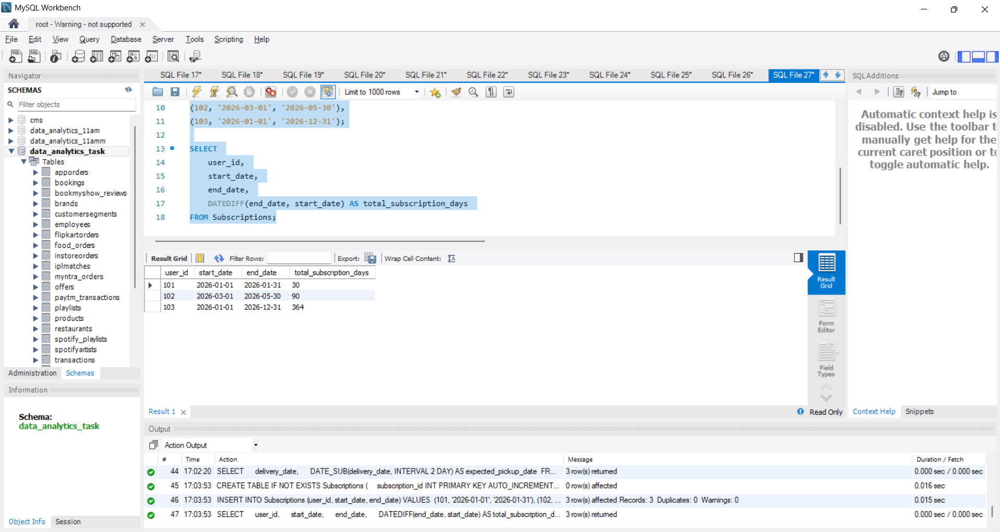
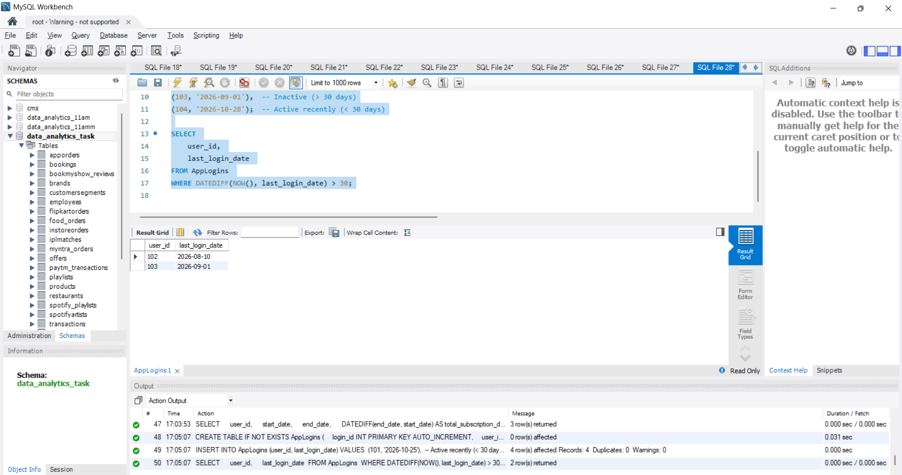

1. Write an SQL query using the NOW() function to display the current date and time as 'CurrentDateTime' in your result set.

2. Suppose you have a table called Orders with a column order_date (DATE type). Write a query to display each order's order_date, the year, month, and day as separate columns using YEAR(), MONTH(), and DAY().

3. Imagine you are building a feature like Zomato's order delivery estimate. Given a table Deliveries with a column delivery_date, write a query to show delivery_date and a new column expected_pickup_date which is 2 days before delivery_date using DATE_SUB().

4. You have a table called Subscriptions with columns user_id, start_date, and end_date. Write a query to display user_id, start_date, end_date, and the total number of days of each subscription using DATEDIFF().<br><br><em><strong>Hint:</strong> Use DATEDIFF(end_date, start_date) to get the duration.</em>

5. Create an SQL query for a table named AppLogins (columns: user_id, last_login_date) to find all users who haven't logged in for more than 30 days from today. Use NOW() and DATEDIFF() in your query.<br><br><em><strong>Constraint:</strong> Only select user_id and last_login_date for users who meet the criteria.</em>

**solution**

## 1. Display Current Date and Time as 'CurrentDateTime' using NOW()

```sql
SELECT NOW() AS CurrentDateTime;
```


----

## 2. Extract Year, Month, and Day as Separate Columns using YEAR(), MONTH(), and DAY()

```sql
CREATE TABLE IF NOT EXISTS Orders (
    order_id INT PRIMARY KEY AUTO_INCREMENT,
    order_date DATE
);

INSERT INTO Orders (order_date) VALUES 
('2026-01-15'),
('2026-08-22'),
('2026-10-31');

SELECT 
    order_date, 
    YEAR(order_date) AS order_year, 
    MONTH(order_date) AS order_month, 
    DAY(order_date) AS order_day 
FROM Orders;
```


----

## 3. Calculate Pickup Date (2 Days Before Delivery) using DATE_SUB()

```sql
SELECT 
    delivery_date, 
    DATE_SUB(delivery_date, INTERVAL 2 DAY) AS expected_pickup_date 
FROM Deliveries;
```


----

## 4. Calculate Total Subscription Days using DATEDIFF()

```sql
CREATE TABLE IF NOT EXISTS Subscriptions (
    subscription_id INT PRIMARY KEY AUTO_INCREMENT,
    user_id INT,
    start_date DATE,
    end_date DATE
);

INSERT INTO Subscriptions (user_id, start_date, end_date) VALUES 
(101, '2026-01-01', '2026-01-31'),
(102, '2026-03-01', '2026-05-30'),
(103, '2026-01-01', '2026-12-31');

SELECT 
    user_id, 
    start_date, 
    end_date, 
    DATEDIFF(end_date, start_date) AS total_subscription_days 
FROM Subscriptions;
```


----

## 5. Users Inactive for More Than 30 Days using NOW() and DATEDIFF()

```sql
CREATE TABLE IF NOT EXISTS AppLogins (
    login_id INT PRIMARY KEY AUTO_INCREMENT,
    user_id INT,
    last_login_date DATE
);

INSERT INTO AppLogins (user_id, last_login_date) VALUES 
(101, '2026-10-25'),  -- Active recently (< 30 days)
(102, '2026-08-10'),  -- Inactive (> 30 days)
(103, '2026-09-01'),  -- Inactive (> 30 days)
(104, '2026-10-28');  -- Active recently (< 30 days)

SELECT 
    user_id, 
    last_login_date 
FROM AppLogins 
WHERE DATEDIFF(NOW(), last_login_date) > 30;
```


----

