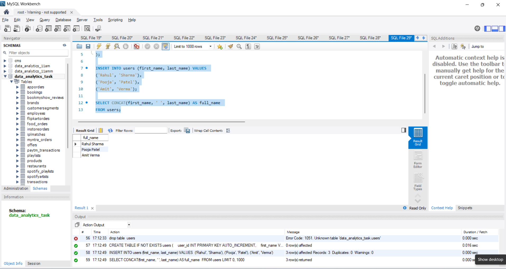
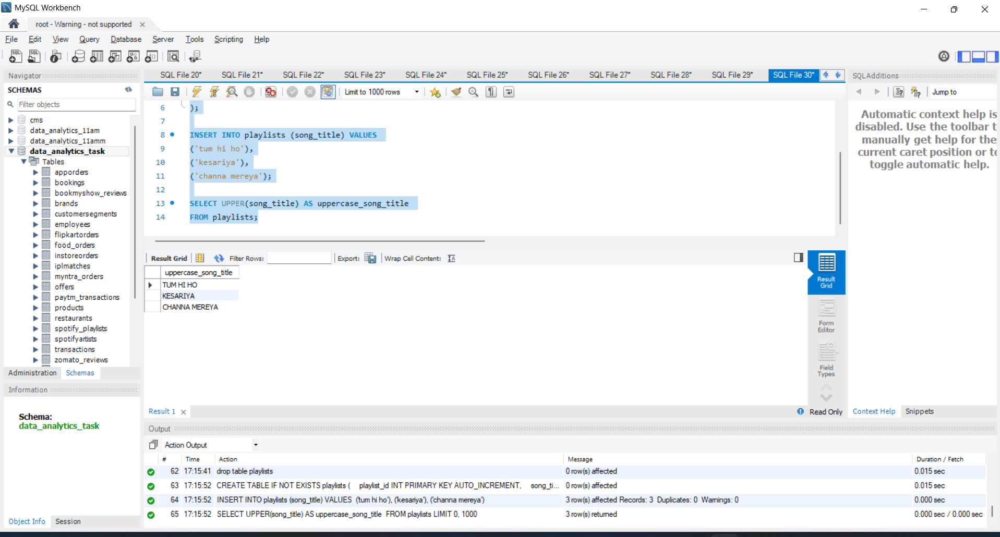
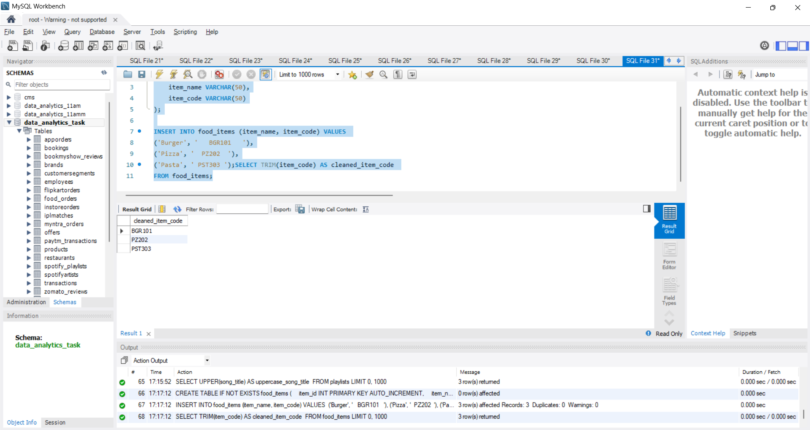
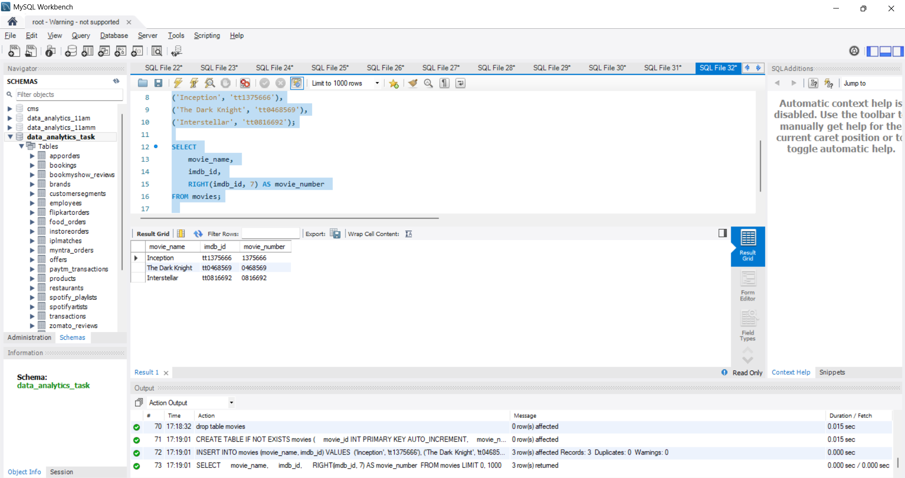
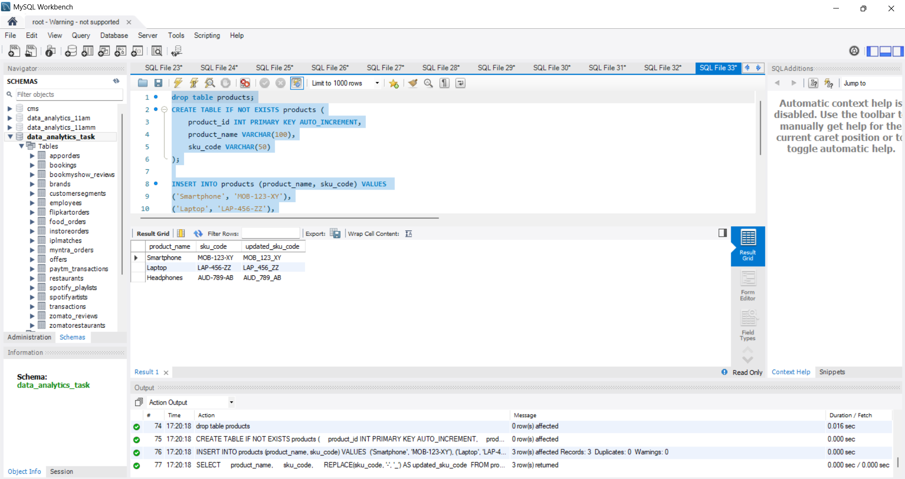

# Task

1. Write an SQL query using CONCAT to combine first_name and last_name columns from a users table into a single full_name column and display the result.

2. Given a table called playlists with a column song_title, write a query to display all song titles in uppercase using the UPPER function.

3. You have a table food_items with a column item_code that sometimes contains extra spaces at the beginning or end. Write an SQL query to select item_code values after removing all leading and trailing spaces using TRIM.

4. In a table called movies, the column imdb_id contains codes like 'tt1234567'. Write a query to extract just the numeric part (the last 7 characters) using RIGHT and display it as movie_number.<br><br><em><strong>Hint:</strong> Use RIGHT(imdb_id, 7) to get the numeric part.</em>

5. A products table has a column sku_code where some entries use dashes (e.g. 'MOB-123-XY'). Write an SQL query to replace all dashes '-' with underscores '_' in sku_code using the REPLACE function and display the updated codes.

**solution**

## 1. Combine first_name and last_name into full_name using CONCAT()

```sql
CREATE TABLE IF NOT EXISTS users (
    user_id INT PRIMARY KEY AUTO_INCREMENT,
    first_name VARCHAR(50),
    last_name VARCHAR(50)
);

INSERT INTO users (first_name, last_name) VALUES 
('Rahul', 'Sharma'),
('Pooja', 'Patel'),
('Amit', 'Verma');

SELECT CONCAT(first_name, ' ', last_name) AS full_name 
FROM users;
```


----

## 2. Display Song Titles in Uppercase using UPPER()

```sql


CREATE TABLE IF NOT EXISTS playlists (
    playlist_id INT PRIMARY KEY AUTO_INCREMENT,
    song_title VARCHAR(100)
);

INSERT INTO playlists (song_title) VALUES 
('tum hi ho'),
('kesariya'),
('channa mereya');

SELECT UPPER(song_title) AS uppercase_song_title 
FROM playlists;
```


---

## 3. Remove Leading and Trailing Spaces from item_code using TRIM()

```sql
CREATE TABLE IF NOT EXISTS food_items (
    item_id INT PRIMARY KEY AUTO_INCREMENT,
    item_name VARCHAR(50),
    item_code VARCHAR(50)
);

INSERT INTO food_items (item_name, item_code) VALUES 
('Burger', '   BGR101   '),
('Pizza', '  PZ202  '),
('Pasta', ' PST303 ');SELECT TRIM(item_code) AS cleaned_item_code 
FROM food_items;
```


----

## 4. Extract Numeric Part from imdb_id using RIGHT()

```sql
CREATE TABLE IF NOT EXISTS movies (
    movie_id INT PRIMARY KEY AUTO_INCREMENT,
    movie_name VARCHAR(100),
    imdb_id VARCHAR(20)
);

INSERT INTO movies (movie_name, imdb_id) VALUES 
('Inception', 'tt1375666'),
('The Dark Knight', 'tt0468569'),
('Interstellar', 'tt0816692');

SELECT 
    movie_name, 
    imdb_id, 
    RIGHT(imdb_id, 7) AS movie_number 
FROM movies;
```


----

## 5. Replace Dashes '-' with Underscores '_' using REPLACE()

```sql
SELECT 
    product_name, 
    sku_code, 
    REPLACE(sku_code, '-', '_') AS updated_sku_code 
FROM products;
```


----


-----