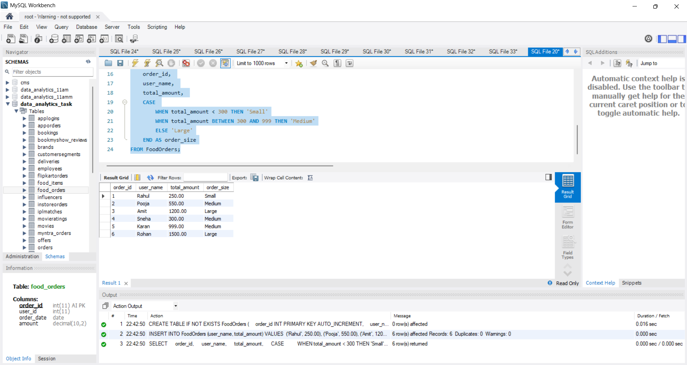
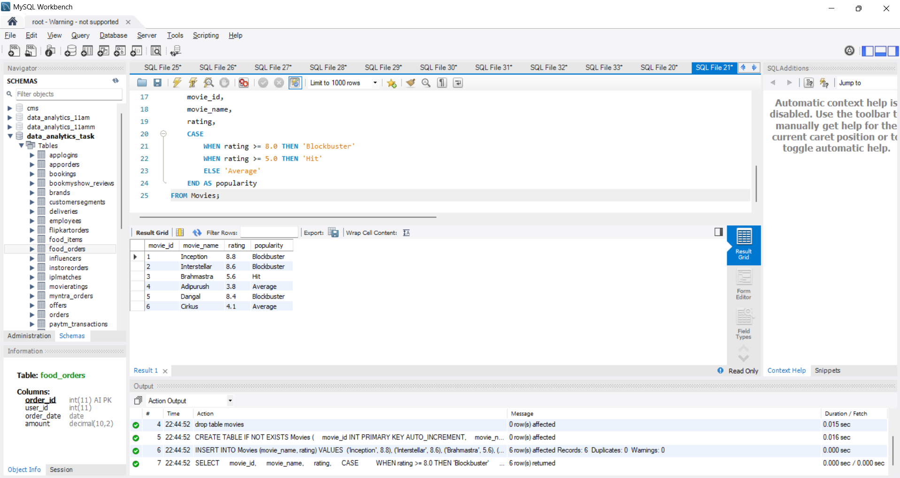
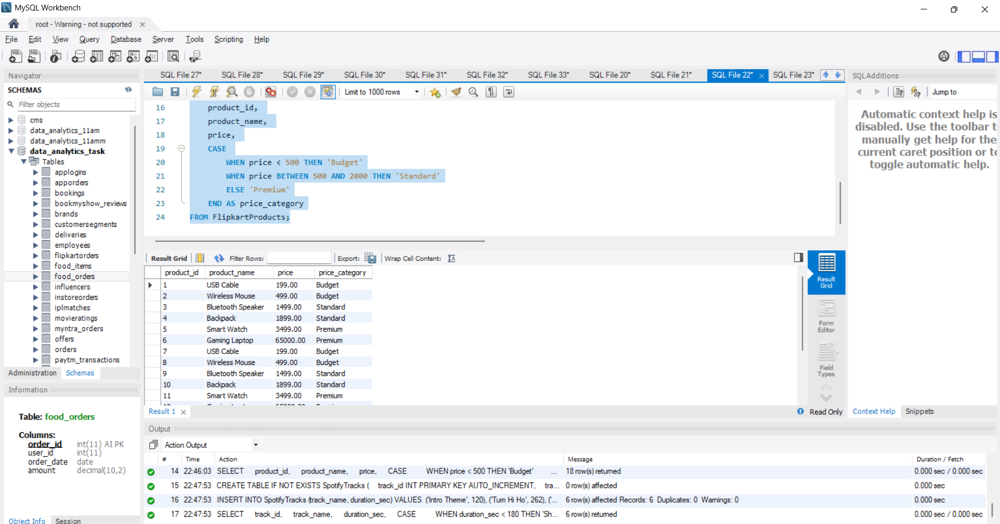

# Task

1. Write an SQL query using CASE WHEN to classify orders in a 'FoodOrders' table as 'Small', 'Medium', or 'Large' based on the total_amount: 'Small' for less than 300, 'Medium' for 300 to 999, and 'Large' for 1000 and above.

2. Given a 'Movies' table with a 'rating' column (out of 10), write an SQL query that adds a new column 'popularity' which shows 'Blockbuster' for ratings 8 and above, 'Hit' for 5 to 7.9, and 'Average' for below 5 using CASE WHEN ELSE END.

3. For a 'FlipkartProducts' table with a 'price' column, write an SQL query to create a 'price_category' column that bins prices as 'Budget' (below 500), 'Standard' (500 to 2000), and 'Premium' (above 2000) using CASE WHEN.

4. Write an SQL query for a 'SpotifyTracks' table that uses CASE WHEN to assign a 'duration_label' column: 'Short' for tracks under 180 seconds, 'Medium' for 180-300 seconds, and 'Long' for over 300 seconds.<br><br><em><strong>Hint:</strong> Use multiple WHEN conditions to cover all possible durations.</em>

**solution**

## 1. Task 1: Classify Orders into 'Small', 'Medium', or 'Large'

```sql
CREATE TABLE IF NOT EXISTS FoodOrders (
    order_id INT PRIMARY KEY AUTO_INCREMENT,
    user_name VARCHAR(50),
    total_amount DECIMAL(10, 2)
);

INSERT INTO FoodOrders (user_name, total_amount) VALUES 
('Rahul', 250.00),
('Pooja', 550.00),
('Amit', 1200.00),
('Sneha', 300.00),
('Karan', 999.00),
('Rohan', 1500.00);

SELECT 
    order_id, 
    user_name, 
    total_amount, 
    CASE 
        WHEN total_amount < 300 THEN 'Small'
        WHEN total_amount BETWEEN 300 AND 999 THEN 'Medium'
        ELSE 'Large'
    END AS order_size
FROM FoodOrders;
```


## 2. Movie Popularity Classification based on Rating

```sql
SELECT 
    movie_id, 
    movie_name, 
    rating, 
    CASE 
        WHEN rating >= 8.0 THEN 'Blockbuster'
        WHEN rating >= 5.0 THEN 'Hit'
        ELSE 'Average'
    END AS popularity
FROM Movies;
```


## 3. Flipkart Products Price Bins ('Budget', 'Standard', 'Premium')

```sql
CREATE TABLE IF NOT EXISTS FlipkartProducts (
    product_id INT PRIMARY KEY AUTO_INCREMENT,
    product_name VARCHAR(100),
    price DECIMAL(10, 2)
);

INSERT INTO FlipkartProducts (product_name, price) VALUES 
('USB Cable', 199.00),
('Wireless Mouse', 499.00),
('Bluetooth Speaker', 1499.00),
('Backpack', 1899.00),
('Smart Watch', 3499.00),
('Gaming Laptop', 65000.00);

SELECT 
    product_id, 
    product_name, 
    price, 
    CASE 
        WHEN price < 500 THEN 'Budget'
        WHEN price BETWEEN 500 AND 2000 THEN 'Standard'
        ELSE 'Premium'
    END AS price_category
FROM FlipkartProducts;
```



## 4. Spotify Tracks Duration Labeling

```sql
CREATE TABLE IF NOT EXISTS SpotifyTracks (
    track_id INT PRIMARY KEY AUTO_INCREMENT,
    track_name VARCHAR(100),
    duration_sec INT
);

INSERT INTO SpotifyTracks (track_name, duration_sec) VALUES 
('Intro Theme', 120),
('Tum Hi Ho', 262),
('Kesariya', 268),
('Bohemian Rhapsody', 354),
('Short Jingle', 95),
('All Too Well (10 min)', 613);

 SELECT 
    track_id, 
    track_name, 
    duration_sec, 
    CASE 
        WHEN duration_sec < 180 THEN 'Short'
        WHEN duration_sec BETWEEN 180 AND 300 THEN 'Medium'
        ELSE 'Long'
    END AS duration_label
FROM SpotifyTracks;
```

