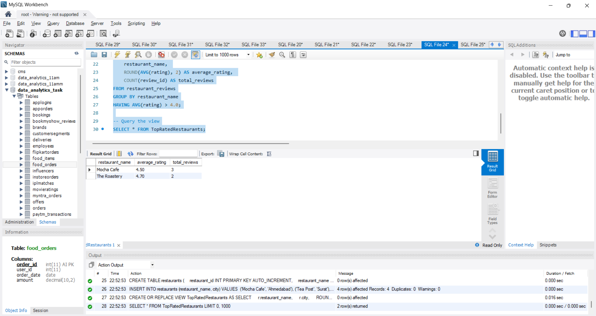
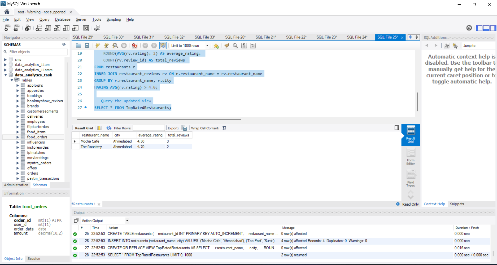
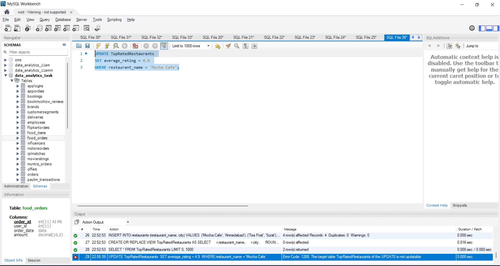
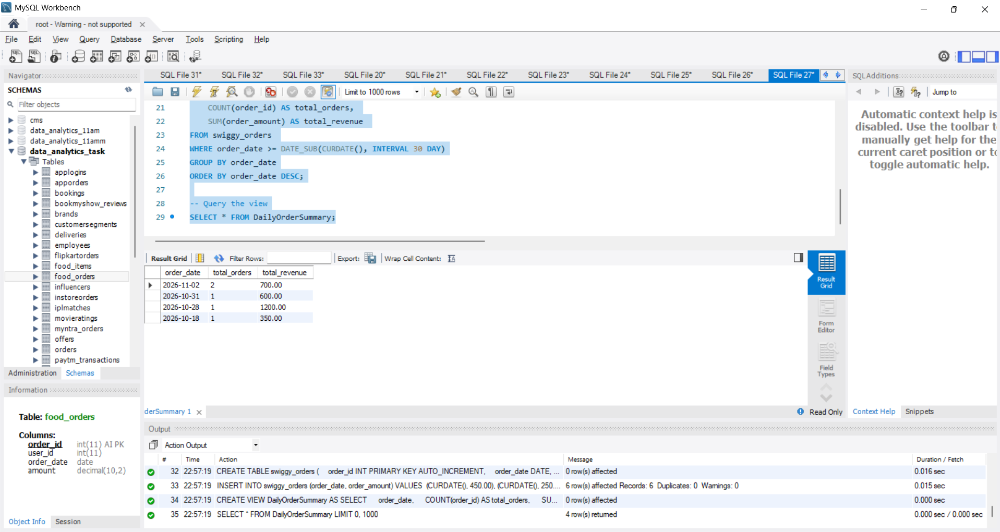

# Task

1. Create a SQL view named TopRatedRestaurants that selects the restaurant name, average rating, and total number of reviews from a table of Zomato-style restaurant reviews, showing only restaurants with an average rating above 4.0.

2. Update the TopRatedRestaurants view to also include the city column from the original restaurants table by joining the relevant tables.<br><br><em><strong>Hint:</strong> Use an INNER JOIN to combine data from both tables 
in your view definition.</em>

3. Try to update the average rating column directly through the TopRatedRestaurants view and observe what error or limitation occurs. Write down the exact error message and explain why this happens based on SQL view limitations.

4. Create a view called DailyOrderSummary that shows, for each date, the total number of food orders and the total revenue from a Swiggy-style orders table. Ensure the view only includes dates from the last 30 days.<br><br><em><strong>Constraint:</strong> Use WHERE and GROUP BY clauses in your view definition.</em>

5. List 3 good practices you should follow when creating SQL views for analytics dashboards, and for each, give a one-line example related to a Flipkart sales reporting scenario.

**solution**

## 1. SQL Assignment: SQL Views and Analytics Best Practices

```sql
DROP VIEW IF EXISTS TopRatedRestaurants;
DROP TABLE IF EXISTS restaurant_reviews;

CREATE TABLE restaurant_reviews (
    review_id INT PRIMARY KEY AUTO_INCREMENT,
    restaurant_name VARCHAR(100),
    rating DECIMAL(2, 1)
);

INSERT INTO restaurant_reviews (restaurant_name, rating) VALUES 
('Mocha Cafe', 4.5),
('Mocha Cafe', 4.7),
('Mocha Cafe', 4.3),
('Tea Post', 3.8),
('Tea Post', 3.9),
('The Roastery', 4.6),
('The Roastery', 4.8),
('Pizza Point', 3.5);

CREATE VIEW TopRatedRestaurants AS
SELECT 
    restaurant_name, 
    ROUND(AVG(rating), 2) AS average_rating, 
    COUNT(review_id) AS total_reviews
FROM restaurant_reviews
GROUP BY restaurant_name
HAVING AVG(rating) > 4.0;

-- Query the view
SELECT * FROM TopRatedRestaurants;
```


## 2. Update View TopRatedRestaurants to Include city using INNER JOIN

```sql
DROP TABLE IF EXISTS restaurants;

CREATE TABLE restaurants (
    restaurant_id INT PRIMARY KEY AUTO_INCREMENT,
    restaurant_name VARCHAR(100),
    city VARCHAR(50)
);

INSERT INTO restaurants (restaurant_name, city) VALUES 
('Mocha Cafe', 'Ahmedabad'),
('Tea Post', 'Surat'),
('The Roastery', 'Ahmedabad'),
('Pizza Point', 'Vadodara');

CREATE OR REPLACE VIEW TopRatedRestaurants AS
SELECT 
    r.restaurant_name, 
    r.city, 
    ROUND(AVG(rv.rating), 2) AS average_rating, 
    COUNT(rv.review_id) AS total_reviews 
FROM restaurants r
INNER JOIN restaurant_reviews rv ON r.restaurant_name = rv.restaurant_name
GROUP BY r.restaurant_name, r.city
HAVING AVG(rv.rating) > 4.0;

-- Query the updated view
SELECT * FROM TopRatedRestaurants;
```


## 3. Attempt Updating View & Observe Error

```sql
UPDATE TopRatedRestaurants 
SET average_rating = 4.9 
WHERE restaurant_name = 'Mocha Cafe';

error is : 0	29	22:55:39	UPDATE TopRatedRestaurants 
 SET average_rating = 4.9 
 WHERE restaurant_name = 'Mocha Cafe'	Error Code: 1288. The target table TopRatedRestaurants of the UPDATE is not updatable	0.000 sec
```


## 4. View DailyOrderSummary for Last 30 Days

```sql
DROP VIEW IF EXISTS DailyOrderSummary;
DROP TABLE IF EXISTS swiggy_orders;

CREATE TABLE swiggy_orders (
    order_id INT PRIMARY KEY AUTO_INCREMENT,
    order_date DATE,
    order_amount DECIMAL(10, 2)
);

INSERT INTO swiggy_orders (order_date, order_amount) VALUES 
(CURDATE(), 450.00),
(CURDATE(), 250.00),
(DATE_SUB(CURDATE(), INTERVAL 2 DAY), 600.00),
(DATE_SUB(CURDATE(), INTERVAL 5 DAY), 1200.00),
(DATE_SUB(CURDATE(), INTERVAL 15 DAY), 350.00),
(DATE_SUB(CURDATE(), INTERVAL 45 DAY), 800.00); -- Outside 30 days

CREATE VIEW DailyOrderSummary AS
SELECT 
    order_date, 
    COUNT(order_id) AS total_orders, 
    SUM(order_amount) AS total_revenue 
FROM swiggy_orders 
WHERE order_date >= DATE_SUB(CURDATE(), INTERVAL 30 DAY)
GROUP BY order_date
ORDER BY order_date DESC;

-- Query the view
SELECT * FROM DailyOrderSummary;
```


## 5. Best Practices for SQL Views in Analytics Dashboards

```sql
1.Avoid SELECT * and Project Only Necessary Columns:
Flipkart Example: In a sales dashboard view, explicitly select only order_id, category, sale_amount, and order_date instead of pulling unneeded raw columns like shipping addresses or internal debug flags.

2. Pre-filter Large Datasets Early (Using Dates/Partitions):
Flipkart Example: Filter historical transactions using WHERE order_date >= DATE_SUB(CURDATE(), INTERVAL 90 DAY) inside the view so Big Billion Day analytics queries don't scan years of archival data.

3. Use Meaningful, Business-Friendly Aliases for Aggregated Columns:
Flipkart Example: Rename complex calculations like ROUND(SUM(sale_price - discount_amount), 2) to intuitive column headers like net_revenue so dashboard tools (e.g., PowerBI/Tableau) can map metrics directly.
```
