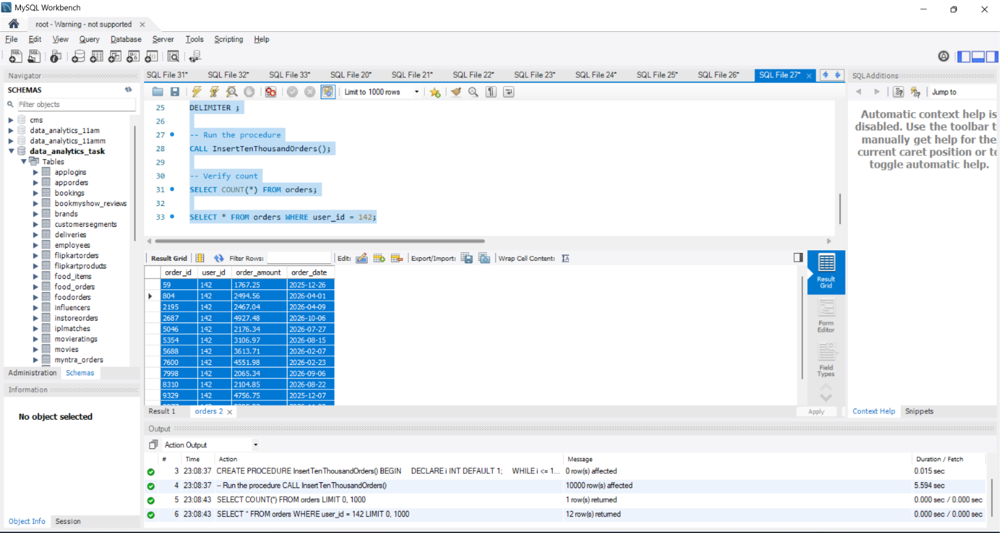
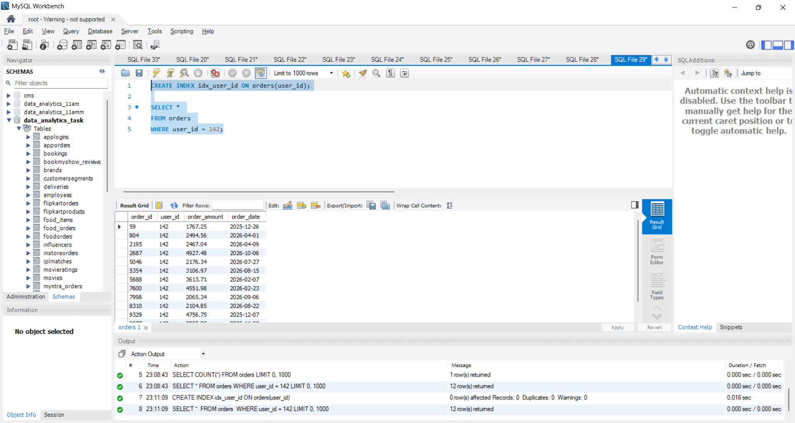
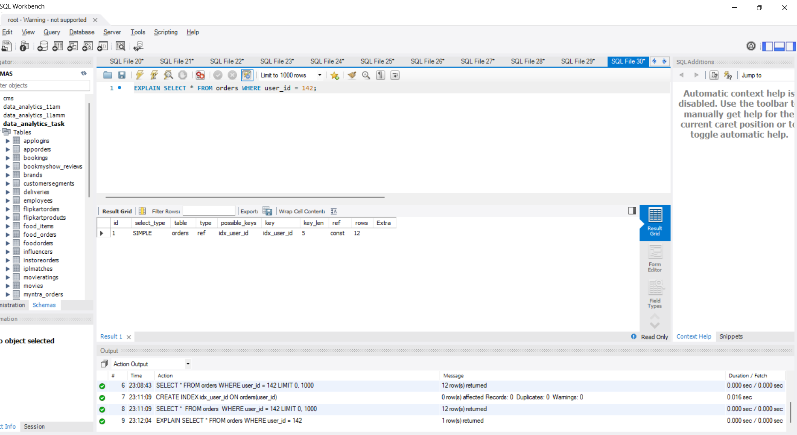
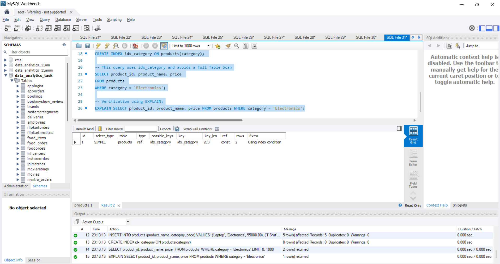
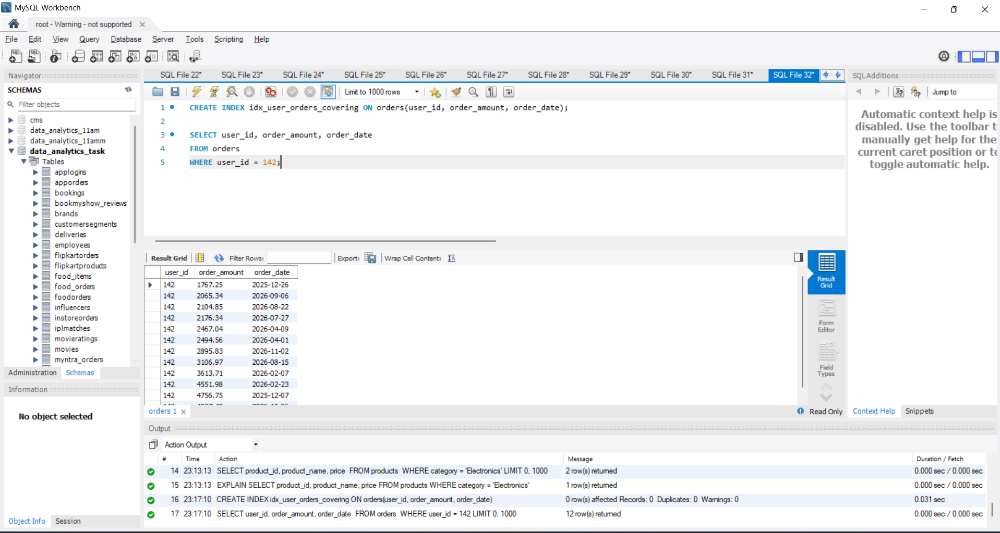

# Task

1. Run a SELECT query on a large 'orders' table (at least 10,000 rows) to find all orders for a specific user_id and measure the query execution time.

2. Create an index on the user_id column of the 'orders' table and re-run the same SELECT query to measure the new execution time.<br><br><em><strong>Hint:</strong> Use CREATE INDEX idx_user_id ON orders(user_id); and compare the times before and after.</em>

3. Use the EXPLAIN PLAN command to analyze how your SELECT query runs before and after adding the index, and write down the key differences you observe in the output.

4. Write a query for a 'products' table that avoids a full table scan by using an index on the 'category' column to fetch all products in a specific category.

5. Suppose your SELECT query on the 'orders' table is still slow even after adding an index. Use EXPLAIN PLAN and research at least one more optimization technique (other than indexing) using an AI tool like ChatGPT or Copilot, and describe how you would apply it.

**solution**

## 1.  Run SELECT Query on Large orders Table (Without Index) & Measure Execution Time

```sql
DROP TABLE IF EXISTS orders;

CREATE TABLE orders (
    order_id INT PRIMARY KEY AUTO_INCREMENT,
    user_id INT,
    order_amount DECIMAL(10, 2),
    order_date DATE
);

-- Procedure to safely insert 10,000 rows
DELIMITER $$
CREATE PROCEDURE InsertTenThousandOrders()
BEGIN
    DECLARE i INT DEFAULT 1;
    WHILE i <= 10000 DO
        INSERT INTO orders (user_id, order_amount, order_date) 
        VALUES (
            FLOOR(1 + (RAND() * 500)),
            ROUND(100 + (RAND() * 4900), 2),
            DATE_SUB(CURDATE(), INTERVAL FLOOR(RAND() * 365) DAY)
        );
        SET i = i + 1;
    END WHILE;
END$$
DELIMITER ;

-- Run the procedure
CALL InsertTenThousandOrders();

-- Verify count
SELECT COUNT(*) FROM orders;

SELECT * FROM orders WHERE user_id = 142;
```



## 2. Create Index on user_id & Measure New Execution Time

```sql
CREATE INDEX idx_user_id ON orders(user_id);

SELECT * 
FROM orders 
WHERE user_id = 142;
```


## 3. EXPLAIN Analysis (Before vs. After Index)

```sql
EXPLAIN SELECT * FROM orders WHERE user_id = 142;
```


## 4. Avoid Full Table Scan on products Table using Category Index

```sql
DROP TABLE IF EXISTS products;

CREATE TABLE products (
    product_id INT PRIMARY KEY AUTO_INCREMENT,
    product_name VARCHAR(100),
    category VARCHAR(50),
    price DECIMAL(10, 2)
);

INSERT INTO products (product_name, category, price) VALUES 
('Laptop', 'Electronics', 55000.00),
('T-Shirt', 'Fashion', 799.00),
('Smartphone', 'Electronics', 25000.00),
('Jeans', 'Fashion', 1499.00),
('Air Fryer', 'Home Appliances', 4999.00);

-- Create index to avoid Full Table Scan
CREATE INDEX idx_category ON products(category); 

-- This query uses idx_category and avoids a Full Table Scan
SELECT product_id, product_name, price 
FROM products 
WHERE category = 'Electronics';

-- Verification using EXPLAIN:
EXPLAIN SELECT product_id, product_name, price FROM products WHERE category = 'Electronics';
```



## 5. Additional Optimization Techniques Beyond Simple Indexing

If queries on large tables remain slow after indexing, two major techniques can be applied:

1. Covering Index (Index-Only Scan)
What it is: Instead of indexing only the WHERE condition column (user_id), create a composite index that also includes the requested columns (order_amount, order_date).
Implementation:

```sql
CREATE INDEX idx_user_orders_covering ON orders(user_id, order_amount, order_date);

SELECT user_id, order_amount, order_date 
FROM orders 
WHERE user_id = 142;
```

Why it optimizes: MySQL fetches all required columns directly from the index tree without needing a second lookup to the actual table disk pages (Eliminates Bookmark/Row Lookup overhead; EXPLAIN shows Using index).

2. Table Partitioning (by Date Range)
What it is: Splitting a massive table physically into smaller partition segments (e.g., partitioned by year/month of order_date).
Implementation:

```sql
ALTER TABLE orders PARTITION BY RANGE (YEAR(order_date)) (
    PARTITION p2024 VALUES LESS THAN (2025),
    PARTITION p2025 VALUES LESS THAN (2026),
    PARTITION p_future VALUES LESS THAN MAXVALUE
);
```
Why it optimizes: Allows Partition Pruning—queries filtering for recent orders only scan the relevant partition file rather than the entire multi-gigabyte dataset.



