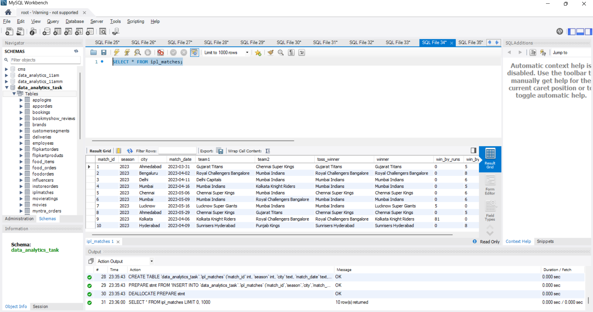
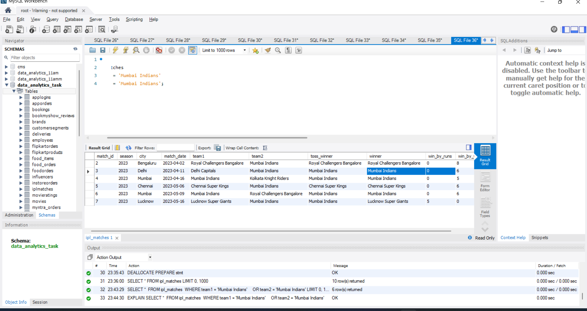
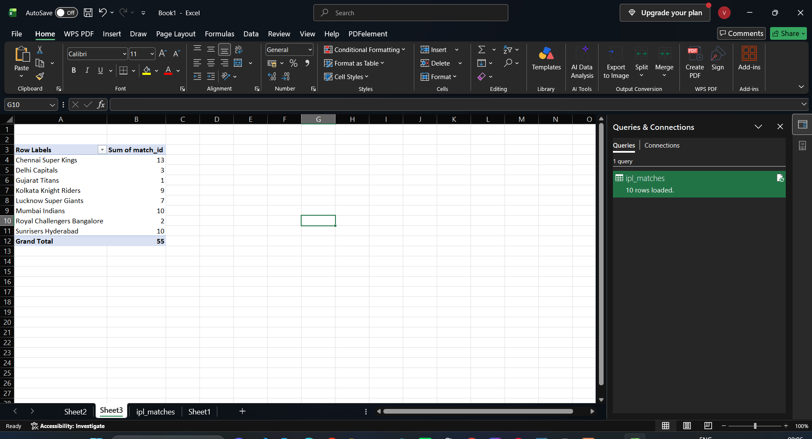
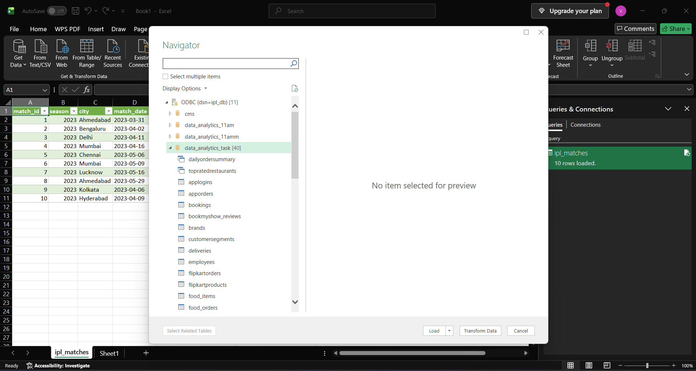
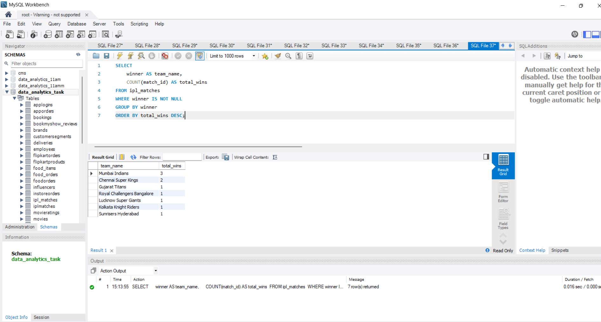
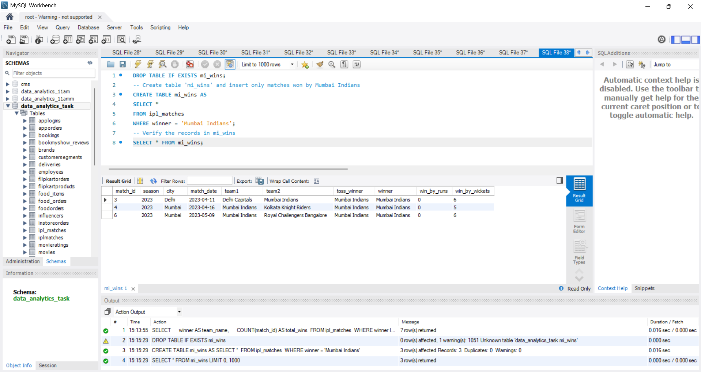

# Task

1. Download a sample IPL match data CSV file and load it into a new SQL table called ipl_matches using your preferred SQL tool (MySQL Workbench, DBeaver, or Azure Data Studio).

2. Write a SQL query to select all matches where the team 'Mumbai Indians' played, then export the query results as a CSV file named mi_matches.csv.

3. Connect Microsoft Excel to your SQL database and import the ipl_matches table. Create a simple table in Excel that shows the total matches played by each team.

4. Connect Power BI Desktop to your SQL database, import the ipl_matches table, and create a pivot chart showing the number of wins for each team.

5. Use Python (with pandas and sqlalchemy) to read the mi_matches.csv file, filter matches where 'Mumbai Indians' won, and insert those rows into a new SQL table called mi_wins.<br><br><em><strong>Hint:</strong> Use pandas.read_csv(), DataFrame filtering, and to_sql() for this task.</em>

**solution**

## 1. Load IPL Match Data into ipl_matches Table

csv file loded in workbench :

```sql
SELECT * FROM ipl_matches;
```



## 2. Mumbai Indians ke Matches Query karna aur CSV Export karna
export alredy done  : 

```sql
SELECT * 
FROM ipl_matches 
WHERE team1 = 'Mumbai Indians' 
   OR team2 = 'Mumbai Indians';
```



## 3. Microsoft Excel ko SQL Database se Connect karna
connected excel and total vlaue




## 4. Number of Wins for Each Team (Power BI Chart Data in SQL)

```sql
SELECT 
    winner AS team_name, 
    COUNT(match_id) AS total_wins 
FROM ipl_matches 
WHERE winner IS NOT NULL 
GROUP BY winner 
ORDER BY total_wins DESC;
```



## 5. Filter and Insert 'Mumbai Indians' Wins into New Table mi_wins (Python to_sql Replacement in SQL)

```sql
DROP TABLE IF EXISTS mi_wins;
-- Create table 'mi_wins' and insert only matches won by Mumbai Indians
CREATE TABLE mi_wins AS
SELECT * 
FROM ipl_matches 
WHERE winner = 'Mumbai Indians';
-- Verify the records in mi_wins
SELECT * FROM mi_wins;
```
