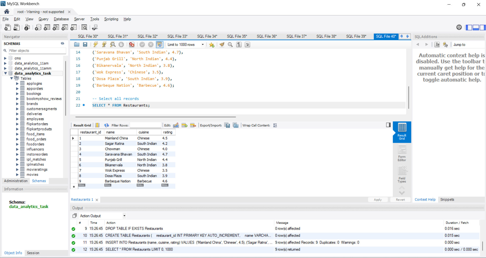
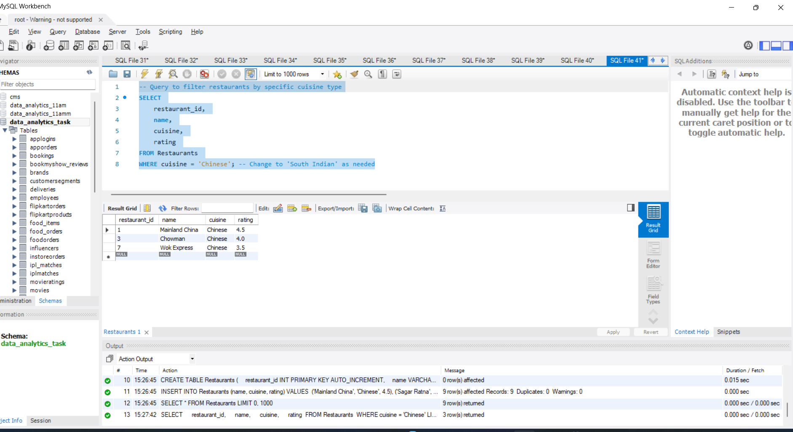
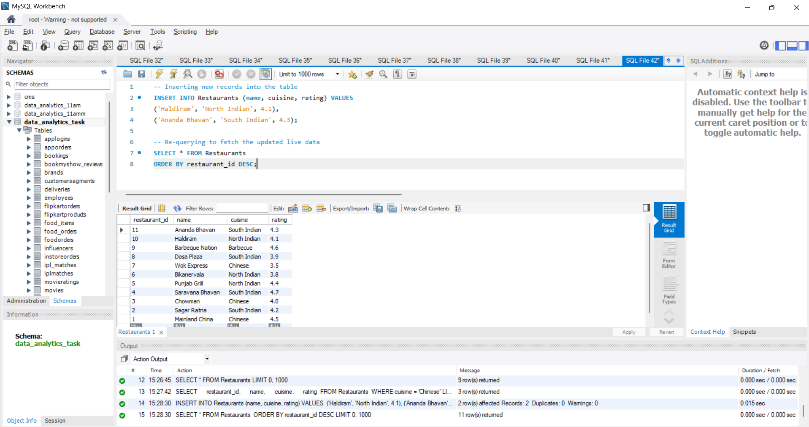
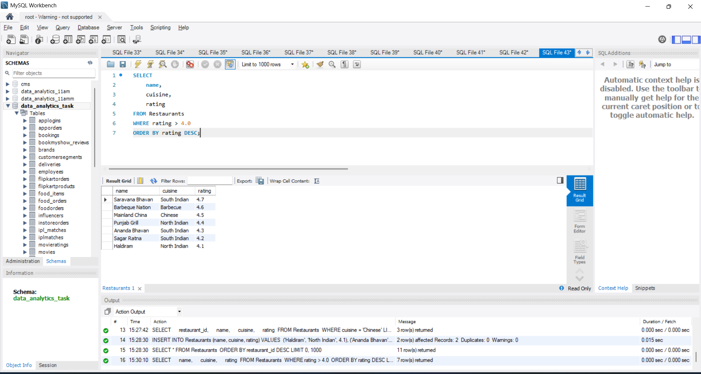
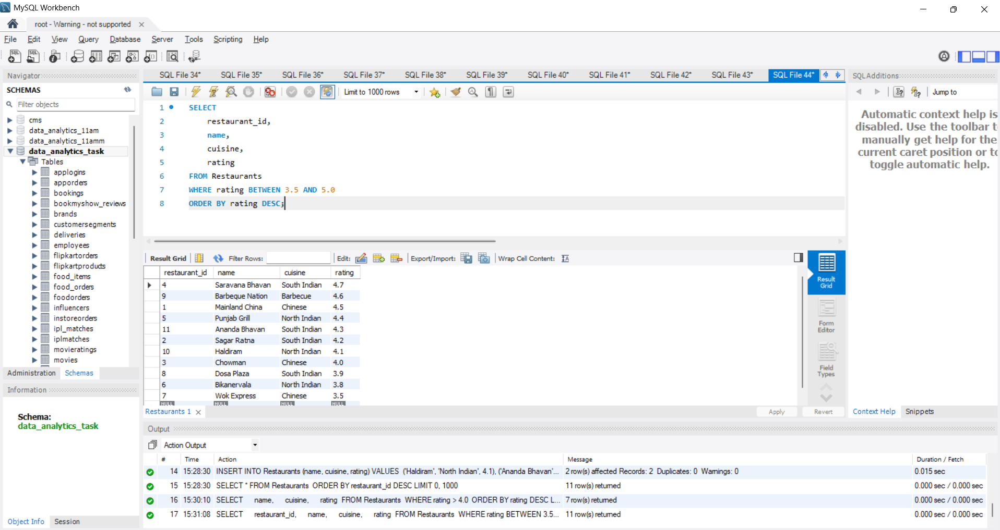

# task 

1. Connect an Excel workbook to a SQL Server database using Power Query and load the 'Restaurants' table (assume it contains columns like name, cuisine, rating) into a new worksheet.

2. Set up a parameterized query in Power Query that allows you to filter the 'Restaurants' data by cuisine type (e.g., only show 'Chinese' or 'South Indian') based on a value entered in an Excel cell.<br><br><em><strong>Hint:</strong> Use Power Query's 'Manage Parameters' feature and reference the cell value in your SQL query.</em>

3. Enable dynamic data refresh in your Excel sheet so that when new records are added to the 'Restaurants' table in SQL Server, you can update the Excel data with a single click.

4. Modify your Power Query connection to include only restaurants with a rating above 4.0, and display the filtered results in a dashboard-style Excel sheet with a table and a bar chart.

5. Use ChatGPT or Copilot to help you write a parameterized SQL query for Power Query that fetches all restaurants within a certain rating range (e.g., between 3.5 and 5.0), then implement and test it in your Excel workbook.

**solution**

## 1. Create Restaurants Table and Load Sample Data

```sql
DROP TABLE IF EXISTS Restaurants;

CREATE TABLE Restaurants (
    restaurant_id INT PRIMARY KEY AUTO_INCREMENT,
    name VARCHAR(100),
    cuisine VARCHAR(50),
    rating DECIMAL(2, 1)
);

INSERT INTO Restaurants (name, cuisine, rating) VALUES 
('Mainland China', 'Chinese', 4.5),
('Sagar Ratna', 'South Indian', 4.2),
('Chowman', 'Chinese', 4.0),
('Saravana Bhavan', 'South Indian', 4.7),
('Punjab Grill', 'North Indian', 4.4),
('Bikanervala', 'North Indian', 3.8),
('Wok Express', 'Chinese', 3.5),
('Dosa Plaza', 'South Indian', 3.9),
('Barbeque Nation', 'Barbecue', 4.6);

-- Select all records
SELECT * FROM Restaurants;
```


## 2. Parameterized Filter Query by Cuisine Type (Chinese / South Indian)

```sql
-- Query to filter restaurants by specific cuisine type
SELECT 
    restaurant_id, 
    name, 
    cuisine, 
    rating 
FROM Restaurants 
WHERE cuisine = 'Chinese'; -- Change to 'South Indian' as needed
```



## 3. Insert New Records to Demonstrate Dynamic Data Update

```sql
-- Inserting new records into the table
INSERT INTO Restaurants (name, cuisine, rating) VALUES 
('Haldiram', 'North Indian', 4.1),
('Ananda Bhavan', 'South Indian', 4.3);

-- Re-querying to fetch the updated live data
SELECT * FROM Restaurants 
ORDER BY restaurant_id DESC;
```


## 4. Filter Restaurants with Rating Above 4.0 (Dashboard Data Query)

```sql
SELECT 
    name, 
    cuisine, 
    rating 
FROM Restaurants 
WHERE rating > 4.0 
ORDER BY rating DESC;
```


## 5. Fetch Restaurants Within a Rating Range (BETWEEN 3.5 and 5.0)

```sql
-- Parameterized rating range query using BETWEEN operator
SELECT 
    restaurant_id, 
    name, 
    cuisine, 
    rating 
FROM Restaurants 
WHERE rating BETWEEN 3.5 AND 5.0 
ORDER BY rating DESC;
```

