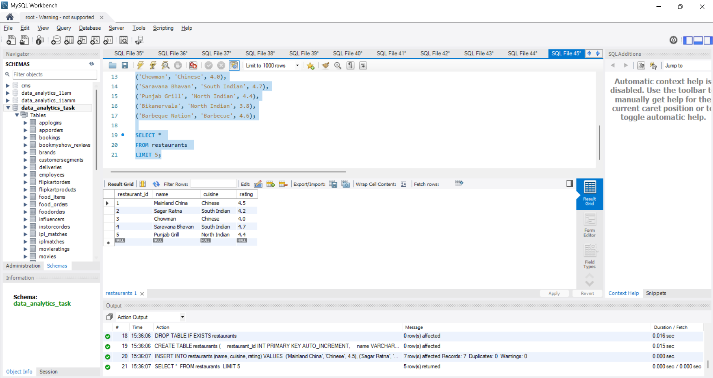
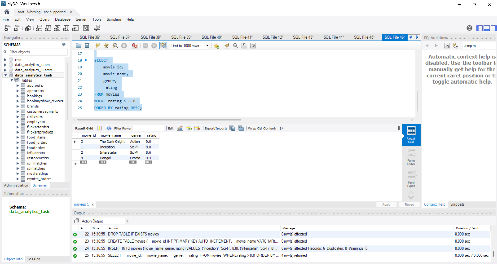
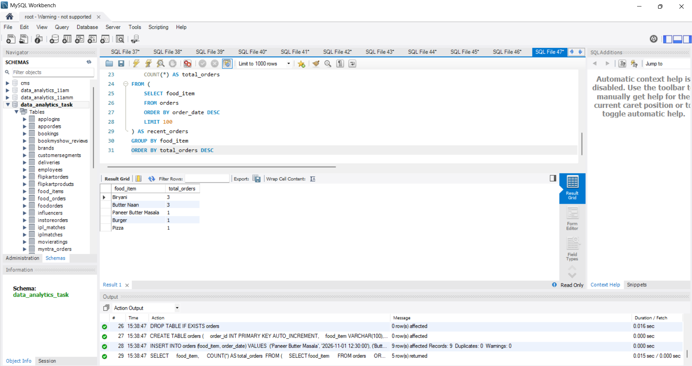
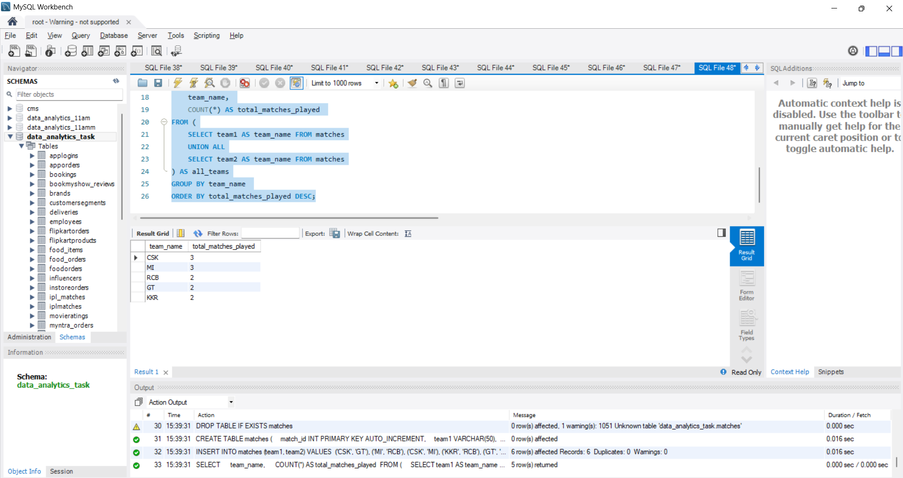
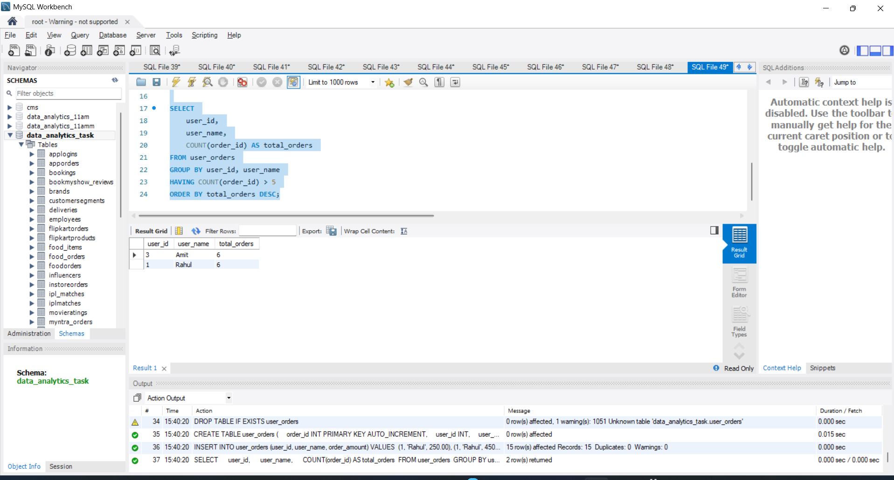

# task 

1. Use pandas' read_sql() function to load all records from a 'restaurants' table (with columns like name, cuisine, rating) in your local SQLite database into a DataFrame, then display the first 5 rows.

2. In a Jupyter Notebook, use the %sql magic command to run a SQL query that selects all movies with a rating above 
from a 'movies' table, and display the results in the notebook.

3. Combine SQL and Python to analyze Zomato-style order data: use pandas read_sql() to load the last 100 orders from an 'orders' table, then use DataFrame methods to find the top 3 most ordered food items.

4. After loading IPL match data from a 'matches' table into a pandas DataFrame, create a bar chart showing the number of matches played by each team using matplotlib or seaborn.<br><br><em><strong>Hint:</strong> Use groupby() in pandas to count matches per team before plotting.</em>

5. Use ChatGPT or Copilot to help you write a Jupyter Notebook cell that connects to a SQLite database, runs a SQL query to fetch all users who have placed more than 5 orders, and loads the result into a pandas DataFrame

**solution**

## 1. Load and Display First 5 Rows from restaurants Table (LIMIT 5)

```sql
DROP TABLE IF EXISTS restaurants;

CREATE TABLE restaurants (
    restaurant_id INT PRIMARY KEY AUTO_INCREMENT,
    name VARCHAR(100),
    cuisine VARCHAR(50),
    rating DECIMAL(2, 1)
);

INSERT INTO restaurants (name, cuisine, rating) VALUES 
('Mainland China', 'Chinese', 4.5),
('Sagar Ratna', 'South Indian', 4.2),
('Chowman', 'Chinese', 4.0),
('Saravana Bhavan', 'South Indian', 4.7),
('Punjab Grill', 'North Indian', 4.4),
('Bikanervala', 'North Indian', 3.8),
('Barbeque Nation', 'Barbecue', 4.6);

SELECT * 
FROM restaurants 
LIMIT 5;
```



## 2. Select Movies with Rating Above 8 (WHERE rating > 8)

```sql
DROP TABLE IF EXISTS movies;

CREATE TABLE movies (
    movie_id INT PRIMARY KEY AUTO_INCREMENT,
    movie_name VARCHAR(100),
    genre VARCHAR(50),
    rating DECIMAL(3, 1)
);

INSERT INTO movies (movie_name, genre, rating) VALUES 
('Inception', 'Sci-Fi', 8.8),
('Interstellar', 'Sci-Fi', 8.6),
('The Dark Knight', 'Action', 9.0),
('Dangal', 'Drama', 8.4),
('Brahmastra', 'Fantasy', 5.6),
('Adipurush', 'Action', 3.8);

SELECT 
    movie_id, 
    movie_name, 
    genre, 
    rating 
FROM movies 
WHERE rating > 8.0 
ORDER BY rating DESC;
```


## 3. Top 3 Most Ordered Food Items from Last 100 Orders

```sql
DROP TABLE IF EXISTS orders;

CREATE TABLE orders (
    order_id INT PRIMARY KEY AUTO_INCREMENT,
    food_item VARCHAR(100),
    order_date DATETIME
);

INSERT INTO orders (food_item, order_date) VALUES 
('Paneer Butter Masala', '2026-11-01 12:30:00'),
('Butter Naan', '2026-11-01 12:35:00'),
('Biryani', '2026-11-01 13:00:00'),
('Biryani', '2026-11-01 13:15:00'),
('Butter Naan', '2026-11-01 13:20:00'),
('Biryani', '2026-11-01 14:00:00'),
('Pizza', '2026-11-01 14:30:00'),
('Burger', '2026-11-01 15:00:00'),
('Butter Naan', '2026-11-01 15:30:00');

-- Subquery takes last 100 orders, outer query finds top 3 items
SELECT 
    food_item, 
    COUNT(*) AS total_orders 
FROM (
    SELECT food_item 
    FROM orders 
    ORDER BY order_date DESC 
    LIMIT 100
) AS recent_orders
GROUP BY food_item 
ORDER BY total_orders DESC 
LIMIT 3;
```


## 4. Total Matches Played by Each Team (IPL Data Aggregation)

```sql
DROP TABLE IF EXISTS matches;

CREATE TABLE matches (
    match_id INT PRIMARY KEY AUTO_INCREMENT,
    team1 VARCHAR(50),
    team2 VARCHAR(50)
);

INSERT INTO matches (team1, team2) VALUES 
('CSK', 'GT'),
('MI', 'RCB'),
('CSK', 'MI'),
('KKR', 'RCB'),
('GT', 'MI'),
('CSK', 'KKR');

SELECT 
    team_name, 
    COUNT(*) AS total_matches_played 
FROM (
    SELECT team1 AS team_name FROM matches
    UNION ALL
    SELECT team2 AS team_name FROM matches
) AS all_teams
GROUP BY team_name 
ORDER BY total_matches_played DESC;
```



## 5. Users Who Have Placed More Than 5 Orders (GROUP BY & HAVING > 5)

```sql
DROP TABLE IF EXISTS user_orders;

CREATE TABLE user_orders (
    order_id INT PRIMARY KEY AUTO_INCREMENT,
    user_id INT,
    user_name VARCHAR(50),
    order_amount DECIMAL(10, 2)
);

INSERT INTO user_orders (user_id, user_name, order_amount) VALUES 
(1, 'Rahul', 250.00), (1, 'Rahul', 450.00), (1, 'Rahul', 300.00),
(1, 'Rahul', 150.00), (1, 'Rahul', 500.00), (1, 'Rahul', 700.00), -- 6 orders (> 5)
(2, 'Pooja', 200.00), (2, 'Pooja', 400.00), (2, 'Pooja', 350.00), -- 3 orders (< 5)
(3, 'Amit', 800.00), (3, 'Amit', 900.00), (3, 'Amit', 150.00),
(3, 'Amit', 250.00), (3, 'Amit', 300.00), (3, 'Amit', 600.00);    -- 6 orders (> 5)

SELECT 
    user_id, 
    user_name, 
    COUNT(order_id) AS total_orders 
FROM user_orders 
GROUP BY user_id, user_name 
HAVING COUNT(order_id) > 5 
ORDER BY total_orders DESC;
```
