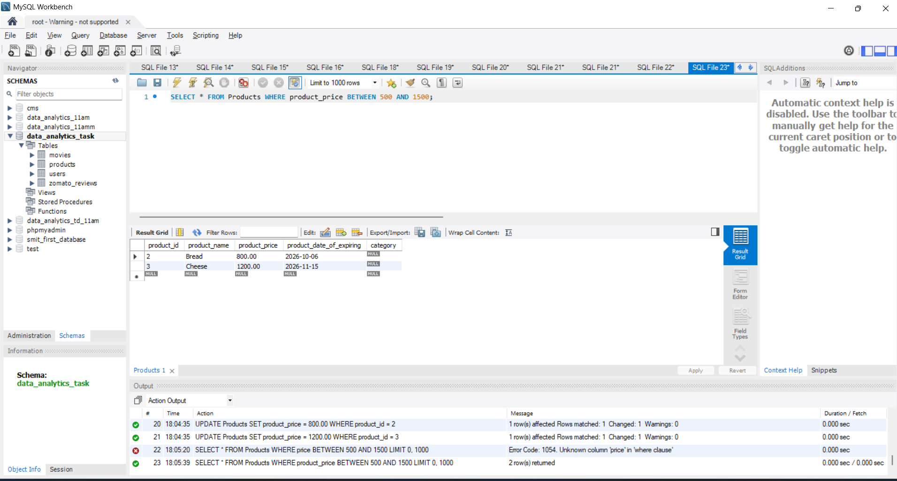
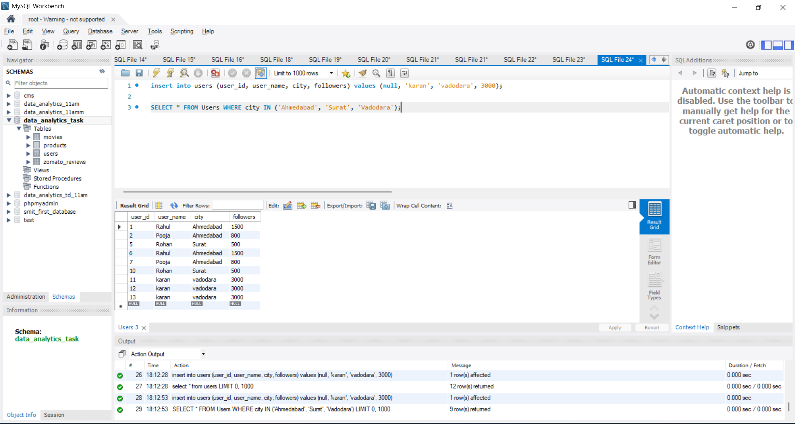
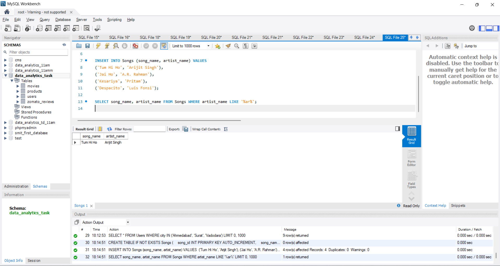

# Task

1. Write an SQL query to find all restaurants in a table called Restaurants whose names end with 'Cafe' using the LIKE operator.

2. In a Flipkart-style Products table, use the BETWEEN operator to select all products with a price between 500 and 1500 rupees.

3. Write an SQL query to display all users from a Users table whose city is either 'Ahmedabad', 'Surat', or 'Vadodara' using the IN operator.

4. Given a table called Songs with columns song_name and artist_name, find all songs where the artist_name contains the letter sequence 'ar' anywhere in the name using the LIKE operator.<br><br><em><strong>Hint:</strong> Use wildcards on both sides of the pattern.</em>

**solution**

## 1.  Restaurants Whose Names End with 'Cafe'

```sql
CREATE TABLE IF NOT EXISTS Restaurants (
    restaurant_id INT PRIMARY KEY AUTO_INCREMENT,
    name VARCHAR(100),
    rating DECIMAL(2, 1)
);

INSERT INTO Restaurants (name, rating) VALUES 
('Mocha Cafe', 4.5),
('Tea Post', 4.0),
('The Roastery Cafe', 4.7),
('Pizza Hut', 4.2);

SELECT * 
FROM Restaurants 
WHERE name LIKE '%Cafe';
```


---
   
## 2. Products with Price Between 500 and 1500 Rupee 

```sql
SELECT * FROM Products WHERE product_price BETWEEN 500 AND 1500;
```



---

## 3. Users from 'Ahmedabad', 'Surat', or 'Vadodara'

```sql
SELECT * FROM Users WHERE city IN ('Ahmedabad', 'Surat', 'Vadodara');
```


---

## 4. Songs Where Artist Name Contains 'ar' Anywhere

```sql
CREATE TABLE IF NOT EXISTS Songs (
    song_id INT PRIMARY KEY AUTO_INCREMENT,
    song_name VARCHAR(100),
    artist_name VARCHAR(100)
);

INSERT INTO Songs (song_name, artist_name) VALUES 
('Tum Hi Ho', 'Arijit Singh'),
('Jai Ho', 'A.R. Rahman'),
('Kesariya', 'Pritam'),
('Despacito', 'Luis Fonsi');

SELECT song_name, artist_name FROM Songs WHERE artist_name LIKE '%ar%';
```



---