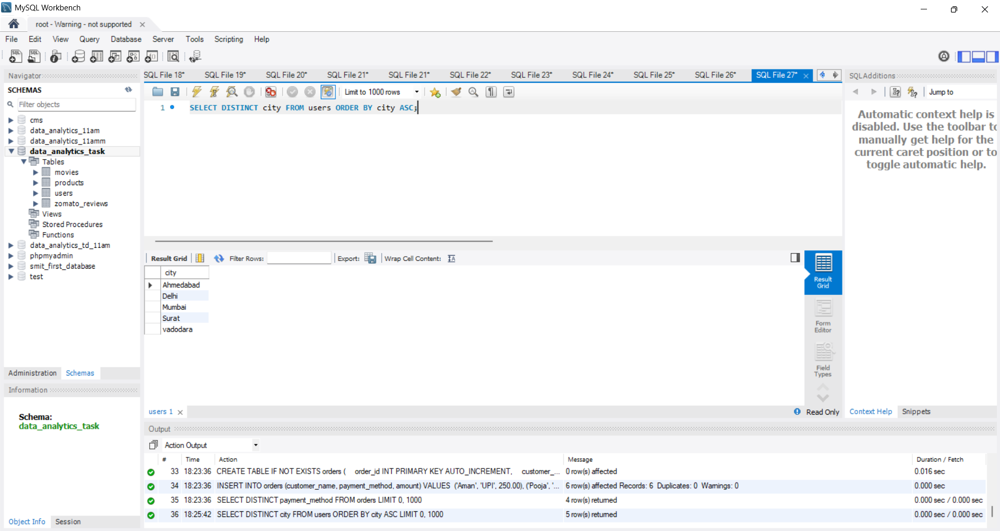
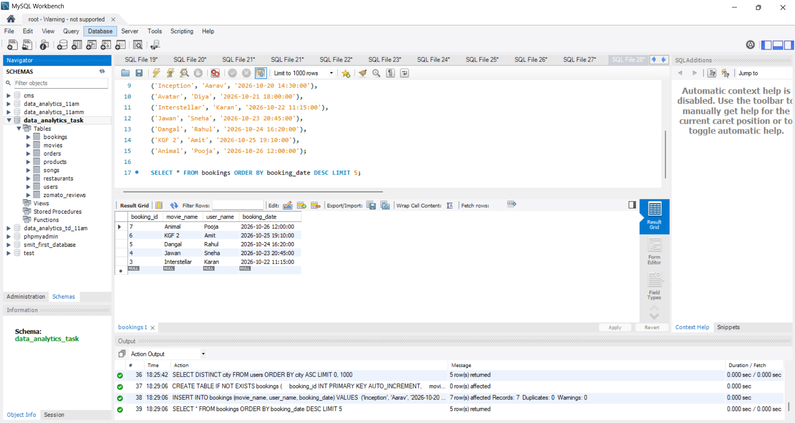
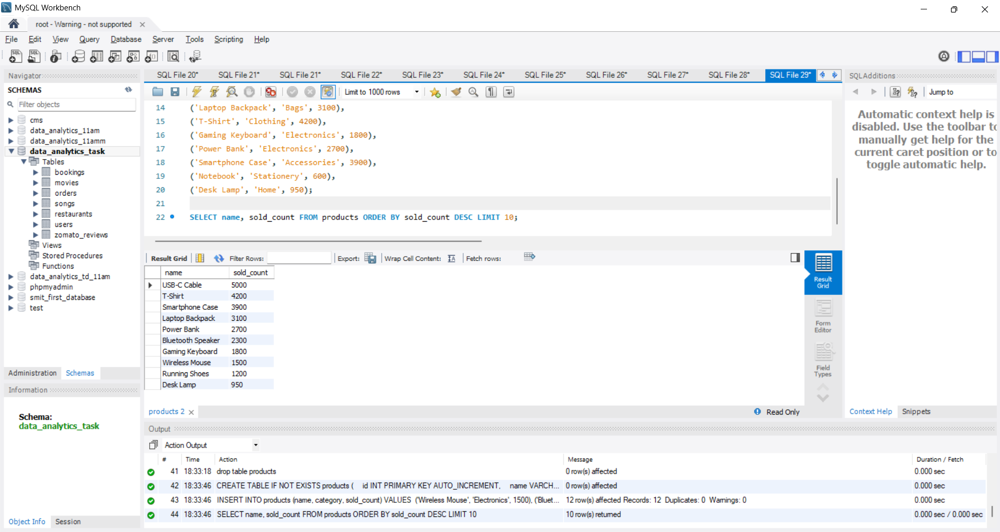

# Task

1. Write an SQL query using the DISTINCT keyword to find all unique payment methods used in the orders table of a food delivery app database.

2. Query the users table to list all cities where users have registered, but display each city only once and sort the result in alphabetical order (A-Z).

3. Write an SQL query to select the top 5 most recent movie bookings from the bookings table, ordered by booking_date in descending order.

4. From a products table containing Flipkart-style product data (id, name, category, sold_count), write an SQL query to retrieve the 10 products with the highest sold_count, displaying only product name and sold_count, sorted from highest to lowest.<br><br><em><strong>Hint:</strong> Use ORDER BY and LIMIT together to achieve this.</em>

**soulution**

## 1. Find All Unique Payment Methods from `orders`

```sql
CREATE TABLE IF NOT EXISTS orders (
    order_id INT PRIMARY KEY AUTO_INCREMENT,
    customer_name VARCHAR(50),
    payment_method VARCHAR(50),
    amount DECIMAL(10, 2)
);

INSERT INTO orders (customer_name, payment_method, amount) VALUES 
('Aman', 'UPI', 250.00),
('Pooja', 'Credit Card', 500.00),
('Rahul', 'UPI', 150.00),
('Sneha', 'Cash on Delivery', 300.00),
('Vikram', 'Debit Card', 450.00),
('Rohit', 'Credit Card', 800.00);

SELECT DISTINCT payment_method FROM orders;
```

## 2. Unique Cities from users Sorted Alphabetically (A-Z)

```sql
SELECT DISTINCT city FROM users ORDER BY city ASC;
```


---

## 3. Top 5 Most Recent Movie Bookings from bookings

```sql
CREATE TABLE IF NOT EXISTS bookings (
    booking_id INT PRIMARY KEY AUTO_INCREMENT,
    movie_name VARCHAR(100),
    user_name VARCHAR(50),
    booking_date DATETIME
);

INSERT INTO bookings (movie_name, user_name, booking_date) VALUES 
('Inception', 'Aarav', '2026-10-20 14:30:00'),
('Avatar', 'Diya', '2026-10-21 18:00:00'),
('Interstellar', 'Karan', '2026-10-22 11:15:00'),
('Jawan', 'Sneha', '2026-10-23 20:45:00'),
('Dangal', 'Rahul', '2026-10-24 16:20:00'),
('KGF 2', 'Amit', '2026-10-25 19:10:00'),
('Animal', 'Pooja', '2026-10-26 12:00:00');

SELECT * FROM bookings ORDER BY booking_date DESC LIMIT 5;
```


---

## 4. Top 10 Products with Highest sold_count

```sql
CREATE TABLE IF NOT EXISTS products (
    id INT PRIMARY KEY AUTO_INCREMENT,
    name VARCHAR(100),
    category VARCHAR(50),
    sold_count INT
);

INSERT INTO products (name, category, sold_count) VALUES 
('Wireless Mouse', 'Electronics', 1500),
('Bluetooth Speaker', 'Electronics', 2300),
('USB-C Cable', 'Accessories', 5000),
('Water Bottle', 'Home', 850),
('Running Shoes', 'Footwear', 1200),
('Laptop Backpack', 'Bags', 3100),
('T-Shirt', 'Clothing', 4200),
('Gaming Keyboard', 'Electronics', 1800),
('Power Bank', 'Electronics', 2700),
('Smartphone Case', 'Accessories', 3900),
('Notebook', 'Stationery', 600),
('Desk Lamp', 'Home', 950);

SELECT name, sold_count FROM products ORDER BY sold_count DESC LIMIT 10;
```


----


