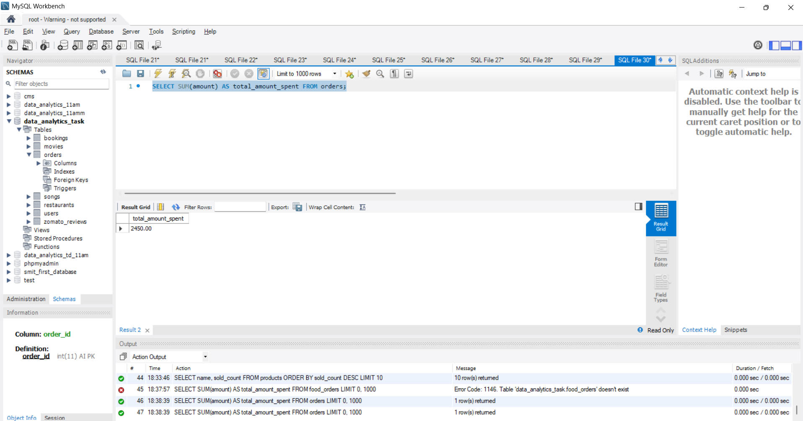
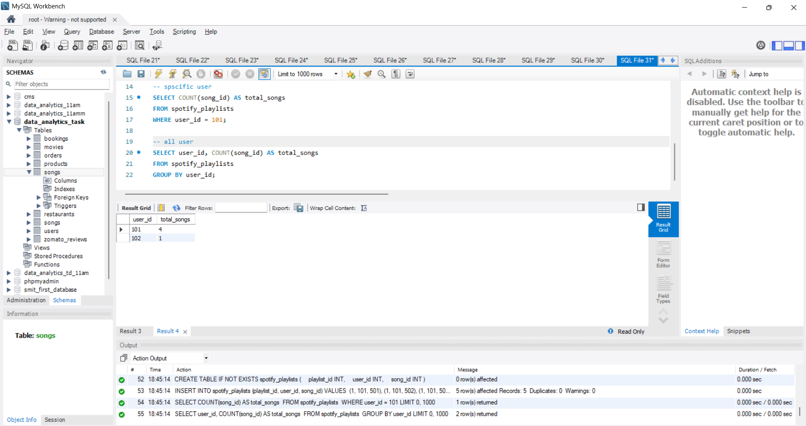
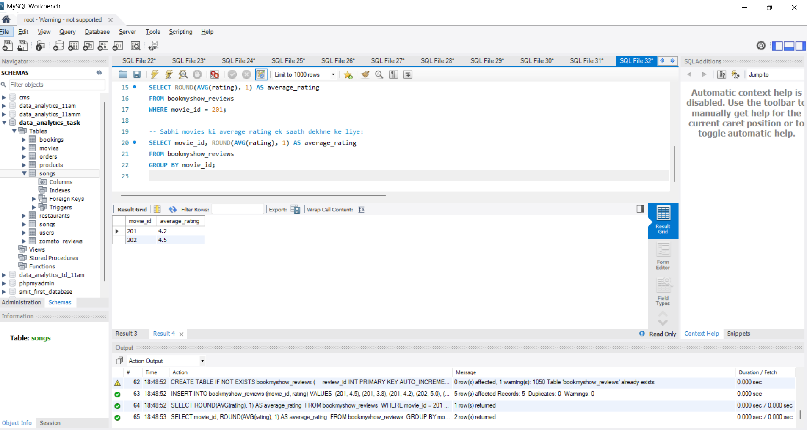
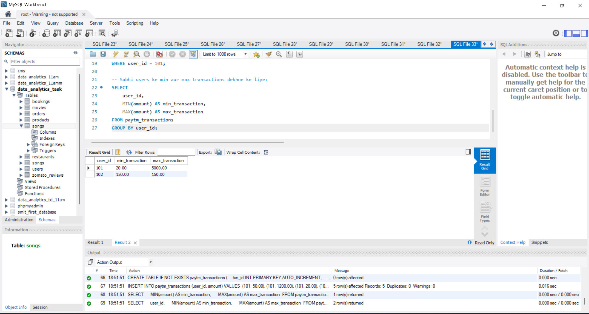
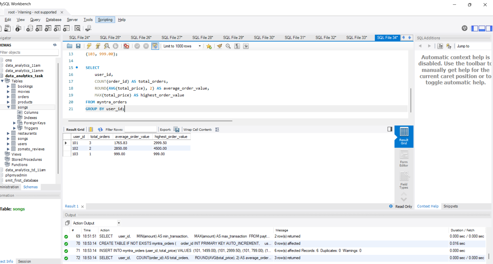

# Task

1. Write an SQL query using the SUM() function to calculate the total amount spent by users on food orders in a table food_orders (columns: order_id, user_id, amount) — imagine it's like Zomato's order history.

2. Using the COUNT() function, find out how many songs a user has added to their playlist in a table spotify_playlists (columns: playlist_id, user_id, song_id).

3. Write an SQL query to get the average rating given to a movie in a table bookmyshow_reviews (columns: review_id, movie_id, rating), and round the result to 1 decimal place using the ROUND() function.<br><br><em><strong>Hint:</strong> Use AVG() with ROUND() to format the output.</em>

4. Find the minimum and maximum transaction values for a user from a table paytm_transactions (columns: txn_id, user_id, amount) — show both the smallest and largest transaction amounts.

5. Given a table myntra_orders (columns: order_id, user_id, total_price), write an SQL query to display the total number of orders, the average order value (rounded to 2 decimals), and the highest order value for each user_id.<br><br><em><strong>Constraint:</strong> Use GROUP BY to get results per user.</em>

**soulution**

## 1. Total Amount Spent on Food Orders using `SUM`()

```sql
SELECT SUM(amount) AS total_amount_spent FROM orders;
```


---

## 2. Count Songs in Playlist using COUNT()

```sql
CREATE TABLE IF NOT EXISTS spotify_playlists (
    playlist_id INT,
    user_id INT,
    song_id INT
);

INSERT INTO spotify_playlists (playlist_id, user_id, song_id) VALUES 
(1, 101, 501),
(1, 101, 502),
(1, 101, 503),
(2, 102, 504),
(1, 101, 505);

-- spscific user 
SELECT COUNT(song_id) AS total_songs 
FROM spotify_playlists 
WHERE user_id = 101;

-- all user
SELECT user_id, COUNT(song_id) AS total_songs 
FROM spotify_playlists 
GROUP BY user_id;
```



---

## 3. Average Rating Rounded to 1 Decimal using AVG() and ROUND()

```sql
CREATE TABLE IF NOT EXISTS bookmyshow_reviews (
    review_id INT PRIMARY KEY AUTO_INCREMENT,
    movie_id INT,
    rating DECIMAL(2, 1)
);

INSERT INTO bookmyshow_reviews (movie_id, rating) VALUES 
(201, 4.5),
(201, 3.8),
(201, 4.2),
(202, 5.0),
(202, 4.0);

-- Kisi specific movie (jaise movie_id = 201) ki average rating:
SELECT ROUND(AVG(rating), 1) AS average_rating 
FROM bookmyshow_reviews 
WHERE movie_id = 201;

-- Sabhi movies ki average rating ek saath dekhne ke liye:
SELECT movie_id, ROUND(AVG(rating), 1) AS average_rating 
FROM bookmyshow_reviews 
GROUP BY movie_id;
```


---

## 4 . Minimum and Maximum Transaction Values using MIN() and MAX()

```sql
CREATE TABLE IF NOT EXISTS paytm_transactions (
    txn_id INT PRIMARY KEY AUTO_INCREMENT,
    user_id INT,
    amount DECIMAL(10, 2)
);

INSERT INTO paytm_transactions (user_id, amount) VALUES 
(101, 50.00),
(101, 1200.00),
(101, 20.00),
(101, 5000.00),
(102, 150.00);

-- Kisi specific user (jaise user_id = 101) ke liye:
SELECT 
    MIN(amount) AS min_transaction, 
    MAX(amount) AS max_transaction 
FROM paytm_transactions 
WHERE user_id = 101;

-- Sabhi users ke min aur max transactions dekhne ke liye:
SELECT 
    user_id, 
    MIN(amount) AS min_transaction, 
    MAX(amount) AS max_transaction 
FROM paytm_transactions 
GROUP BY user_id;
```



---

## 5. Orders Summary per User using GROUP BY, COUNT(), ROUND(), AVG(), and MAX()

```sql
CREATE TABLE IF NOT EXISTS myntra_orders (
    order_id INT PRIMARY KEY AUTO_INCREMENT,
    user_id INT,
    total_price DECIMAL(10, 2)
);

INSERT INTO myntra_orders (user_id, total_price) VALUES 
(101, 1499.00),
(101, 2999.50),
(101, 799.00),
(102, 4500.00),
(102, 1200.00),
(103, 999.00);

SELECT 
    user_id, 
    COUNT(order_id) AS total_orders, 
    ROUND(AVG(total_price), 2) AS average_order_value, 
    MAX(total_price) AS highest_order_value 
FROM myntra_orders 
GROUP BY user_id;
```



----
