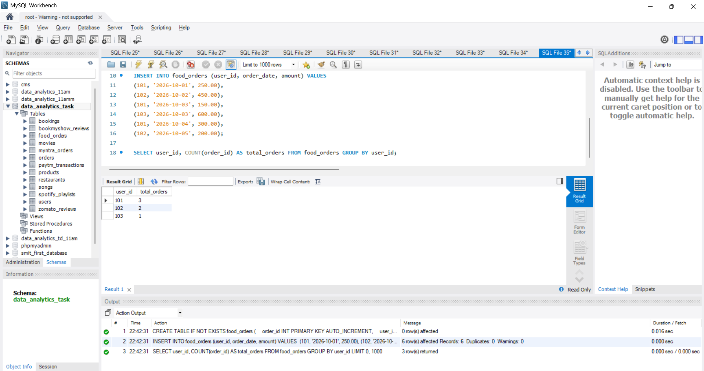
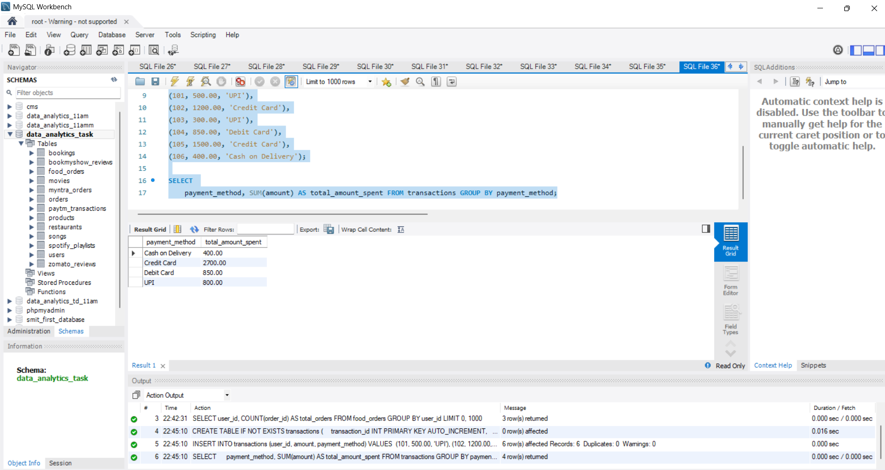
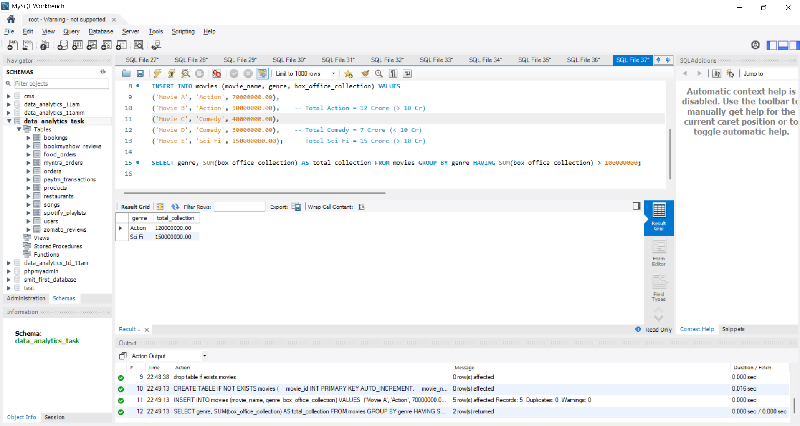
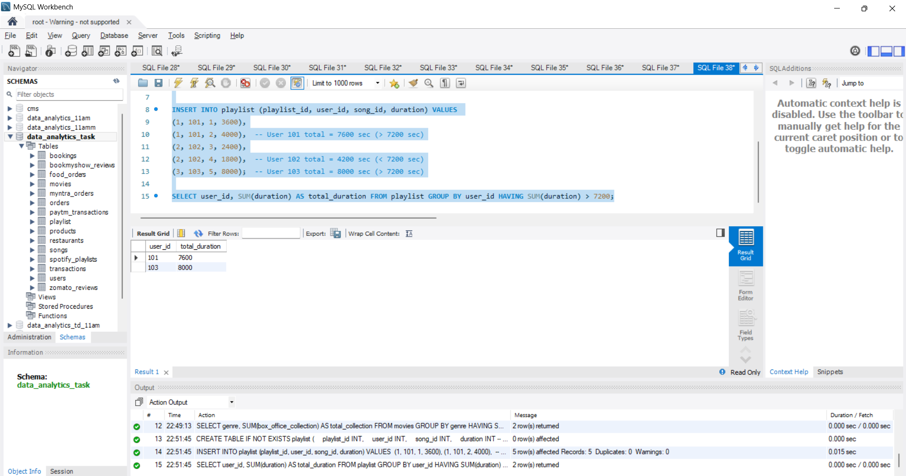

# Task

1. Write an SQL query to display the total number of orders placed by each user in a 'food_orders' table, grouped by user_id.

2. Using a 'transactions' table with columns (transaction_id, user_id, amount, payment_method), write an SQL query to show the total amount spent by each payment_method.

3. Given a 'movies' table with columns (movie_id, genre, box_office_collection), write an SQL query to display each genre and its total box_office_collection, but only show genres where the total collection is above 10 crore.<br><br><em><strong>Hint:</strong> Use GROUP BY and HAVING together to filter the aggregated results.</em>

4. Suppose you have a 'playlist' table with columns (playlist_id, user_id, song_id, duration). Write an SQL query to find users who have created playlists with a combined song duration of more than 2 hours (7200 seconds), showing user_id and total duration.

**solution**

## 1. Total Number of Orders Placed by Each User

```sql


CREATE TABLE IF NOT EXISTS food_orders (
    order_id INT PRIMARY KEY AUTO_INCREMENT,
    user_id INT,
    order_date DATE,
    amount DECIMAL(10, 2)
);

INSERT INTO food_orders (user_id, order_date, amount) VALUES 
(101, '2026-10-01', 250.00),
(102, '2026-10-02', 450.00),
(101, '2026-10-03', 150.00),
(103, '2026-10-03', 600.00),
(101, '2026-10-04', 300.00),
(102, '2026-10-05', 200.00);

SELECT user_id, COUNT(order_id) AS total_orders FROM food_orders GROUP BY user_id;
```



---

## 2. Total Amount Spent by Each Payment Method

```sql
CREATE TABLE IF NOT EXISTS transactions (
    transaction_id INT PRIMARY KEY AUTO_INCREMENT,
    user_id INT,
    amount DECIMAL(10, 2),
    payment_method VARCHAR(50)
);

INSERT INTO transactions (user_id, amount, payment_method) VALUES 
(101, 500.00, 'UPI'),
(102, 1200.00, 'Credit Card'),
(103, 300.00, 'UPI'),
(104, 850.00, 'Debit Card'),
(105, 1500.00, 'Credit Card'),
(106, 400.00, 'Cash on Delivery');

SELECT 
    payment_method, SUM(amount) AS total_amount_spent FROM transactions GROUP BY payment_method;
```



---

## 3. Genres with Total Box Office Collection Above 10 Cror

```sql
CREATE TABLE IF NOT EXISTS movies (
    movie_id INT PRIMARY KEY AUTO_INCREMENT,
    movie_name VARCHAR(100),
    genre VARCHAR(50),
    box_office_collection DECIMAL(15, 2)
);

INSERT INTO movies (movie_name, genre, box_office_collection) VALUES 
('Movie A', 'Action', 70000000.00),
('Movie B', 'Action', 50000000.00),    -- Total Action = 12 Crore (> 10 Cr)
('Movie C', 'Comedy', 40000000.00),
('Movie D', 'Comedy', 30000000.00),    -- Total Comedy = 7 Crore (< 10 Cr)
('Movie E', 'Sci-Fi', 150000000.00);   -- Total Sci-Fi = 15 Crore (> 10 Cr)

SELECT genre, SUM(box_office_collection) AS total_collection FROM movies GROUP BY genre HAVING SUM(box_office_collection) > 100000000;

```


---

## 4. Users with Combined Playlist Song Duration > 2 Hours (7200 seconds)

```sql
CREATE TABLE IF NOT EXISTS playlist (
    playlist_id INT,
    user_id INT,
    song_id INT,
    duration INT -- duration in seconds
);

INSERT INTO playlist (playlist_id, user_id, song_id, duration) VALUES 
(1, 101, 1, 3600),
(1, 101, 2, 4000),  -- User 101 total = 7600 sec (> 7200 sec)
(2, 102, 3, 2400),
(2, 102, 4, 1800),  -- User 102 total = 4200 sec (< 7200 sec)
(3, 103, 5, 8000);  -- User 103 total = 8000 sec (> 7200 sec)

SELECT user_id, SUM(duration) AS total_duration FROM playlist GROUP BY user_id HAVING SUM(duration) > 7200;
```


------