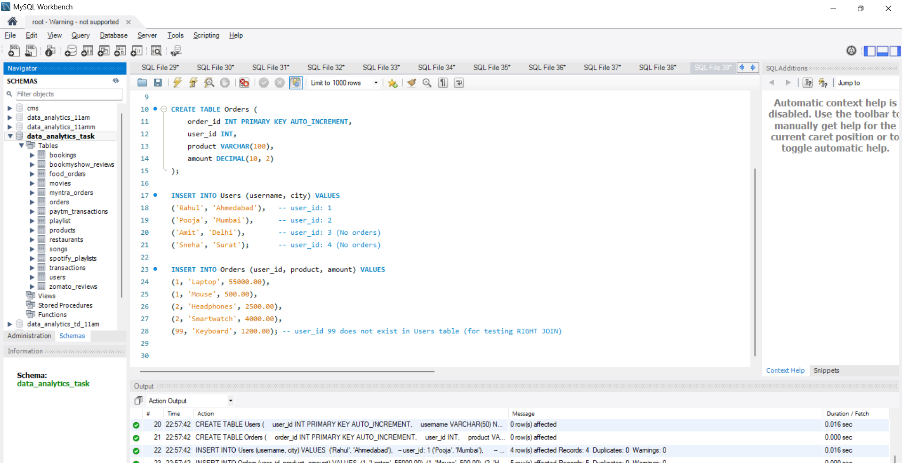
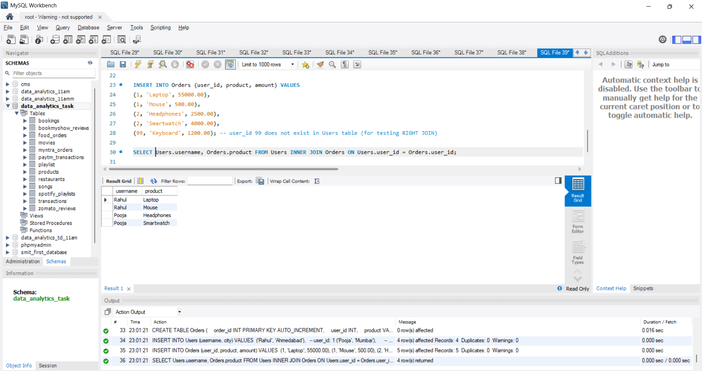
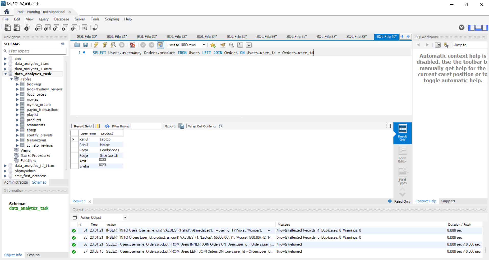
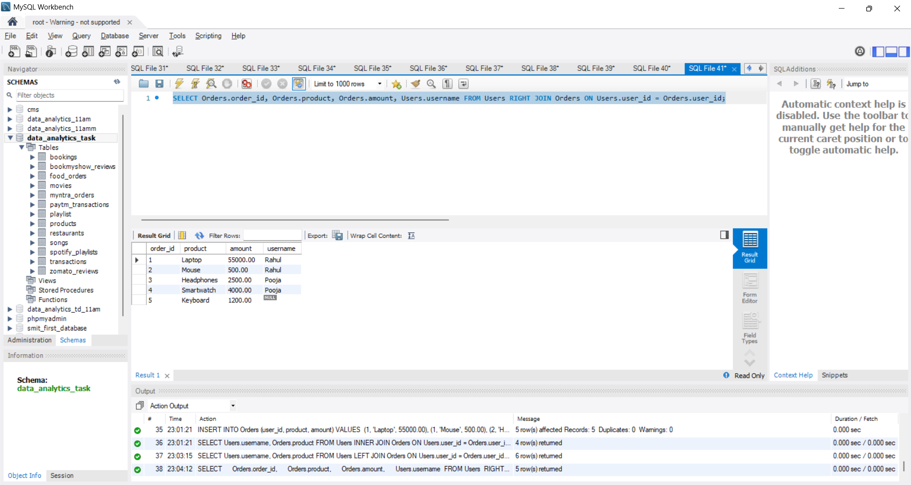
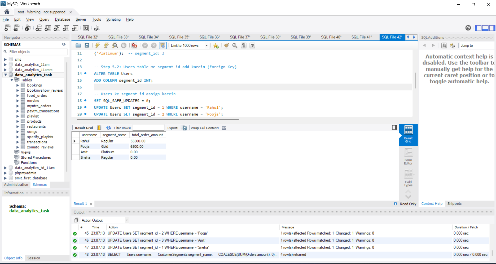

# Task

1. Create two tables in your SQL database: Users (user_id, username, city) and Orders (order_id, user_id, product, amount). Insert at least 3 users and 5 orders, making sure some users have no orders.

2. Write an SQL query using INNER JOIN to list all usernames and their ordered products, showing only users who have placed at least one order.

3. Write an SQL query using LEFT JOIN to display all usernames along with their ordered products. For users who haven't placed any orders, show NULL for the product.

4. Write an SQL query using RIGHT JOIN to show all orders and the corresponding username for each order. If an order has a user_id that doesn't exist in the Users table, display NULL for the username.<br><br><em><strong>Hint:</strong> Try deleting one user and keeping their order to test this case.</em>

5. Suppose you want to analyze food delivery data like Zomato. Create a CustomerSegments table (segment_id, segment_name), and link it to Users with a foreign key. Write an SQL query to show each username, their segment name, and total order amount (use JOINs as needed)

**solution**

## 1.  Create Tables `Users` and `Orders` with Sample Data

```sql
DROP TABLE IF EXISTS Orders;
DROP TABLE IF EXISTS Users;

CREATE TABLE Users (
    user_id INT PRIMARY KEY AUTO_INCREMENT,
    username VARCHAR(50) NOT NULL,
    city VARCHAR(50)
);

CREATE TABLE Orders (
    order_id INT PRIMARY KEY AUTO_INCREMENT,
    user_id INT,
    product VARCHAR(100),
    amount DECIMAL(10, 2)
);

INSERT INTO Users (username, city) VALUES 
('Rahul', 'Ahmedabad'),   -- user_id: 1
('Pooja', 'Mumbai'),      -- user_id: 2
('Amit', 'Delhi'),        -- user_id: 3 (No orders)
('Sneha', 'Surat');       -- user_id: 4 (No orders)

INSERT INTO Orders (user_id, product, amount) VALUES 
(1, 'Laptop', 55000.00),
(1, 'Mouse', 500.00),
(2, 'Headphones', 2500.00),
(2, 'Smartwatch', 4000.00),
(99, 'Keyboard', 1200.00); -- user_id 99 does not exist in Users table (for testing RIGHT JOIN)
```



---

## 2. INNER JOIN: List Usernames and Ordered Products (Only Users with Orders)

```sql
SELECT  Users.username,  Orders.product FROM Users INNER JOIN Orders ON Users.user_id = Orders.user_id;
```


---

## 3. LEFT JOIN: All Usernames and Products (Show NULL for Users without Orders 

```sql
SELECT Users.username, Orders.product FROM Users LEFT JOIN Orders ON Users.user_id = Orders.user_id;
```


---

## 4. RIGHT JOIN: All Orders and Usernames (Show NULL if User Doesn't Exist)

```sql
SELECT Orders.order_id, Orders.product, Orders.amount, Users.username FROM Users RIGHT JOIN Orders ON Users.user_id = Orders.user_id;
```



---

## 5. CustomerSegments Analysis (Multi-Table JOIN with Aggregation)

```sql

DROP TABLE IF EXISTS CustomerSegments;
CREATE TABLE CustomerSegments (
    segment_id INT PRIMARY KEY AUTO_INCREMENT,
    segment_name VARCHAR(50) NOT NULL
);

INSERT INTO CustomerSegments (segment_name) VALUES 
('Regular'),   -- segment_id: 1
('Gold'),      -- segment_id: 2
('Platinum');  -- segment_id: 3

-- Step 5.2: Users table me segment_id add karein (Foreign Key)
ALTER TABLE Users 
ADD COLUMN segment_id INT;

-- Users ke segment_id assign karein
SET SQL_SAFE_UPDATES = 0;
UPDATE Users SET segment_id = 1 WHERE username = 'Rahul';
UPDATE Users SET segment_id = 2 WHERE username = 'Pooja';
UPDATE Users SET segment_id = 3 WHERE username = 'Amit';
UPDATE Users SET segment_id = 1 WHERE username = 'Sneha';

-- Step 5.3: Query to show Username, Segment Name, and Total Order Amount
SELECT 
    Users.username, 
    CustomerSegments.segment_name, 
    COALESCE(SUM(Orders.amount), 0) AS total_order_amount 
FROM Users 
INNER JOIN CustomerSegments ON Users.segment_id = CustomerSegments.segment_id 
LEFT JOIN Orders ON Users.user_id = Orders.user_id 
GROUP BY Users.user_id, Users.username, CustomerSegments.segment_name;
```


----