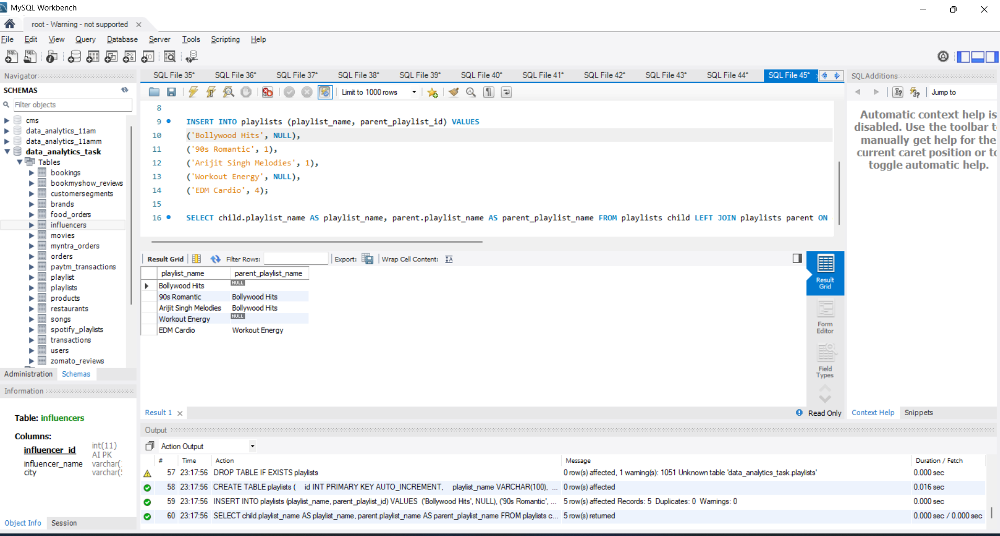
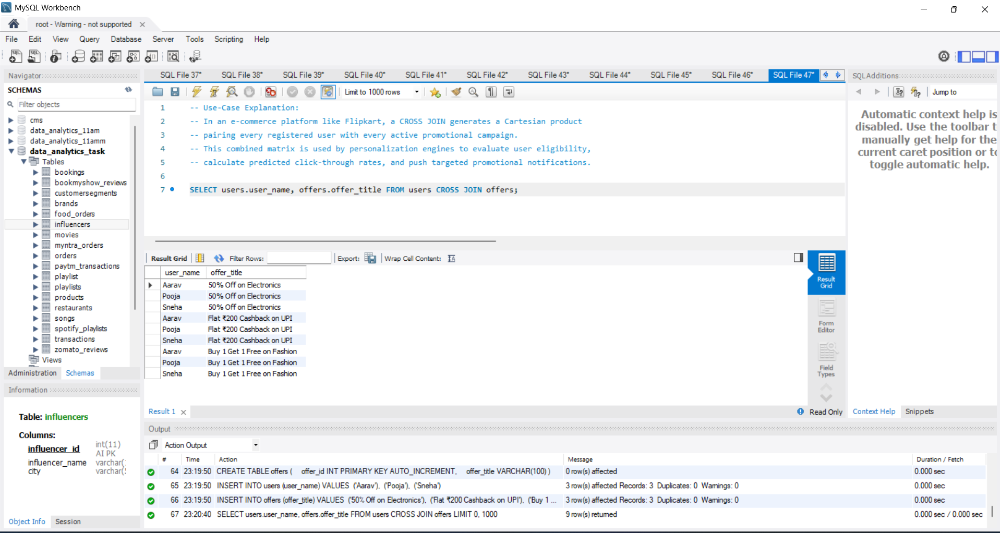

# Task

1. Create two tables, influencers and brands, with at least 3 sample rows each. Use a FULL OUTER JOIN to list all influencers and brands, showing influencer_name and brand_name, matching on city. If there is no match, display NULL for the missing side.<br><br><em><strong>Hint:</strong> Use LEFT JOIN, RIGHT JOIN, and UNION if your SQL dialect does not support FULL OUTER JOIN directly.</em>

2. Given a table called playlists with columns (id, playlist_name, parent_playlist_id), write a SELF JOIN query to display each playlist alongside its parent playlist's name, similar to how Spotify might nest playlists.

3. Create two tables: users and offers. Write a CROSS JOIN query to generate all possible combinations of users and offers, displaying user_name and offer_title. Explain in a comment how this could be used for a Flipkart-style personalized offer campaign.

4. You have an employees table with columns (id, name, manager_id). Write a SELF JOIN to display each employee's name along with their manager's name. Then, modify your query to only show employees who do not have a manager (i.e., top-level managers).

5. Use ChatGPT or Copilot to help you write a SQL query that finds all pairs of users from a users table who live in the same city (excluding pairs where the user is compared with themselves). Paste the query and briefly describe how the AI helped you improve or debug 

**solution**

## 1. FULL OUTER JOIN (Influencers and Brands matching on City)

```sql
CREATE TABLE influencers (
    influencer_id INT PRIMARY KEY AUTO_INCREMENT,
    influencer_name VARCHAR(100),
    city VARCHAR(50)
);

CREATE TABLE brands (
    brand_id INT PRIMARY KEY AUTO_INCREMENT,
    brand_name VARCHAR(100),
    city VARCHAR(50)
);

INSERT INTO influencers (influencer_name, city) VALUES 
('Kusha Kapila', 'Delhi'),
('Bhuvan Bam', 'Delhi'),
('Dolly Singh', 'Nainital');

INSERT INTO brands (brand_name, city) VALUES 
('Zomato', 'Delhi'),
('Nykaa', 'Mumbai'),
('Mamaearth', 'Gurgaon');

SELECT influencers.influencer_name, brands.brand_name FROM influencers LEFT JOIN brands ON influencers.city = brands.city

UNION

SELECT influencers.influencer_name, brands.brand_name FROM influencers RIGHT JOIN brands ON influencers.city = brands.city;
```


----

## 2. SELF JOIN on playlists (Nested Playlists like Spotify)

```sql
DROP TABLE IF EXISTS playlists;

CREATE TABLE playlists (
    id INT PRIMARY KEY AUTO_INCREMENT,
    playlist_name VARCHAR(100),
    parent_playlist_id INT
);

INSERT INTO playlists (playlist_name, parent_playlist_id) VALUES 
('Bollywood Hits', NULL),
('90s Romantic', 1),
('Arijit Singh Melodies', 1),
('Workout Energy', NULL),
('EDM Cardio', 4);

SELECT child.playlist_name AS playlist_name, parent.playlist_name AS parent_playlist_name FROM playlists child LEFT JOIN playlists parent ON child.parent_playlist_id = parent.id;
```


----

## 3. CROSS JOIN: All Combinations of users and offers (Flipkart Campaign)

```sql
DROP TABLE IF EXISTS offers;
DROP TABLE IF EXISTS users;

CREATE TABLE users (
    user_id INT PRIMARY KEY AUTO_INCREMENT,
    user_name VARCHAR(50)
);

CREATE TABLE offers (
    offer_id INT PRIMARY KEY AUTO_INCREMENT,
    offer_title VARCHAR(100)
);

INSERT INTO users (user_name) VALUES 
('Aarav'), 
('Pooja'), 
('Sneha');

INSERT INTO offers (offer_title) VALUES 
('50% Off on Electronics'), 
('Flat ₹200 Cashback on UPI'), 
('Buy 1 Get 1 Free on Fashion');

-- Use-Case Explanation: 
-- In an e-commerce platform like Flipkart, a CROSS JOIN generates a Cartesian product 
-- pairing every registered user with every active promotional campaign. 
-- This combined matrix is used by personalization engines to evaluate user eligibility, 
-- calculate predicted click-through rates, and push targeted promotional notifications.

SELECT users.user_name, offers.offer_title FROM users CROSS JOIN offers;
```




-----

## 4. Employees and Managers (SELF JOIN) & Top-Level Managers

```sql
CREATE TABLE employees (
    id INT PRIMARY KEY AUTO_INCREMENT,
    name VARCHAR(100),
    manager_id INT
);

INSERT INTO employees (name, manager_id) VALUES 
('Sundar Pichai', NULL),   -- CEO / Top-level manager
('Thomas Kurian', 1),
('Jeff Dean', 1),
('Senior Engineer', 3);

SELECT emp.name AS employee_name, mgr.name AS manager_name FROM employees emp LEFT JOIN employees mgr ON emp.manager_id = mgr.id;
```


---

## 5. Find All Pairs of Users Living in the Same City

```sql
DROP TABLE IF EXISTS users;

CREATE TABLE users (
    user_id INT PRIMARY KEY AUTO_INCREMENT,
    user_name VARCHAR(50),
    city VARCHAR(50)
);

INSERT INTO users (user_name, city) VALUES 
('Rahul', 'Ahmedabad'),
('Sneha', 'Ahmedabad'),
('Amit', 'Mumbai'),
('Pooja', 'Mumbai'),
('Karan', 'Delhi');

SELECT u1.user_name AS user_1, u2.user_name AS user_2, u1.city FROM users u1 INNER JOIN users u2 ON u1.city = u2.city AND u1.user_id < u2.user_id;
```


---


